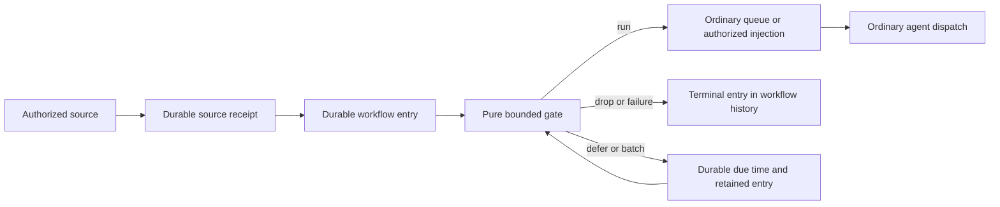

# Workflow entry gates

MP-08 / MP-09 / MP-10 / MP-11 · design only · 2026-11-02

Source inspected: `9a31a58847514ab39fa2d41e0a6b87d8fe130893`.
Names and shapes marked **proposed** below do not exist at that revision. This
document changes no runtime, protocol number, UI, or acceptance result.

## 1. Decision

Add one optional **gate** to a workflow definition. It runs at entry, for every
endpoint and every kind of invocation, after source authorization and durable
acceptance and before workflow queue insertion, runtime-agent provisioning,
provider startup, or notification steering. It receives a normalized trigger and
small durable workflow/binding state. It returns exactly one of `run`, `drop`,
`defer_until`, or `batch`, together with replacement state.

The gate is a pure, metered WebAssembly function. No model, network, filesystem,
Vault, App SDK, provider API, or ambient clock is available to its code. Inventory
matching and morning digests belong in user-authored gate modules. The kernel
knows only entry identity, state revisions, decisions, deadlines, and opaque keys.

Use the existing workflow queue and dispatch policy after `run`. An entry gate is
neither a DAG agent node nor another workflow execution engine. Downstream edges,
handoffs, turn continuations, and resumes of an already admitted run do not execute
it again. A newly submitted endpoint invocation does, including a manual one.
Workflows without a gate retain their existing admission behavior.

### The sandbox premise at this base

There is **no Apps WASM execution runtime to reuse** in this checkout. Apps run
JavaScript in embedded Node. `apps/app-worker/README.md`,
`apps/app-worker/src/launcher.c`, `apps/app-worker/src/bootstrap.md`, and
`packages/app-runtime/src/worker_process.rs` describe the native launcher,
bootstrap, and supervised process domains. `packages/app-package/README.md`
describes packaging, not a WASM engine. The current wrapper has no WASM host
imports, fuel meter, or epoch interrupt. App workers also have legitimate broker
capabilities and ambient JavaScript time/randomness, inappropriate for a gate.

**Proposed:** reuse App worker process containment and supervision, with a trusted
WASM runner instead of the Node embedder. Add a small interpreter integration to
`packages/app-runtime`, shared by the kernel's gate runner; do not create an App
installation, SDK channel, or private App database for a workflow gate. Wasmi is
the proposed engine: its documented fuel and store limits supply the missing
execution controls. Pin a release compatible with the repository Rust toolchain,
its enabled WASM features, and fuel configuration as `gate_v1`; do not select a
floating dependency. This is new interpreter integration, not existing product
functionality. The implementation must prove the process-containment seam on
Linux and macOS before enabling gates.

## 2. Existing pipeline and exact insertion points

All paths below are relative to the repository root.

| Input | Existing path at the inspected base | Proposed integration |
| --- | --- | --- |
| App event | AEGS → AEDS → `runtime/state/app_inbox_runtime.rs::accept_app_inbox_occurrence` validates the signed incoming schema and persists inbox acceptance before ACK. `app_inbox_pass` delivers to the App. Its explicit outgoing automation emission reaches the App outbox. `runtime/state/app_event_pump_runtime.rs::pump_app_event_pass` calls `app_event_delivery_owned_state.rs::queue_app_event`; `durable_state/app_event_delivery/preparation.rs::PreparedAppEvent::prepare` and `app_event_delivery.rs::commit_app_event_queue` perform atomic receipt → workflow queue handoff. | Preserve inbox ACK and App execution. For gated targets, replace the final receipt → queue handoff with an atomic receipt → entry handoff. Evaluate the gate before constructing a queue item. The App itself may run before this gate; no target workflow agent runs. |
| Private workflow notification, local or peer | `durable_state/workflow_notifications.rs::accept` checks binding, filter, TTL, ancestry and dedupe. `runtime/state/workflow_notification_router.rs::route_workflow_notifications` prepares accepted work with `PreparedNotification::prepare` in `durable_state/app_event_delivery/workflow_completion.rs`; `commit_in` queues it atomically. Peer delivery reaches the same target acceptance. | Gate only on the subscriber's authoritative kernel, after acceptance. Replace the accepted receipt → queue handoff for gated targets. Source filters and loop prevention run first and remain authoritative. |
| Published HTTP invocation | `apps/server/src/kernel-publication-client.ts::invokeKernelWorkflow` normalizes an invocation and sends `InvokeWorkflowEndpoint`. `runtime/state/workflow_run_request_runtime_state.rs::execute_workflow_invoke_endpoint_request` calls `workflow_prompt_queue_owned_state.rs::workflow_enqueue_prompt_by_agent_and_maybe_start`. | Normalize and durably admit an entry in the kernel. The HTTP gateway forwards typed entry results; it does not evaluate code, own state, or decide retries. |
| Workflow interval/cron | `workflow_prompt_queue_owned_state.rs::workflow_collect_due_watchdog_dispatches` collects plans; `workflow_start_watchdog_tick_plan` enqueues a scheduled prompt under `workflow_admit_prompt_transaction_with_invoker`. `session/workflow_scheduling.rs::WorkflowScheduleTrigger` already handles interval/cron and IANA timezones. | A due plan admits an entry with stable `(schedule_id, revision, scheduled_for_ms)` occurrence identity before queue insertion. Preserve the schedule's existing overlap/skip policy; record a skipped tick without evaluating a gate. Gate timers do not consume additional schedule runs. |
| Manual, Room command, workflow-code run | Same runtime invoke handler and queue admission as above. `session/service/launches.rs` constructs queue items and runs. | Apply the workflow gate regardless of invocation transport. Caller-provided publication envelopes cannot claim a gate pass. |

Paths under `runtime/`, `durable_state/`, and `session/` in this table are in
`apps/kernel/src/`.

After a gate passes, keep
`workflow_prompt_queue_owned_state.rs::workflow_start_next_queued_prompt_for_response`,
`runtime/state/workflow_queue_durable.rs`, and
`runtime/state/workflow_launch_owned_state.rs::workflow_schedule_entry_node` as
the queue → durable run → entry turn path. A new private `GatePassedEntry` value
must be backed by the writer's entry/decision record; possession of JSON is not
proof. Low-level enqueue/run functions must reject a gated workflow without that
proof. Also cover `apps/kernel/src/app/workflow_runtime.rs`'s alternate enqueue
path: delegate to the owner or reject; it must not bypass the gate.

Notification injection is another dispatch path:
`runtime/state/notification_delivery.rs::deliver_pending_notification_injections`
and `prepare_notification_injection`. Only a committed `run` result may reach
it. Keep its exact run/turn/provider acceptance and uncertain-send rules. An
injection falling back to a queue must reuse the passed entry, never rerun the
gate or state update. A retry explicitly requested after a held send likewise
does not retroactively undo or repeat its gate decision.



### Agent triggers are a separate existing path

`runtime/state/agent_trigger_http.rs::invoke_agent_trigger` currently calls
`claim_http_agent_trigger` then `agent_trigger_runtime_state.rs::fire_agent_trigger`.
It can steer an already running agent directly; it does not use workflow entry.
The gateway is not the published-workflow HTTP path described above.

For an agent trigger whose agent has a generated workflow with a gate, adapt its
firing to that workflow's entry boundary **before** `fire_agent_trigger`. Preserve
the trigger ID, source occurrence, target agent and existing busy policy as
kernel-only dispatch context. `run` continues the same fire/steer path using a
private passed-entry proof; other decisions never call it. Route timer firings
through the same adapter. Do not convert unrelated agent prompts or triggers
without a gated workflow into workflow runs. Configuring a gate on a generated
workflow is refused unless all of its trigger adapters support this boundary;
silently bypassing the gate is forbidden. This closes the apparent HTTP/timer
shortcut without moving trigger busy semantics into gate code.

The proposed trigger binding stores the resolved workflow/endpoint identity;
never guess it from an agent's membership in possibly several workflows. Recheck
the exact trigger dispatch claim/generation before releasing a saved result.
`dispatch_due_agent_triggers` is the timer adapter beside `invoke_agent_trigger`.
Keep an existing offline/busy refusal before acceptance as that refusal; once an
entry is accepted, a later offline agent is retained/retried or expired under the
entry contract, never mistaken for an unaccepted source request.

## 3. Proposed authoring and execution contract

### Definition and module storage

Extend `WorkflowCodeWorkflow` in `apps/kernel/src/workflow_code/model.rs` and the
runtime `WorkflowDefinition` in `session/workflow_definition.rs` with:

```ts
type WorkflowGateDefinition = {
  abi: "gate_v1"
  module_sha256: string
  initial_workflow_state: JsonObject
  initial_binding_state: JsonObject
}
```

There is exactly one gate, shared by the workflow's endpoints, with no binding
override chain and no fail-open option. Seed state initializes missing state once;
editing a seed does not reset existing state. Module upload is an owner-authorized
`PutWorkflowGateModule {session_id, wasm_base64, sha256}` request. The kernel
hashes, validates and stores the bytes by digest. It never opens a caller-supplied
path or downloads a module. Workflow source references that digest. Portable
workflow packages embed referenced bytes as a bounded sidecar, verified on import;
they never reference the original machine's files. Export source includes the
reference and a package can carry the bytes. No executable native cache is imported.

Workflow-code remains declarative: its Node compiler builds a definition and does
not execute the gate. Extend `workflow_code/definition.rs`, validation, apply,
source export/rebuild, artifact/package hashing, and SDK builder together. Apply
requires a locally verified module and validates sample inputs without starting
providers. A module is user code, not a publisher-trusted native binary; an owned
workflow edit authorizes its use under this sandbox, without a new permission
prompt. Only the trusted runner/platform bundle needs product signing/enrollment.

### Input

The kernel creates and records the exact canonical input before evaluation:

```ts
type GateInput = {
  abi: "gate_v1"
  entry_id: string
  endpoint_id: string
  binding_id: string
  phase: "trigger" | "resume" | "batch_flush"
  accepted_at_ms: number
  evaluation_at_ms: number
  deadline_ms: number
  trigger: {
    kind: "app_event" | "workflow_notification" | "http" | "schedule" | "manual"
    occurrence_id: string
    occurred_at_ms: number | null
    payload: JsonValue
    prompt: string | null
    artifacts: ArtifactMetadata[]
  } | null
  batch: null | {
    key: string
    flush_at_ms: number
    items: {entry_id: string, payload: JsonValue}[]
  }
  state: {workflow: JsonObject, binding: JsonObject}
}
```

For `batch_flush`, `trigger` is null and items are in durable acceptance order.
For `resume`, use the saved trigger or saved batch. Time is a recorded UTC instant,
not a callable capability. `evaluation_at_ms` is the instant the writer claims the
evaluation, including after a late restart. Replay uses that same instant. Guest
JSON numbers are safe integers; versions, arbitrary decimals and large identifiers
are strings. Reject invalid UTF-8, duplicate JSON keys, excessive nesting, and
noncanonical/unsupported numbers before running. Use one canonical serializer for
hashes, test replay, and worker input.

Kernel-only authority is **not** writable guest data: owner/realm, target and
binding revisions, authenticated caller, installation/catalog/signer identity,
ancestry, delivery mode, original expiry, original artifact records, dispatch
obligation, and content digest remain on the entry. The gate may inspect public
payload fields that happen to contain similar strings; they grant no authority.

### Output

```ts
type GateOutput = {
  state: {workflow: JsonObject, binding: JsonObject}
  reason: string
  decision:
    | {kind: "run", payload: JsonValue, prompt: string | null}
    | {kind: "drop"}
    | {kind: "defer_until", at_ms: number}
    | {kind: "batch", key: string, flush_at_ms: number, payload: JsonValue}
}
```

`reason` is a short author-supplied explanation, untrusted plain text. Validate
the whole result before committing any part. Output replaces both state objects;
there are no arbitrary storage calls or partial patch semantics. A gate needing
an unchanged prompt/payload copies it explicitly. Only the output `prompt` and
`payload` enter agent context; retaining the original prompt alongside the reduced
one would defeat reduction. The kernel reconstructs the trusted invocation
envelope and applies the target input contract after transformation. It preserves
source provenance separately, including notification ancestry and deadline.
Artifact metadata can be retained from the original input but cannot be promoted
to provider attachments, fetched, or replaced with guest-supplied file paths.

`run` commits state plus exactly one durable dispatch intent. It may insert the
ordinary queue item in that transaction when capacity permits; otherwise the
intent waits for queue admission. A paused target may delay dispatch; the gate
is not evaluated again. A single
notification `run` preserves the binding's `queue|inject` policy. `drop` commits
state and a terminal dropped entry, with zero dispatch items. It is a successful
mechanical decision, not an agent run failure or successful workflow completion.

`defer_until` commits state, the original retained input, and one durable UTC due
time. Require `evaluation_at_ms < at_ms < deadline_ms`. The due evaluation gets
phase `resume` and the then-current workflow/binding state, with its new recorded
time. It may run, drop, defer again, or batch a single trigger. There is a hard
evaluation-count limit; a past/equal time is invalid, never a tight retry loop.

`batch` retains only the returned reduced item, plus kernel provenance. The flush
schedule is one absolute UTC instant, not a new cron interpreter: gate code may
compute it with a pinned pure calendar library. Require the instant strictly
after evaluation and before every member's deadline. Group identity is
`(owner, session, workflow_revision, endpoint, binding_id, binding_revision,
authenticated_caller_digest, module_sha256, key)`. The kernel computes the caller
digest from authenticated dispatch context, never guest input. Thus different
bindings/callers/authorities cannot accidentally
coalesce. The first item fixes the flush instant; later items must return that
same instant or a different key. Conflicting times fail the new entry without
changing the existing batch. There is no sliding debounce hidden in the kernel.

At due time the writer atomically closes that group and creates one aggregate
entry with its ordered member IDs. Closed groups reject new members; an arrival
at/after cutoff must use a new key/time. Each source occurrence can belong to at
most one group. `batch_flush` may `run`, `drop`, or `defer_until`, but cannot batch
again. `run` releases one **queued** invocation; batching never steers an active
turn. All members link to that aggregate and eventual run. The aggregate carries
the union of member ancestry and the earliest deadline; overflow fails the
aggregate without truncating ancestry. Domain duplicate releases may still need
gate-state deduplication; transport deduplication is already kernel-owned.

## 4. Durable ownership, transactions and recovery

Add normalized tables to the existing kernel SQLite database, owned by its sole
durable writer. Do not use worker files or App private storage for gate state.
Proposed table responsibilities:

| Table | Identity and contents |
| --- | --- |
| `workflow_gate_state` | Owner/session/workflow plus `scope=workflow|binding` and scope ID; state JSON, monotonic CAS revision, state digest. Binding state is never shared solely because two callers supplied the same string. |
| `workflow_gate_entries` | Stable entry ID and acceptance sequence; immutable source dedupe identity/digest, pinned gate/target/binding revision and dispatch context, retained input, original deadline, current phase/disposition, evaluation count, due time, queue/run link. |
| `workflow_gate_decisions` | Append-only `(entry_id, evaluation_number)` input/state digests, exact recorded time, engine profile and module digest, decision/reason or stable failure, state revisions before/after, fuel used, and output digest. Retained replay bytes follow the limits below. |
| `workflow_gate_batches` and membership | Opaque group identity, cutoff, open/closed state, aggregate entry link, ordered member links. Members and timers are part of the same writer transaction as the decision. |

The workflow owns state and entries on its authoritative kernel, even if its
agents execute on leased remote workers. A binding ID is resolved from kernel
records: App automation ID; notification subscription ID; authenticated HTTP hook
or agent-trigger ID; schedule ID; or a kernel-defined manual endpoint binding.
HTTP callers cannot choose another binding's state with envelope fields. Within
a hook, shared state is intentional; do not put caller-private material there.

There is one in-flight evaluation per workflow, because every gate can change
workflow state. Concurrent source admissions persist first and are evaluated in
acceptance-sequence order. Timers become ready entries ordered by due instant
then durable sequence. A deferred entry releases this lane until due. Independent
workflows rotate fairly through a bounded shared worker pool. State edits use the
same lane/CAS, so there is no lost update or speculative concurrent evaluation.

Execution has three boundaries:

1. **Accept/handoff.** Authorize and dedupe first. Atomically persist the entry,
   its source link and pinned definition. Gated App/notification receipts move to
   a new `entry_owned` state with `gate_entry_id`. This means the workflow entry
   owns the work, **not** queued, delivered, or completed. Their existing pumps
   must stop selecting these receipts. Source ACKs keep their present meaning;
   an already ACKed inbox occurrence is not undone by a later gate failure.
   A replay returns the existing entry/result; changed content under the same
   occurrence ID conflicts. Source/binding quotas must include pending linked
   entries until settlement, and compaction must not remove their dedupe links.
2. **Claim/evaluate.** In a short writer transaction claim the next entry with a
   durable evaluation token, captured state revisions and recorded time. Run the
   isolated worker after releasing session/SQLite/global transition locks. No
   untrusted code runs on the writer thread. A workflow-level reservation holds
   order without holding those locks. Validate result and await worker exit.
3. **Commit decision.** One writer transaction verifies that token, state CAS,
   deadline, owner, live grant, target/binding and current App capability checks.
   It writes both states, audit decision, disposition and the timer/batch or
   unique durable dispatch intent together. Queue insertion may consume that
   intent in the same transaction, or later under the same ownership checks.
   `write_queue_state_in` from
   `durable_state/app_event_delivery.rs` is the existing atomic queue persistence
   seam. Publish projections and dispatch only after acknowledged commit. A
   capacity-delayed intent already owns its committed state update; later queue
   insertion consumes the intent exactly once and never applies state again.

Use the existing writer's commit-uncertainty fence: never infer success or
rollback from a query-only read and never wake an agent on an uncertain commit.
On writer recovery, reconcile by evaluation token: either the full decision and
its queue/timer exist, or none do. A committed decision is never repeated. An
evaluation claimed before kernel/worker crash with no committed result becomes
terminal `gate_interrupted` on recovery; no automatic retry of that evaluation.
The small reservation releases only after the old owned process domain is empty.
Unclaimed accepted entries remain eligible. Loss of machine power necessarily
delays recording that terminal result until the authority restarts; the design
does not promise durable writes while storage or the kernel is unavailable.

Entry dispositions are `ready`, `evaluating`, `waiting_for_queue`, `deferred`,
`batched`, `queued`, `dispatched`, `injected`, `dropped`, `failed`, `expired`, and
`cancelled`.
Only `evaluating` has a live worker and finite execution deadline.
`waiting_for_queue` retains a committed decision/state update and a durable
dispatch intent, with no worker or state reservation. It releases the workflow
lane immediately. No later state change can alter that saved decision. A paused target therefore
does not block unrelated gate decisions. Final queue insertion still atomically
consumes that ready result and cannot happen twice.

`dispatched` means the ordinary durable run association exists; `injected` means
the existing provider acceptance path confirmed steering. Both end gate-owned
pending accounting, while the run/send retains its ordinary lifecycle. Every
batch member follows its aggregate to queued/dispatched or the aggregate's
terminal drop/failure/expiry/cancel, in the same writer transition. A closed batch
must never leave members apparently waiting after its aggregate failed. Source
receipt status and quota accounting follow those entry links without fabricating
queue IDs. A terminal gate entry cannot reset a downstream run or uncertain send.

Queued entries use ordinary workflow recovery. Injected entries use existing
exact-send uncertainty recovery, not gate retry. For an original `entry_owned`
receipt, the gate entry is the authoritative downstream status; source status
queries project that link. Batch source receipts need no fabricated one-to-one
queue IDs. This deliberately avoids weakening existing ordinary outbox
receipt/run correlation for many-to-one batches.

### Edits, expiry and ownership changes

New entries pin the active module/definition. State persists across module edits;
an edit must pass the supplied state fixtures against current state. Incompatible
changes require an explicit atomic state replacement, not a migration guessed by
the kernel. Ordinary CAS state replacement serializes with evaluations; deferred
entries and batch flushes intentionally observe the resulting current state.
It cannot change an already committed `run` decision. The kernel does not infer
domain compatibility from state fields. Pending entries are cancelled with
`gate_definition_changed` when the workflow gate, target, or relevant binding
revision changes; their already
committed state is not rolled back. An edit serializes with an evaluation and
cancels its uncommitted result. There is no mix of old and new code in one batch.
Removing a gate cancels its pending entries before admitting new ungated work.
Here pending means not yet handed to an ordinary queue or send intent. Already
queued work follows the ordinary target-revision/cancellation checks; an edit
must not erase its gate proof or authorize another evaluation.

Uninstall, revoked signer/capability, detached notification grant, workflow/Room
deletion or owner transfer stops further release under the old authority.
Cancel affected pending entries/batches and their timers atomically. State never
crosses owners implicitly. Runtime execution already admitted to the provider
continues under existing cancellation/ownership rules, not retrospective gate
rollback. Queue-level pause preserves entries until resume or original expiry.

Use the source's immutable deadline: App pending lifetime stays seven days;
notification deadlines retain their declared 1–30 day TTL. Gate-created manual,
HTTP and schedule entries get a seven-day maximum. A defer or batch cannot extend
it. The aggregate uses the earliest member deadline; if any member's authority
is invalidated, cancel the aggregate rather than silently omit an item after the
gate has decided. Expiry sweeps terminalize entries and remove timers, including
while paused. No expiry can replay a possibly accepted provider send.

## 5. Proposed fixed v1 limits and scheduling

These are implementation bounds to validate with drills, not measured claims.
They are shared by ordinary and managed kernels and not client preferences.

| Resource | Gate v1 ceiling |
| --- | --- |
| Module | 2 MiB raw WASM; reject oversized base64 before decoding; bounded validation/translation in the worker |
| Guest module structure | One nonshared 32-bit memory; 256 pages (16 MiB); at most one table/4,096 elements, 4,096 functions, call depth 256, value stack 256 KiB; reject unsupported features and start functions |
| Work per evaluation | 10,000,000 fuel units over allocation and gate call; no resumable fuel refill; profile pinned with the engine |
| Host process | 128 MiB hard Linux memory domain; equivalent App-style macOS monitored bound with documented sampling overshoot; two workers kernel-wide, one per workflow |
| Time | 2 seconds total monotonic deadline including spawn, validation, I/O, execution and result acceptance; 250 ms execution watchdog; 1 second OS CPU limit as an outer bound |
| Wire | 512 KiB total canonical input; 128 KiB total output; one framed response; no guest stdout/log API |
| State | 16 KiB workflow + 16 KiB per binding, depth 32 and 4,096 JSON nodes per object; at most 256 retained binding-state records/workflow |
| Output context | Combined rendered agent prompt and transformed payload at most 64 KiB, reserving trusted envelope/header space before acceptance; reason at most 512 UTF-8 bytes |
| Pending work | 1,024 source entries and 16 MiB retained bodies/workflow; 4,096 entries and 64 MiB/kernel; existing smaller source limits still apply |
| Batch | 64 open groups/workflow, key at most 128 UTF-8 bytes; 256 members and 64 KiB combined encoded item list/group, plus bounded kernel provenance; no automatic partial flush |
| Repeated evaluation | At most 32 evaluations per original entry or aggregate, including resumes; one durable due time per deferred entry/group |
| History | At most 65,536 terminal entries, 262,144 decisions and 256 MiB of retained history bytes/kernel. Keep detail 30 days; compact replay bodies after seven days or earlier source expiry. Keep IDs, decisions, times, reasons, revisions and digests for that window. At capacity, refuse new admission rather than erase unexpired decisions. |

Account retained originals, replay state snapshots, transformed results, batch
items, and duplicate copies together under the body budgets. Pending entries and
their source dedupe links are never pruned for history retention. Dedupe tombstones
survive through original deadline plus 30 days, matching the notification replay
window. Module references stay pinned by live definitions/entries and retained
replay records. Free only unreferenced modules, state and terminal records in
bounded sweeps. State has no invisible LRU eviction: reaching the binding-state
limit refuses a new binding until the owner removes unused state explicitly.

Limit/overload before durable entry acceptance returns typed retryable
backpressure; it does not ACK new work. Work whose source is already ACKed stays
in its existing durable inbox/outbox until handoff or that source's terminal
expiry. Batch capacity failure after entry acceptance fails only the incoming
entry with `gate_batch_limit` and leaves the existing group/state untouched.
Never truncate payloads, evict accepted work, or flush early as a hidden fallback.
Audit storage has its own admission accounting: entry acceptance reserves the
bounded metadata slots for its possible evaluations and terminal outcome; batch
creation also reserves its aggregate's slots. Replay-body space is charged as
used. Exhausting that space terminalizes the pending entry with a reserved
`gate_history_limit` record before another evaluation. Sustained overload cannot create unbounded failure
rows; when history/body reservations cannot be made, stop new entry admission.

Extend the existing bounded transport/background pump
(`runtime/state/transport_runtime_state.rs`, `runtime/app_event_pump.rs` and
`app_event_pump_runtime.rs`) with due-entry selection and a durable minimum due
query. Reconstruct wake interest at startup. No timer thread, sleeping worker or
agent per entry; no new scheduler service. Keep the pump's one-second floor and
round-robin page budget (eight candidates/pass). Index on disposition/due time
and rotate busy workflows. A future due time must not force one-second polling
all night. Lateness is recorded; evaluation uses actual recorded claim time and
checks original expiry first. This is durable eventual scheduling, not a promise
to run while its authoritative machine is powered off.

## 6. Definitive failure and security boundaries

| Event | Result before any target agent wake |
| --- | --- |
| Fuel exhausted, trap, bad pointer, invalid JSON/output, invalid decision time, state/body limit | Terminal failed entry with a stable code (`gate_fuel_exhausted`, `gate_trapped`, `gate_invalid_output`, `gate_invalid_time`, `gate_limit`). No output state or dispatch commits. |
| Watchdog/CPU/memory limit, process crash or worker IPC loss | Kill/cancel and reap the exact owned domain; terminal `gate_timeout`, `gate_resource_limit` or `gate_worker_failed`. Retain accounting until physical exit. Late responses cannot commit. |
| Unsupported/missing sandbox, verified runner unavailable | Refuse activation/upload test clearly; if discovered after acceptance, terminal `gate_runtime_unavailable`. No unsandboxed execution fallback. |
| Kernel exits after claim without decision | Recover as `gate_interrupted` after confirming the old domain is empty. Unclaimed work resumes normally. |
| State CAS or authority changed while running | Discard output; terminal conflict/cancel reason, no automatic reevaluation against different state. State editing uses the same lane so this is exceptional. |
| Definitively rolled-back writer failure | No state/queue partial commit; retain the captured result for a bounded persistence retry until entry deadline. Storage-unavailable state is operationally visible; dispatch is prohibited. |
| Uncertain writer commit | Fence affected transitions; recovery reconciles exact token. Never pretend rollback, repeat a committed update, or dispatch from a provisional read. |
| Due time/entry deadline/evaluation count exhausted | Terminal expired/failed entry, clear timers and memberships, zero new dispatches. |

Pure evaluation is deterministic for identical module, profile, canonical input
and state. Fuel exhaustion is deterministic within that profile. OS timeout/OOM
and availability are operational failures, not reproducible domain decisions;
history distinguishes them. An owner may submit a new entry after fixing a
failure. A duplicate source occurrence returns its old failure, not another try.

The proposed runner implements `gate_alloc(i32) -> i32` and
`gate_evaluate(i32, i32) -> i64`, exporting memory. The i64 packs output pointer
and length; the runner validates checked ranges against current memory and caps
the length before copying. Use a fresh instance per evaluation; drop it rather
than retaining guest globals/heap. Both exports consume the same fuel allowance.
The SDK must emit this ABI without WASI. Reject **all imports**, start functions,
floating-point instructions/types, threads/atomics, shared memory, SIMD, memory64,
extern references and other features outside the pinned integer profile. No
guest host callback can read time, obtain entropy, log, allocate outside metered
memory, or call the kernel. Calendar/version/JSON helpers must be pure code in
the module; the SDK's integer-only JSON implementation must not link float code.

Use Wasmi's fuel, stack and store-resource limits, plus bounded parsing/translation;
defaults are not acceptable limits. Its documented APIs are evidence for a
feasible engine choice, not a completed integration:
[Config](https://docs.rs/wasmi/latest/wasmi/struct.Config.html),
[Store](https://docs.rs/wasmi/latest/wasmi/struct.Store.html),
[StoreLimitsBuilder](https://docs.rs/wasmi/latest/wasmi/struct.StoreLimitsBuilder.html).
Engine changes require replay/resource calibration and an explicit profile
revision; do not silently reinterpret retained module fuel costs.

Factor the existing `ResourceDomain` lifecycle out of
`packages/app-runtime/src/worker_process.rs` into shared internal supervision;
reuse its Linux cgroup/bundled Bubblewrap and macOS Seatbelt/monitoring paths.
Their current App installation/storage/Node assumptions need explicit separation.
Pass only a clean environment, verified runner/runtime and module bytes, bounded
input/output channels, and empty ephemeral scratch if the OS needs it. No App
data mount, broker FD3, provider profile, inherited descriptors or host home.
The trusted gate runner is part of the pinned product runtime, not an App-selected
executable. OS confinement setup failure is definitive. Update native bundle
inventory/signing/enrollment with the runner; do not reuse a Node verification
receipt to claim another executable was verified. Keep all teardown by exact
owned PID/domain and preserve existing signal guards.

Source authentication, App signatures/schema/capability admission, notification
ownership/grants, ancestry, and relay peer checks remain outside and before the
guest. Recheck revocable authority before release. Guest output cannot select
another workflow, endpoint, owner, queue, artifact authority or delivery mode.
Module digest is identity, not authority. Test/replay APIs require the same
owner/workflow access as editing/history and cannot read another binding's state.

Never resolve Vault handles into gate input/state/history. Preserve the existing
redaction policy before persistence/model context; worker errors expose stable
codes, not arbitrary stderr/memory. Guest reasons and payloads render as untrusted
text, never HTML. Ordinary visible user input is not a new secret-guard target.

### MP-08 / MP-09 placement and shutdown

Run gates on the workflow's authority, using the same implementation for ordinary
and managed kernels. No compute-provider name, worker-size rule, Cloud polling
policy, relay plaintext, or placement-dependent gate fallback is added.

Future defer/batch timers are not active agents or keepalive leases. Gate decisions
and retries must not call `ManagedActivityMutation::record` merely to reset idle
time. Preserve `runtime/state/managed_activity_runtime_state.rs::running_agent_count`
and its last-agent-finished meaning. Gate execution/admission holds the existing
`begin_managed_activity_admission` quiescence guard only over the bounded local
operation and teardown/commit; release it while waiting. Once `run` becomes
ordinary queued prompt work, use the existing activity recording. Mandatory
Cloud stop, minimum runtime, idle delay, and stop fences remain intact. A home
kernel can retain a batch while its leased agent worker stops. If the authority
itself stops, evaluate due entries after it next starts; no new Cloud wake service
or suppression of managed stop is implied. The real shutdown drill must cover
both placements of authority.

## 7. History, protocol and existing user surfaces

Every gate evaluation commits a structured decision with its entry, even for
drop, failure, defer, batch membership, flush and cancellation. An entry is not a
`WorkflowRun`: the existing `session/service/launches.rs` creates a Ready node run
on invocation, so creating fake runs for dropped gates would count active work,
consume concurrency, and risk emitting completion notifications.

Extend the existing paginated `ListWorkflowRuns` history response to typed
`WorkflowHistoryItem = {kind:"run", run: WorkflowRun} | {kind:"gate", entry,
decisions}` items, with one sequence cursor across both kinds. Replace the old
run-only response field/read path in the same implementation. Gate summaries
have no pause/resume/stop-run capability; an explicit cancel-entry operation
cancels waiting work. `GetWorkflowGateEntry` pages decisions and member IDs with
bounded limits. `WorkflowRun` gets an optional gate-entry link; batch runs point
to the aggregate, whose members are pageable. Injected decisions link to the
actual existing run/turn. No background toast or new notification is needed.
Clearing the workflow console cannot erase the authoritative decision journal.
Assign a stable history sequence at entry/run creation; later decisions and status
updates change that row without moving it in the list. Page the latest decision
summary with each row, not all retained snapshots or batch members.

Update Room command dispatch registration in
`execute_workflow_invoke_endpoint_request`: a gated invocation initially returns
its entry ID. Drop/failure/expiry/cancel settles that invocation's completion
obligation with its actual outcome. Deferred/batched work remains tracked by the
entry, and a run attaches its eventual run ID. Do not leave an agent waiting for
a nonexistent run, emit a completion notification for a gate-only entry, or claim
that `accepted` means model execution completed.

Proposed local protocol changes:

- Gate definition and module sidecars in workflow-code artifacts, apply/rebuild
  reports, runtime workflow projection and portable package hashes.
- `PutWorkflowGateModule`, `TestWorkflowGate`, `GetWorkflowGateState`,
  `ReplaceWorkflowGateState` (CAS), `GetWorkflowGateEntry`, and
  `CancelWorkflowGateEntry`. State replacement records actor/reason and checks
  CAS under the workflow lane; future evaluations see it. Module/definition edits
  cancel pending work as specified above. There is no arbitrary guest state API.
- `WorkflowEntryAccepted {entry_id, disposition, next_due_at_ms?}` alongside
  existing started/queued invoke responses; source receipt `entry_owned` and
  `gate_entry_id`; history union, run link, and entry-update subscription.
- Shared TypeScript types/request builders in `packages/kernel-client`, CLI
  shell commands and TUI history formatting; shared protocol snapshot/hash tests.

The HTTP gateway must handle the new response in `kernel-publication-client.ts`
and the publication response/SSE code. A completed drop returns HTTP 200 with
`disposition:"dropped"` and entry ID, without inventing agent output; pending
gate/defer/batch returns 202 with entry ID and optional due time. Gate failure
returns a bounded typed error with entry ID (422 for invalid gate execution
result, 503 for runtime unavailable); an unknown commit/response remains
uncertain and uses the same invocation identity for status lookup. Existing
source transports keep their ACK enums: acceptance transfers ownership, and
entry status supplies the later outcome. HTTP retries must carry a stable request
ID/idempotency key; a fresh ID is a fresh invocation. Authenticate and scope it
before dedupe. Agent-trigger responses similarly expose an entry result rather
than fabricate a prompt ID. Sync callers do not hold a request until tomorrow's
batch, and SSE must stop waiting for a run on a terminal gate outcome.

Implementation needs coordinator-allocated local protocol version and updated
snapshots. Peer forwarding of these requests, history or workflow packages also
needs a coordinator-allocated peer version/capability, since remote clients must
receive the same contract. The AEGS/AEDS delivery envelope does not change. Do not
guess version numbers or add old-kernel fallback execution. Reject unsupported
gate control/history clearly; raise a client's minimum only for these features.

### Author, test, apply

1. Write a pure Rust gate using a small proposed SDK for the ABI, bounded
   integer-only JSON, and optional pure calendar/version helpers. Compile to
   `wasm32-unknown-unknown`; the repository currently has no gate SDK or gate build
   command. Add that SDK/recipe as implementation work. Existing
   `chariox app create/pack/validate` packages JavaScript Apps and is not that recipe.
2. Upload bytes through the proposed shared `workflow gate module put <file>`
   shell command. This command reads the chosen file client-side and calls the
   bounded kernel upload; it grants no kernel filesystem read. Declare its digest
   and seed state in existing workflow code; use the existing
   `/workflow code validate`, `apply`, artifact and package commands implemented
   by `packages/kernel-client/src/shell-workflow-code-command.ts`.
3. Run proposed `/workflow gate test <workflow> <fixture-file>`. The kernel runs
   the same sandbox/profile against supplied trigger/time and explicit fixture
   state, returning decision, replacement state, resource usage and validation
   failures. No source ACK, durable state update, timer, queue or provider start.
   Exact retained decision replay uses its stored bytes; after body compaction,
   report replay unavailable rather than substituting today's state/time.
4. Apply using existing workflow-code flow, then submit real triggers and inspect
   existing workflow history/run detail and command-output surfaces. State reads
   and CAS replacement use shared requests; state reset is explicit and audited.
   Disabling a workflow/trigger retains its normal meaning, not a gate bypass.

Use the existing Room terminal/prompt, command output, workflow list/history
rows and detail surfaces. Extend their typed data/formatting, not their layout.
`apps/cli/src/workflow-run-command-handlers.ts` and shared shell formatting are
concrete TUI integration points. Cloud Web consumes the same kernel contract;
this checkout does not contain `apps/web`. No new editor, gate canvas node,
wizard, card, menu or background error banner is proposed. Product authoring can
start entirely through existing terminal components. Any later dedicated visual
editor needs its own prototype proposal and owner approval outside this design.

## 8. Worked example: advisory relevance against an inventory

This policy is example gate code, not kernel vulnerability handling. An external
App normalizes public advisory data; an owner or inventory App updates the
workflow state through authorized CAS. No inventory fetch happens inside a gate.

```json
{
  "workflow": {
    "inventory_as_of_ms": 1793577600000,
    "inventory": [
      {"ecosystem":"npm", "package":"widget", "version":"2.4.1"},
      {"ecosystem":"cargo", "package":"sample", "version":"0.9.0"}
    ]
  },
  "binding": {"seen": [], "dropped": 0}
}
```

Advisory payloads contain an advisory ID/revision, ecosystem, package and affected
ranges. Example code (pseudocode; `matches` is a pinned pure ecosystem-specific
version library in the module):

```text
on trigger/resume:
    if inventory absent/stale, payload incomplete, or range unsupported:
        return run(prompt="Check advisory; relevance unknown", payload=compact(advisory)), same_state
    hits = inventory entries with exact ecosystem/package and matches(version, ranges)
    occurrence = advisory.id + ":" + advisory.revision
    if occurrence in binding.seen:
        return drop("already considered"), same_state
    next = state with bounded seen set updated
    if hits empty:
        next.binding.dropped += 1
        return drop("no installed version in affected ranges"), next
    return run(prompt="Assess the matching installed packages",
               payload={advisory_id, revision, affected:hits, advisory_url}), next
```

The unknown branch deliberately asks the downstream agent to assess uncertainty;
it does not silently suppress possibly relevant advisories. Set freshness to 24
hours in this example module. If the bounded seen set is full, evict by an explicit
documented policy in gate code or emit `run` for assessment; kernel transport
dedupe still protects exact occurrence retries.

At `evaluation_at_ms=1793581200000` (2026-11-02 01:00 UTC), advisory `ADV-A:1`
affecting npm `widget >=2.4.0 <2.5.0` matches `2.4.1`: one `run` with that compact
payload and one state advance. `ADV-B:1` affecting only `widget <2.0.0` drops with
the stated reason and zero agent wakes. Exact transport replay of `ADV-A:1` does
not call the gate again. A distinct delivery of the same advisory revision drops
through the module's seen set. Unsupported version syntax or stale inventory
runs with `relevance unknown`, rather than treating an error as no match.
History shows module, inventory-state revision, decision and eventual run link.

## 9. Worked example: release morning batch

This example uses 09:00 UTC daily; a local-time variant ships its timezone rules
inside the module and computes an absolute instant. The kernel has no notion of
release, morning, repository, holidays, urgency, or digest content.

```text
on trigger/resume with a release payload:
    if the payload cannot be normalized:
        return run(prompt="Review unrecognized release", payload=original), state
    if release.id/revision already in binding.seen:
        return drop("release already collected"), state
    morning = next 09:00 UTC strictly after evaluation_at_ms
    key = "release:" + UTC-date(morning)
    item = {id, revision, repository, tag, url, summary}
    return batch(key, flush_at_ms=morning, payload=item), state with seen updated

on batch_flush/resume with a batch:
    return run(prompt="Review these releases together",
               payload={releases: batch.items.map(item => item.payload)}), state
```

| Recorded UTC time | Action | Durable effect / agent work |
| --- | --- | --- |
| Nov 2, 01:00 | Release R1 arrives | `batch("release:2026-11-02", 09:00, compact R1)`; one member/state advance, no agent |
| Nov 2, 08:30 | R2 arrives on same binding | Same key/cutoff; second member, no agent |
| Nov 2, 08:31 | R2 transport replay | Existing receipt/entry returned, no evaluation/state advance |
| Nov 2, 08:45 | Kernel restarts | Restore two members and durable cutoff; no sleeping worker to recover |
| Nov 2, 09:00 or next pump | Close group, evaluate flush | One aggregate `run`, one queued invocation containing R1/R2; link both histories |
| Nov 2, 09:00 onward | R3 admitted after cutoff | New key `release:2026-11-03`, next 09:00; closed group cannot reopen |

If restart occurs at 10:00, flush the already due group once at the next pass,
provided original member deadlines remain valid. A crash after the queue/decision
commit cannot enqueue a second digest. A crash during the claimed flush records
`gate_interrupted` for the aggregate and failed disposition for its members;
it does not lose them behind an open batch or automatically submit another digest.
Capacity overflow fails the new member explicitly. A 09:00 flush whose endpoint
is busy waits in the ordinary queue without waking an extra agent. A stopped
leased worker remains stopped until ordinary dispatch needs it; waiting overnight
does not extend managed idle time.

For defer coverage, the same ABI permits a module to return
`defer_until(accepted_at_ms + 60_000)` once while waiting for a state refresh.
The resume sees current state and its recorded time. If it defers 32 times or
cannot fit another due time inside the immutable deadline, it terminates with
the named limit/expiry rather than waiting forever.

## 10. What this replaces or deletes

- For gated workflows, replace direct source receipt → prompt admission with
  source receipt → durable entry → passed-result admission. Delete parallel
  client/gateway/trigger shortcuts introduced during implementation; one kernel
  gate service covers all adapters and both queue/inject dispatch.
- Eliminate an agent's first turn whose only task is a mechanical relevance,
  duplicate, waiting-time or digest grouping decision when the workflow author
  chooses to encode that policy as a gate. Remove those instructions/nodes from
  the example workflows when migrating them; do not delete general agent nodes.
- Remove per-use-case release/advisory filters, scripts, private cron jobs or
  sleeping agent loops from those migrated examples. This source inspection does
  not establish that such product modules currently exist; there are no named
  release/advisory kernel modules to delete at this base.
- Replace the run-only history response/read path with the typed mixed history,
  and separate native App supervision from Node-specific launch assumptions in
  the same implementation. Keep one OS containment/signal implementation.
- Keep App incoming handlers, outgoing emission, AEGS/AEDS delivery, source
  schema/filter checks, private-notification ancestry/grants, transport dedupe,
  ordinary queue ordering/overlap/max-concurrency, provider acceptance recovery,
  interval/cron schedules, and mandatory shutdown. These do different jobs.
- Do not restore retired direct AEGS-to-workflow bindings or add Cloud/provider
  business logic, legacy gate shims, fail-open modes, or a second timer service.

## 11. Implementation proof required after design review

This round performs source/design validation only. No live feature or MP ledger
item is claimed PASS. These proposed gate drills are new required scenarios,
supplementing existing workflow/compiler/inbox/injection tests:

| ID | Red-capable drill and required result |
| --- | --- |
| `workflow-gate/G-01` | Real App inbox → outgoing automation, local/remote workflow notification, published HTTP, workflow cron/interval, manual/Room invocation, and generated-agent HTTP/timer firing. Use a drop gate; assert zero target provider starts/steers and a history decision on every path. Removing the gate executes ordinary work as control. |
| `workflow-gate/G-02` | Advisory fixture and inventory above through real source adapters; relevant/irrelevant/unknown and distinct/exact duplicates. Count state revisions, agent turns and retained context. One permitted real provider turn proves reduction reaches the actual prompt. |
| `workflow-gate/G-03` | Morning batch with real delivered releases and short test cutoff, later real scheduled cutoff. Restart before due, race arrival at cutoff, busy/paused queue, differing binding/caller, conflicting time, earliest expiry and capacity. Exactly one aggregate invocation and complete member lineage. |
| `workflow-gate/G-04` | Defer/resume with a controlled CAS state edit, expiry, evaluation limit, late restart and cancellation. Resume observes current state, while committed run decisions stay fixed. No waiting worker/agent or original-deadline extension. Definition changes cancel pending work. |
| `workflow-gate/G-05` | Fault-inject before/after source handoff, claim, result persistence, state/queue commit and projection; kill kernel/worker at each seam. Duplicate/concurrent delivery must not repeat a state transition or dispatch; claimed unfinished evaluations terminalize, including flush membership. |
| `workflow-gate/G-06` | Malicious modules: import/WASI/clock/random/float/start/threads, invalid pointers, huge memory/table/module/JSON, recursion, infinite loop, output flood; missing confinement and runner tampering. Test Linux and signed macOS boundary; bounded failure, no ambient read/network/model/Vault capability, cleanup verified. |
| `workflow-gate/G-07` | Concurrent bindings sharing workflow state, owner isolation, scope spoofing, module/binding/grant/signer edits, transfer/uninstall/deletion, package export/import. No lost update, stale authority release, cross-owner state or bypass through low-level enqueue/injection. |
| `workflow-gate/G-08` | Real Web and TUI via existing terminal/history surfaces and hosted encrypted relay: author, upload, test, apply, inspect drop/failure/defer/batch/run, cancel and restart/reconnect. Sync HTTP/SSE and Room obligations terminate truthfully with entry IDs. Test API does not mutate live state. |
| `workflow-gate/G-09` | Ordinary/managed comparison, both authority and leased-worker placements. Deferred/batched future work permits mandatory auto-stop; a due release respects the quiescence fence. Verify the delay still measures from the last real agent finishing, disabled/keep-running policy and all existing stop triggers. No Cloud wake promise. |
| `workflow-gate/G-10` | Multi-hour real-trigger soak under body/history/module/state quotas, many idle workflows, backpressure, and restart. Bounded memory/CPU/WAL growth and pending latency, no one-second polling for future-only timers, eventual admission fairness, and zero leaked processes/domains/timers after cancellation. |

Use existing regressions in `session/service/tests/workflow_runs`,
`runtime/state/workflow_prompt_queue_owned_state/`,
`runtime/state/notification_delivery/tests*`,
`durable_state/workflow_notifications/tests.rs`, App inbox/outbox tests and
`apps/server/src/index.test/publication-run-isolation.test.ts` as adjacent
coverage. Keep logs, screenshots, recordings and disposable state outside the
repository. Run real built clients/kernel/relay and official providers where
the drill exercises an agent, using approved accounts and lane resource rules.
Focused source tests alone do not establish MP-10 acceptance. MP-11 review must
cover the new WASM import/ABI boundary, shared process containment, module trust,
state/receipt authority and exact-send integration. Protocol allocations and
runtime signing happen in the implementation lane; none is needed to deliver
this design.
