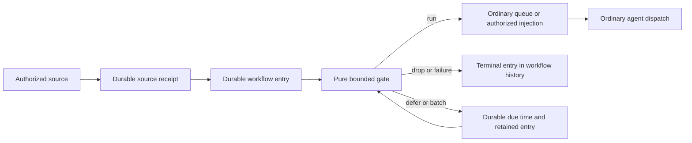
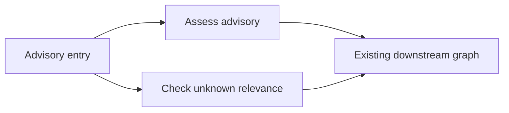

# Workflow entry gates

MP-08 / MP-09 / MP-10 / MP-11 · design only · 2026-11-02

Workflow pipeline inspected: `9a31a58847514ab39fa2d41e0a6b87d8fe130893`.
Apps WASM runtime inspected separately: `apps/r4-a2-integration` at
`83241dd4296c1f98ac785a3113626b39d0e9a2d1` (including async worker `8df139da77`
and signed migrations `cd4cdb90b5`), and R5 containment at
`11683dba40396a31f101526a5e6ce606aca4f824` on `apps/r5-containment`.
These are source identities, not a claim that the branches are integrated here.
Gate names and shapes marked **proposed** below do not exist at these revisions.
This document changes no runtime, protocol number, UI, or acceptance result.

## 1. Decision

Add one optional **gate** to a workflow definition. It runs at entry, for every
endpoint and every kind of invocation, after source authorization and durable
acceptance and before workflow queue insertion, runtime-agent provisioning,
provider startup, or notification steering. It receives a normalized trigger and
revisioned setup configuration and small durable workflow/binding state. It returns
exactly one of `run`, `drop`,
`defer_until`, or `batch`, together with replacement state.

The gate is a pure, metered WebAssembly function. No model, network, filesystem,
Vault, App SDK, provider API, or ambient clock is available to its code. Inventory
matching and morning digests belong in user-authored gate modules. The kernel
knows only entry identity, state revisions, decisions, deadlines, and opaque keys.

A `run` selects one or more connected entry nodes and a payload/prompt for each.
Use the existing workflow queue and dispatch policy after that selection. An entry
gate is neither a DAG agent node nor another workflow execution engine. Downstream edges,
handoffs, turn continuations, and resumes of an already admitted run do not execute
it again. A newly submitted endpoint invocation does, including a manual one.
Workflows without a gate retain their existing admission behavior.

### Primary path: describe it to a utility agent (21:16Z decision)

The default remains **No gate**. To add one, the user opens the workflow inspector,
sees the selected notification's JSON **field list beside the description**, and
writes what should happen. An existing **utility agent** turns that request into
gate code and tests once, during authoring. The panel then leads with a
plain-language summary and results on past events. Code stays in **Advanced**.
There is no per-event model call; every enabled gate is the same import-free
`gate_v1` WASM component with the same kernel admission, state, routing and history.

Recommend v1: **No gate + Describe with utility agent + shared Test/History**.
Ship the internal Rust SDK/build path required to produce those components, not a
manual coding UI. A small Rules quick-start is optional only if it can cheaply
prefill the description/tests and use that same utility-agent path; it is not a
separate v1 compiler project or a prerequisite. Rich no-code rules are deferred.
Ready-made publisher packages follow when they exist. Advanced read-only source
and component export may ship for transparency; manual code editing/build UX is
later. The 21:16Z owner direction supersedes the 21:12Z proposal to prioritize
Rules, while preserving its requirement that all layers use one primitive.

| Layer | User experience | Compile/run boundary |
| --- | --- | --- |
| No gate | Default ordinary workflow entry | No component or gate-owned state |
| Describe (primary) | Utility agent gets schema, examples and selected past entries; proposes code, tests and a plain summary | Same bounded Rust build, component admission and normal reviewed workflow apply |
| Rules (optional quick-start) | A small condition list prefills a description/tests, then Generate proposal uses the utility agent | Same generated component; no host rules interpreter or second compiler in v1 |
| Ready-made (later availability) | Publisher package; owner fills inventory/severity configuration | Same portable component and local validation; no App capability grant |
| Advanced (later manual editor) | Source/identity inspection first; optional manual editing later | Same SDK/WIT/profile, never another language runtime |

The inspector uses **Summary / Test / History / Advanced** tabs; optional Rules is
an additional quick-start, closed initially. A gate mode switch edits a draft,
never the active revision immediately. Selecting No gate requires ordinary apply
with the pending-entry cancellation preview. No silent fallback, automatic agent
run or code-to-rules reverse engineering. Config remains revisioned setup, never
an external state-write path. Utility-agent authoring is an ordinary real agent
run (including managed activity); evaluating the compiled gate is not.

### Optional Rules quick-start / later no-code specification

This is optional authoring vocabulary, not a v1 runtime or required independent
compiler. A cheap quick-start submits its typed selections as a prompt and tests
to the utility agent. Defer it if that integration grows. The richer deterministic
rules-to-Rust compiler below is a possible later authoring tool only.

Reuse the existing workflow field/picker, checkbox, section/row, button and time
input components. A row is **When [field] [comparison] [value] → [action]**;
multiple conditions in one row mean all; rows are ordered and **first match wins**.
Offer add/remove and explicit move up/down buttons rather than invent a builder
canvas. Up to 16 rows and 8 conditions/row; a required final **Otherwise** action
makes uncovered events visible. The gate mode itself defaults to No gate; a fresh
Rules draft defaults to an explicit run to the current singleton entry node, so
merely opening the draft cannot discard events.

Fields come from the event's declared schema and configuration; choose structured
JSON property paths, never free-form expressions. Comparisons are present,
equals/not-equals, string contains, and integer < / ≤ / > / ≥. Missing/type-mismatched
values make a positive comparison false (`not-equals` also requires presence);
null equality is explicit. No regex, scripts or user-defined expression syntax.
Validate safe integers, bounded string/path lengths and enum values at draft/apply.
Version-range/inventory joins exceed this small rule language: use Describe or a
publisher gate for advisory relevance. Simple severity/category matching does not
claim to calculate pinned-version relevance.

Actions are **Run → connected node(s)** (normally one selected A or B), **Drop**, or
**Batch → connected node(s) at daily HH:MM UTC**. Batch rows form separate groups by
rule ID/day with the existing kernel-owned provenance boundaries; the compiled
flush path routes the aggregate straight to that row's fixed targets. It never
re-evaluates the trigger condition or batches an aggregate again. A daily flush
is a literal UTC time in v1; local-time/DST calendar choices are advanced/publisher
policies until tested. Conditions and route IDs are part of the workflow revision.

Optional policies use ordinary existing fields, not another rule engine:

- **Dedupe by key:** choose a required scalar event field and a bounded retention
  window (at most seven days / 256 keys per binding). Exact transport dedupe stays
  in the kernel. The generated component checks its seen set and records a key
  only on terminal `run`, `drop`, or batch membership, never on defer. Missing
  keys yield a visible failed test/decision; never turn all missing keys into one.
  An exhausted set returns the named limit failure; it does not silently evict
  still-retained keys. A flush uses its membership identity, not a second dedupe
  of source items already collected.
- **At most N per period:** 1–1,000 invocations per integer UTC period (1 minute
  to 24 hours); use a fixed epoch-aligned window. One workflow invocation counts
  once even when it selects two nodes. On overflow defer to the next window,
  before original expiry, with no token consumed until `run`. A batch consumes
  one admission at flush, not one per member.
- **Quiet hours:** start/end HH:MM UTC (overnight allowed, equal values invalid).
  Run/flush waits via `defer_until` to the first permitted instant. No provider
  or persistent worker waits. Drop may still finish immediately, and batch may
  collect during quiet hours. Rate and quiet hours combine by taking the later
  eligible instant; the hard deadline/evaluation-count bounds still apply.

Fixed semantic order inside the compiled component: validate fields/config →
source-key dedupe → first matching rule (or its Otherwise) → batch collection or
drop → rate/quiet-hours eligibility for run/flush → atomic counter/seen update
and decision. Deferral retains the event; reconsider its first-match rule against
the same revision on resume. Flush retains its chosen rule/targets. Emit the
matched row ID and policy reason as bounded returned logs, so tests explain the
outcome without exposing code. The plain summary includes policy order and UTC
meaning. Warn on unreachable trailing rows during Validate, with no hidden reorder.

If the later direct Rules compiler is built, it validates this typed, bounded rule document,
generates straight-line Rust using the locked gate SDK, and builds/admits a normal
component through the same supervised build path as Describe. Include the rule
source hash/compiler identity in the manifest and pin the result with the workflow
revision. The evaluator receives only ordinary config/input/state; it does not
parse rules or interpret conditions on the host. Rules require no compiler or
model while an event arrives, and cannot bypass fuel/containment. Generated
rule/summary/source fixtures are portable with the component. Changing rule order,
policy, action or config creates a new revision and cancels old pending work.

### Describe, ready-made and shared testing

**Describe (primary)** uses the existing instructions textarea and a **Generate proposal**
button. Only that user action starts the existing selected utility agent through its real official provider in
the Room, with normal authoring permissions. The agent writes the gate and tests,
builds it, and returns a proposed plain-language summary, not a permission grant
or live activation. Show, for example: “Runs the triage agent for critical/high
advisories that affect your pinned versions; everything else waits for the 07:00
summary.” Include unknown/stale-inventory handling, dedupe, UTC time and failures
in expandable policy details. Summary, source, config, fixtures and component
hashes share one draft identity; edits mark the summary/tests stale until
regenerated/reviewed. Do not treat an agent's prose as verification of code.

The proposal's tests include supplied boundary cases plus a sample of retained
real past events. Show matched/skipped/unknown events, expected vs actual decision,
selected nodes/payload, state diff, logs and fuel/time using the shared Test view.
Past-history replay is isolated; no agent runs, source ACKs or live state changes.
Compare events independently from their captured states by default; an explicit
**Sequence** test instead advances a private copied state in original history
order to assess dedupe/rates/batching, and simulates recorded due entries up to a
chosen bounded horizon. Label which mode was used; independent replays do not
establish batch/rate behavior. Sample count/time horizon and missing/pruned bodies
are visible. The user reviews and applies the exact built proposal; failure
leaves the active gate untouched. No automatic application by generated code.

**Ready-made**, when supplied, uses a versioned package from the upstream AEGS
publisher (for example advisory normalization plus relevance gate) with component,
config schema/labels, optional source, plain summary and test cases. Existing App
publisher/catalog trust verifies package provenance during authoring/import; it
does not grant the gate any App capability, state store or Vault access. Pin its
component and configuration with the workflow revision. A publisher update is an
explicit replacement/apply, never hot-loaded during delivery. The user's inventory
and severity exist only in setup on their authoritative kernel, never in relay
plaintext or an automatic publisher feedback channel. Publisher signatures do not
replace local WIT/limits validation. Until an actual package exists, offer Describe
rather than a fabricated ready-made product.

Describe, optional Rules and ready-made modes all expose the same Test and History tabs.
History is about the actual WASM decision: it records the authoring mode/manifest,
rule ID where available, selected targets and immutable config/module identity.
Advanced is closed initially. A user can understand the example through Summary
and past-event results without opening source or learning WASM.

### Reuse the Apps WASM runtime

The Apps branches already provide a Rust Wasmtime component worker in
`packages/app-wasm-worker`, WIT admission in `packages/app-wit`, and verified
process launch in `packages/app-runtime`. Use that runtime, pinned to Wasmtime
50.0.0 at the inspected revisions. Do not add another WASM engine. The older
Node worker in this workflow checkout is not the foundation for new gates.

**Proposed:** add the import-free gate WIT world below and a one-evaluation
worker entry mode to the same trusted worker/runtime bundle. Share the following
mechanisms, while keeping gate authority and state in the workflow kernel:

| Existing Apps mechanism | Gate reuse and explicit boundary |
| --- | --- |
| `app-wasm-worker/src/engine.rs`, `worker.rs` | Reuse Wasmtime component compilation, engine/build identity and the epoch ticker. Add a pinned `gate_v1` engine profile with fuel enabled; the inspected App engine enables epochs but **does not enable fuel**. Do not change App metering implicitly. |
| `app-wasm-worker/src/limits.rs` | Reuse the store `ResourceLimiter` mechanism for aggregate linear-memory and table growth, with the tighter gate ceilings. Use a fresh store/instance for each evaluation, never the App's long-lived instance or concurrent calls. |
| `app-wit/src/lib.rs` and `contract.rs` | Reuse structural/type admission machinery and generated Wasmtime WIT bindings for a new, separately resolved gate world. The existing supported worlds are App and migration; neither admits a gate today. Never include `app-admission`, `wasi-compat`, or migration state imports in the gate world. |
| R5 `app-wasm-worker/src/containment.rs` and `containment/{linux.rs,macos.rs,macos.sb}` | Reuse mandatory containment before readiness, compilation, epoch/Tokio threads and guest entry: Linux Landlock + seccomp + process limits; macOS signed hardened runtime/JIT + Seatbelt + process limits. No gate-specific sandbox implementation or bypass switch. |
| `app-runtime/src/worker_process/` and `worker_process/wasm/` | Reuse verified executable pinning, clean spawn, startup continuation, bounded transport, cancellation, exact owned PID supervision and reap. Introduce a workflow-entry/evaluation identity in place of installation identity; the current App launch constructor cannot be called unchanged. |
| `app-runtime/src/release_store/aot_cache.rs` | Reuse engine/build/target/CPU provenance rules if local compilation is cached; include the gate profile and world in cache identity. Uploaded or exported native code remains forbidden. No App release/install transaction is needed to store portable gate bytes. |

Bypass App installation/catalog activation, registration and `worker.ready`
broker exchange, App SDK/broker dispatch, App capability grants, App private
DB/data/tmp directories, migrations and snapshots. In particular,
`bindings.rs`, `broker.rs`, `host.rs`, `wasi.rs`, HTTP/files/streams and App
`RetryPolicy` are not linked into a gate evaluator. A gate has no App installation
ID and cannot call `state.get/transact`; its only state is explicit input/output
committed by the workflow writer. Signed App migrations demonstrate another WIT
world on the runtime, not a storage API for gates.

The inspected R4 supervised path and R5 `serve` containment are separate seams:
R4's `worker_process/wasm/domain.rs` explicitly leaves native verification to R5.
The gate implementation must compose them so **every** evaluation/test path
enters R5 containment before engine construction or continuation, including any
cached-code path. Neither an R4 Ready reply nor R5 source alone proves that
integration. Linux and signed macOS drills are required before enabling gates.

### Typical checks

These are user-authored pure policies, not kernel business rules:

| Check | Concrete gate behavior |
| --- | --- |
| Relevance against inventory/version ranges | Compare an advisory's ecosystem/package/affected range with configured installed versions using a pinned pure range library; drop a known nonmatch, run on a match or explicitly unknown/stale inventory. |
| Severity threshold | Run for a numeric score ≥ 7 or an owner-listed critical category; drop lower scores, with an explicit policy for missing scores. |
| Dedup/already handled | Drop an advisory ID + revision already in a bounded seen set maintained by the gate. A committed `run` means admitted, not successfully handled; v1 does not accept completion writes into gate state. |
| Debounce/coalesce | Store the newest change revision and a fixed due instant; defer candidates to that instant, then drop superseded revisions and run the current one. A sliding window requires explicit state/defer updates; the kernel does not move a batch cutoff. |
| Batching/quiet hours | Batch compact release records under a fixed morning cutoff, or defer a single alert until quiet hours end, always before its original deadline. Flush emits one queued digest. |
| Rate limits | Store a bounded token bucket and recorded refill time; consume a token on `run`, otherwise defer to the next eligible instant or drop under the author's policy. This meters admission, not provider completions. |
| Payload reduction | Keep advisory ID, matched packages, severity and URL; remove the full feed body before forming the downstream prompt/payload. |

Inventory and other external context enter **only through workflow configuration
and setup**. The owner or an authorized agent edits a bounded configuration snapshot
using the ordinary workflow edit/apply path. Each edit creates a workflow revision;
it never writes gate-owned state. Configuration is an immutable explicit argument,
separate from the gate's mutable dedup counters, seen IDs, rate buckets and batches.
There is no prior-run state-write path, inventory-update trigger, App DB read or
hidden refresh. A source event carries the event to assess, not a replacement
inventory. If inventory changes, update setup and apply a new revision. Store its
source revision and freshness timestamp in configuration; missing/stale data has
an explicit author policy. The gate cannot fetch a URL or resolve Vault values.

### Typed notification data is a prerequisite for structured filtering

Source verification at this workflow checkout (`3d090bc750`):

| Source | Observed contract / gap |
| --- | --- |
| `apps/kernel/src/local/api/types/event_publication.rs::EventGeneratorEventDefinition` | `event_type`, `version`, `name`, `description`, `filter_schema`, `required_scopes`; **no payload schema/examples** |
| `packages/aegs-sdk/src/manifest.rs::validate_manifest_envelope`, `unsigned_manifest_digest` | Event validation checks type/version/name/filter schema; canonical unsigned manifest bytes are signed. `filter_schema` describes subscription choices, not delivered data. |
| `packages/event-protocol/src/lib.rs::PublishEventRequest`, `EventDeliveryEnvelope` | Required nonempty prompt, maximum **1 MiB**, artifact metadata, arbitrary `metadata`, reply context; **no typed `data`**. Current event-delivery version is 3, management version 4. |
| `packages/aegs-sdk/src/provider.rs::NormalizedEvent` and `manifest.rs::PublishEventBuilder` | Prompt/metadata-centric emit path; no schema-aware data builder. |
| `apps/kernel/src/runtime/state/event_delivery_runtime_state.rs::accept_app_event_delivery` | Validates event identity against App route, wraps prompt as `text` with metadata/artifacts/reply context, then passes it to the App inbox. A gate cannot infer typed advisory properties from this wrapper. |
| `packages/app-package/src/declarations.rs::EventDeclaration`; `app_inbox_runtime.rs::accept_app_inbox_occurrence` | **Already** has signed `payload_schema`/`schema_version`, incoming/outgoing direction and receipt validation. Reuse these mechanisms; do not claim all current App events are untyped. |
| `packages/app-runtime/src/app_outbox/invocation.rs::Invocation`; `durable_state/app_event_delivery/preparation.rs::PreparedAppEvent::prepare` | App workflow invocation is prompt/artifacts (64 KiB prompt here), separate from the already validated App event payload. Preparation retains a payload in the receipt but queues prompt/publication context. Preserve a typed bridge to the gate instead of reading App DB. |
| `session/workflow_scheduling.rs::WorkflowPublicationInvocationEnvelope`; `session/workflow_publication.rs` | Internal invocation already has untyped `input`; HTTP publication has optional input schema. Normalize/validate this at the kernel boundary rather than parse prompt text. |

**Manifest extension (proposed).** Add optional `payload_schema` and `examples` to
each publisher-signed AEGS event definition, catalog detail and SDK manifest model.
Use the existing restricted JSON Schema **Draft 7** compiler from
`packages/app-package/src/declarations.rs` (factor its schema-only helper if needed,
not a new validator). Require a closed object schema, inline finite references,
no remote fetch/IDs or recursive references; retain bounded schema compilation.
Schema max 64 KiB, depth 32 / 4,096 nodes. Gate-compatible schemas and their
examples must use safe integer JSON numeric literals; decimal values/constraints
are represented by declared strings or rejected at gate apply, rather than passed
to the integer-only guest profile. Examples are at most eight named objects
`{name, data}`, each 8 KiB and 32 KiB aggregate, and every example must validate.
Examples without a schema fail manifest admission. Sign schema and examples as
part of the canonical manifest body; a schema digest alone is not a trust root.

```json
{
  "event_type": "advisory.published", "version": 2,
  "name": "Advisory published", "description": "Normalized package advisory",
  "filter_schema": {"type":"object","properties":{},"additionalProperties":false},
  "required_scopes": [],
  "payload_schema": {
    "type":"object", "additionalProperties":false,
    "required":["advisory_id","revision","severity","package","affected"],
    "properties": {
      "advisory_id":{"type":"string"}, "revision":{"type":"string"},
      "severity":{"type":"string","enum":["critical","high","medium","low"]},
      "package":{"type":"object","additionalProperties":false,
        "required":["ecosystem","name"],
        "properties":{"ecosystem":{"type":"string"},"name":{"type":"string"}}},
      "affected":{"type":"array","maxItems":32,"items":{"type":"string"}}
    }
  },
  "examples":[{"name":"Affected npm package","data":{
    "advisory_id":"ADV-A","revision":"1","severity":"high",
    "package":{"ecosystem":"npm","name":"widget"},
    "affected":[">=2.4.0 <2.5.0"]}}]
}
```

The example's event version is illustrative, not a protocol allocation. Identify
schemas by generator/manifest digest + event type/version + schema digest. Reject
schema changes under the same event type/version at registry/install/apply;
publish a new event version instead. Pin verified manifest/schema on source
binding and workflow revision. Publisher updates never change an accepted entry.
`description` and examples are untrusted content, not agent instructions.

**Delivery and validation (proposed).** Add `data: JsonObject | null` and
`payload_schema_sha256: string | null` beside prompt in `NormalizedEvent`,
`PublishEventRequest`, `EventDeliveryEnvelope`, durable AEGS outbox/inbox/replay and
AEDS fan-out records. With a declared schema, data/digest are required and must
match; without one both are null and the event is explicitly text-only. This is
an intentional untyped source capability, not a legacy compatibility read path.
Never silently derive `data` from prompt, metadata, filter parameters or a model.
The authenticated binding chooses the signed schema; a delivery cannot select a
schema URL or pass its own schema to gain admission. Schema validity does not
make data trusted instructions or authority.

SDK emit validates against the registered manifest before storing/publishing; a
bad producer gets field-path validation errors and must fix the event. AEDS
checks event/schema identity and byte bounds against verified registration (Cloud
service contract work), preserves bytes/digest during fan-out, and never routes
from `data`. The authoritative kernel independently checks the signed binding's
schema and validates `data` **before its durable acceptance ACK**. Wrong/missing
schema, wrong types/required fields, excess bodies and invalid examples fail
clearly with `event_schema_mismatch` / `event_data_invalid`, no gate state/queue
or success ACK. Retries under the same occurrence cannot change canonical data;
dedupe hashes include data and schema identity. Data is at most 128 KiB, depth 32 /
4,096 nodes; the whole envelope is capped at 1.5 MiB with existing prompt/artifact
ceilings retained. A gated entry has the stricter **512 KiB whole input** limit:
a formerly legal 1 MiB prompt is refused at gate handoff with `gate_input_limit`,
never silently truncated. Already ACKed App inbox work retains its truthful source
status if the later outgoing handoff fails.

For the current AEGS → App inbox → App outgoing automation → workflow path,
preserve typed data in the declared incoming wrapper and validate against both
the source AEGS schema and App incoming schema before inbox acceptance. An App may
normalize/transform it; its outgoing event already has a signed payload schema.
At the automation boundary project that **outgoing** payload as gate `data` with
its own schema identity, not the original upstream identity. Add structured data
to workflow `Invocation`/publication envelope and pass it through
`PreparedAppEvent::prepare` atomically with the existing receipt. Require equality
to the validated outgoing payload for that handoff, or an explicitly declared,
validated output mapping/schema; never infer a schema for arbitrary prompt text.
Do not restore a retired direct AEGS-to-workflow route. Private workflow
notifications likewise carry their producer-declared validated data/schema; a
text-only notification remains explicitly text-only.

**HTTP / manual / schedules.** Input schema is **optional per endpoint**.
Preserve GET URLs where the user types `?prompt=...` and that exact decoded text
is injected as the invocation prompt (subject to the gate's explicit decision).
The schema governs structured fields, not the free-text prompt; adding a schema
must not remove GET or require wrapping prompt in JSON. POST can carry the same
canonical `{prompt, data}` envelope when a URL is too short. Manual/Room calls use
the same endpoint contract. Normalize to one canonical data field in the kernel;
remove ambiguous parallel `input` vs `data` reads in this implementation.

For GET, decode UTF-8 query exactly once (`+` means space, percent escapes decoded
once). `prompt` is reserved free text and is **excluded from data**. All remaining
application query parameters map to `data` by their literal top-level names;
no dotted-path/bracket expansion, JSON-in-query parsing or hidden metadata fields.
A query named `data` is just a string application field, not an envelope override.
Reject malformed escapes, duplicate keys (including repeated `prompt`), and
prototype keys (`__proto__`, `prototype`, `constructor`) at normalization. Empty
values are empty strings, not absent. Transport auth and idempotency are headers /
existing authenticated session state, never query data; reserve `_chariox_*` names
and reject them in the application query. Do not parse a query `token`/`key` as
authentication; it is ordinary application data only if the endpoint allows it.

- **No schema:** `data` is the remaining `Record<string,string>` (empty `{}` for
  prompt-only URLs), `data_schema` is null and the panel says **Query strings;
  no declared fields**. The gate can inspect those strings or prompt text; the
  utility agent does not invent typed fields from a sample. This intentional
  HTTP source shape differs from an untyped AEGS event's null data.
- **With schema:** extract prompt first, then coerce each remaining query value
  according to its declared top-level property. Strings stay strings; integer
  accepts a base-10 signed integer lexeme within safe JSON range; boolean accepts
  only `true`/`false`. No truthiness, hex/exponent coercion, silent defaults, empty
  to null/zero or inference from examples. A `number` property is gate-compatible
  only for safe integers in v1; fractions/amounts/versions use declared strings.
  Object/array/null or ambiguous union properties cannot be encoded by this v1
  scalar GET mapping: return an actionable 422 to use POST JSON, not an implicit
  change of type. Apply flags schemas requiring those fields as POST-only while
  retaining GET for schemas whose required fields can be represented. Run the
  full declared schema validator after coercion, including required, enum,
  bounds and additional-properties policy. The gate receives the resulting
  typed object and its pinned schema; invalid input never starts a gate or agent.

Bound GET request-target (encoded path + `?` + query) to **8,192 bytes**, at most
64 application parameters, 128 decoded UTF-8 bytes/name and 4,096 bytes/value;
`prompt` may use the remaining URL budget up to 8,192 decoded bytes. Enforce raw
and decoded limits before allocation in gateway **and** kernel normalization
(shared helper/raw bounded query representation), not only a proxy setting.
Return HTTP **414** for request-target overflow, **400** for malformed/duplicate
encoding, **422** for coercion/schema failure, with no silent truncation. The
existing 1 MiB prompt ceiling still applies to POST transports, and the stricter
gate whole-input limit applies after normalization. A proxy/browser may impose a
smaller URL limit; provide POST JSON as the explicit larger-payload path.

**GET authentication and intentional invocation.** A URL identifies a trigger;
it is not a grant. Keep the endpoint's existing publication admission policy for
both methods: owner/session or authorized caller cookie for a browser link,
Authorization header for service clients, and anonymous invocation only when the
owner explicitly published that endpoint as public. The kernel rechecks the
verified publication caller and source binding before acceptance; query fields
cannot choose caller/owner/workflow/queue. A copied protected link prompts the
existing sign-in/access flow when needed and never becomes public because it is
GET. Hosted links use HTTPS. Never issue a bearer credential in the URL or record
it as data. Preserve existing CSRF/session checks; reject cross-site embedded
subresource requests and advertised prefetch/prerender/link-preview fetches as
non-invocations. Permit an intentional signed-in top-level user navigation under
that policy, without a new gate-specific confirmation. Service callers use their
existing authentication, independent of browser fetch metadata. Send
`Cache-Control: no-store` and `Referrer-Policy: no-referrer`; no CDN caching or
viewer auto-refresh may repeat the invocation. An explicit reload/new GET is a
new request; service retries use the existing idempotency header and same caller
identity. Do not claim all browser reloads are deduplicated automatically.

A schedule supplies a fixed kernel-owned closed schema:
`{schedule_id:string, schedule_revision:string, scheduled_for_ms:integer,
trigger_kind:"interval"|"cron", timezone:string}`. This describes the occurrence,
not invented notification fields. Manual/query time cannot impersonate the
kernel-owned schedule provenance. A gate shared by several sources gets a
source-discriminated union, including the untyped HTTP query-string map and
text-only AEGS case. The utility agent handles each explicitly.

**Gate and utility agent.** The normalized trigger below exposes validated
`data`, `data_schema` (source kind/type/version, schema digest, exact schema JSON)
and prompt separately. JSON remains the language-neutral WIT transport, while
SDK bindings provide typed accessors/generated structs from that schema. Include
schema bytes in input/hash/body accounting and retained replay. Test fixtures
validate the event data before worker entry. In the panel, list field path, type,
required/optional and enum beside the description, with the full JSON/examples
expandable. An absent schema says **Text only; no declared fields**, rather than
suggest made-up field names.

The explicit Generate proposal action passes the utility agent the requested
policy, connected node IDs, config/schema, signed publisher examples, selected
real past entry data (up to 20 / 256 KiB total, fewer if the body budget is reached),
known gate limits and pinned SDK. Existing owner/history access and Vault-target
redaction still apply; examples/data do not grant Vault reads or expose opaque
reply credentials. Historical external text is treated as data by the authoring
prompt. Show how many events are retained/missing. The agent may implement regex
where simple Rules cannot: use a pinned pure, bounded non-backtracking regex
helper compiled inside the component, with integer-profile-compatible build
features, explicit pattern/input bounds and fuel tests. No host regex call, model
inference or language interpreter is added to `evaluate`. Schema + examples are
necessary hints; only compiled tests and the owner's apply review validate the
proposed behavior.

**Protocol / SDK implementation impact.** This round allocates no numbers.
Coordinate new local and relay-peer versions for schema/catalog projections,
workflow data/gate definitions, requests/history and forwarding. Coordinate event
delivery and AEGS management protocol revisions (currently 3 and 4), manifest
schema version, SDK release and Cloud catalog/AEDS contract together. Update
canonical signature/digest fixtures, protocol shape/hash snapshots, client minimums
for typed-gate features and App event schema/package revisions for the changed
wrappers/invocation. Do not carry dual prompt-to-data conversions or older-kernel
fallbacks. Re-register/re-pair affected publishers/bindings as needed in development.

AEGS SDK changes span `manifest.rs` (schema/examples validation and signed
manifest), `provider.rs::NormalizedEvent`, `PublishEventBuilder.data(...)` plus
schema-aware build/emit, `publisher.rs` and `server/inbox.rs` durable emit,
`store/inbox.rs`/replay and event-protocol types/hashes. The SDK must retain the
verified registration schema handle (not just a producer ID) so an unvalidated
builder cannot bypass checking via direct `publish`. Reuse the schema-only
validator in both SDK and kernel. Cloud validates producer registration/delivery;
OSS contains no Cloud compute-provider business logic. Update App SDK/outbox
builders to carry the validated payload across their existing signed boundary.
No schema or data parsing belongs in the encrypted relay.

## 2. Existing pipeline and exact insertion points

All paths below are relative to the repository root.

| Input | Existing path at the inspected base | Proposed integration |
| --- | --- | --- |
| App event | AEGS → AEDS → `runtime/state/app_inbox_runtime.rs::accept_app_inbox_occurrence` validates the signed incoming schema and persists inbox acceptance before ACK. `app_inbox_pass` delivers to the App. Its explicit outgoing automation emission reaches the App outbox. `runtime/state/app_event_pump_runtime.rs::pump_app_event_pass` calls `app_event_delivery_owned_state.rs::queue_app_event`; `durable_state/app_event_delivery/preparation.rs::PreparedAppEvent::prepare` and `app_event_delivery.rs::commit_app_event_queue` perform atomic receipt → workflow queue handoff. | Preserve inbox ACK and App execution. For gated targets, replace the final receipt → queue handoff with an atomic receipt → entry handoff. Evaluate the gate before constructing a queue item. The App itself may run before this gate; no target workflow agent runs. |
| Private workflow notification, local or peer | `durable_state/workflow_notifications.rs::accept` checks binding, filter, TTL, ancestry and dedupe. `runtime/state/workflow_notification_router.rs::route_workflow_notifications` prepares accepted work with `PreparedNotification::prepare` in `durable_state/app_event_delivery/workflow_completion.rs`; `commit_in` queues it atomically. Peer delivery reaches the same target acceptance. | Gate only on the subscriber's authoritative kernel, after acceptance. Replace the accepted receipt → queue handoff for gated targets. Source filters and loop prevention run first and remain authoritative. |
| Published HTTP invocation | `apps/server/src/kernel-publication-client.ts::invokeKernelWorkflow` normalizes an invocation and sends `InvokeWorkflowEndpoint`. `runtime/state/workflow_run_request_runtime_state.rs::execute_workflow_invoke_endpoint_request` calls `workflow_prompt_queue_owned_state.rs::workflow_enqueue_prompt_by_agent_and_maybe_start`. | Normalize and durably admit an entry in the kernel. The HTTP gateway forwards typed entry results; it does not evaluate code, own state, or decide retries. |
| Workflow interval/cron | `workflow_prompt_queue_owned_state.rs::workflow_collect_due_watchdog_dispatches` collects plans; `workflow_start_watchdog_tick_plan` enqueues a scheduled prompt under `workflow_admit_prompt_transaction_with_invoker`. `session/workflow_scheduling.rs::WorkflowScheduleTrigger` already handles interval/cron and IANA timezones. | A due plan admits an entry with stable `(schedule_id, revision, scheduled_for_ms)` occurrence identity before queue insertion. Preserve the schedule's existing overlap/skip policy; record a skipped tick without evaluating a gate. Gate timers do not consume additional schedule runs. |
| Manual, Room command, workflow-code run | Same runtime invoke handler and queue admission as above. `session/service/launches.rs` constructs queue items and runs. | Apply the workflow gate regardless of invocation transport. Caller-provided publication envelopes cannot claim a gate pass. |

Paths under `runtime/`, `durable_state/`, and `session/` in this table are in
`apps/kernel/src/`.

After a gate passes, keep
`workflow_prompt_queue_owned_state.rs::workflow_start_next_queued_prompt_for_response`,
`runtime/state/workflow_queue_durable.rs`, and
`runtime/state/workflow_launch_owned_state.rs::workflow_schedule_entry_node` as
the queue → durable run → entry turn path. A new private `GatePassedEntry` value
must be backed by the writer's entry/decision record; possession of JSON is not
proof. Low-level enqueue/run functions must reject a gated workflow without that
proof. Also cover `apps/kernel/src/app/workflow_runtime.rs`'s alternate enqueue
path: delegate to the owner or reject; it must not bypass the gate.

Notification injection is another dispatch path:
`runtime/state/notification_delivery.rs::deliver_pending_notification_injections`
and `prepare_notification_injection`. Only a committed `run` result may reach
it. Keep its exact run/turn/provider acceptance and uncertain-send rules. An
injection falling back to a queue must reuse the passed entry, never rerun the
gate or state update. A retry explicitly requested after a held send likewise
does not retroactively undo or repeat its gate decision.



### Agent triggers are a separate existing path

`runtime/state/agent_trigger_http.rs::invoke_agent_trigger` currently calls
`claim_http_agent_trigger` then `agent_trigger_runtime_state.rs::fire_agent_trigger`.
It can steer an already running agent directly; it does not use workflow entry.
The gateway is not the published-workflow HTTP path described above.

For an agent trigger whose agent has a generated workflow with a gate, adapt its
firing to that workflow's entry boundary **before** `fire_agent_trigger`. Preserve
the trigger ID, source occurrence, target agent and existing busy policy as
kernel-only dispatch context. `run` continues the same fire/steer path using a
private passed-entry proof; other decisions never call it. Route timer firings
through the same adapter. Do not convert unrelated agent prompts or triggers
without a gated workflow into workflow runs. Configuring a gate on a generated
workflow is refused unless all of its trigger adapters support this boundary;
silently bypassing the gate is forbidden. This closes the apparent HTTP/timer
shortcut without moving trigger busy semantics into gate code.

The proposed trigger binding stores the resolved workflow/endpoint identity;
never guess it from an agent's membership in possibly several workflows. Recheck
the exact trigger dispatch claim/generation before releasing a saved result.
`dispatch_due_agent_triggers` is the timer adapter beside `invoke_agent_trigger`.
Keep an existing offline/busy refusal before acceptance as that refusal; once an
entry is accepted, a later offline agent is retained/retried or expired under the
entry contract, never mistaken for an unaccepted source request.

## 3. Proposed authoring and execution contract

### Definition and module storage

Extend `WorkflowCodeWorkflow` in `apps/kernel/src/workflow_code/model.rs` and the
runtime `WorkflowDefinition` in `session/workflow_definition.rs` with:

```ts
type WorkflowGateDefinition = {
  abi: "gate_v1"
  module_sha256: string
  config: JsonObject
  config_sha256: string // kernel-computed canonical JSON digest
}
```

There is exactly one gate, shared by the workflow's endpoints, with no binding
override chain and no fail-open option. New workflow/binding state starts as `{}`;
only committed gate decisions populate it. Config is not a state seed. Module
upload is an owner-authorized
`PutWorkflowGateModule {session_id, wasm_base64, sha256}` request. The kernel
hashes, validates and stores the bytes by digest. It never opens a caller-supplied
path or downloads a module. Workflow source references that digest. Portable
workflow packages embed referenced bytes as a bounded sidecar, verified on import;
they never reference the original machine's files. Export source includes the
reference and a package can carry the bytes. No executable native cache is imported.

Workflow-code remains declarative: its Node compiler builds a definition and does
not execute the gate. Extend `workflow_code/definition.rs`, validation, apply,
source export/rebuild, artifact/package hashing, and SDK builder together. Apply
requires a locally verified module, checks the config and declared entry targets,
and runs author-supplied fixtures without starting providers. A module is user code, not a publisher-trusted native binary; an owned
workflow edit authorizes its use under this sandbox, without a new permission
prompt. Only the trusted runner/platform bundle needs product signing/enrollment.

### Configuration revision and delivery

The canonical config object (64 KiB, JSON depth 32, 4,096 nodes) is stored in the
workflow definition/artifact and hashed into the ordinary workflow revision and
portable package. Verify `config_sha256` on import/apply; never trust a client digest.
A source/build manifest pins module bytes, source digest, SDK/toolchain versions
and config digest together. Source may be absent for an imported component; show
read-only component identity and allow replacement rather than fabricate source.

At acceptance the writer pins the entire workflow revision, config bytes/digest,
module and endpoint target set on the entry. The worker receives the immutable
`configuration` record below on every trigger/resume/flush. Replay uses those
exact bytes. A flush inherits one revision because batch identity includes it.
Config has no ambient read API and output cannot replace it. The returned state
is gate-owned memory only; the SDK exposes no external state-write request.

Applying a config/module/entry-edge edit cancels all pending, unhanded entries,
open groups and their timers atomically with revision activation. An old active
evaluation cannot commit after the revision fence; no old entry is silently
reinterpreted with new inventory. Already handed queue work keeps its committed
revision/proof under ordinary cancellation checks. Gate-owned state persists
across revisions; policies whose dedup meaning changes must namespace their seen
keys by config digest, or the owner explicitly resets state as part of apply.
Reset accepts expected revisions and a reason, cancels pending work, and clears
state to `{}`; it cannot import arbitrary external data. The apply preview shows
config changes, affected entries and optional reset before confirmation.

### Entry edges and conditional branching

Extend the endpoint's current single `entryNode` to a nonempty ordered set
`entry_nodes: NodeId[]`, encoded by outgoing entry-to-agent edges in the existing
graph. There is still one entry point and one workflow gate, with no gate node
or predicate on each edge. Example:



The entry inspector lists these two target IDs. Gate code returns
`run([{node_id:"assess", payload:compactMatch, prompt:"Assess advisory"}])` on a
known match, `run([{node_id:"check_unknown", payload:compactUnknown,
prompt:"Check advisory; relevance unknown"}])` for stale/incomplete configuration,
and `drop` for a known nonmatch. Multiple selected targets are explicit fan-out;
no match is `drop`, never an empty successful `run` or implicit all-target default.

Apply rejects empty/duplicate/missing entry targets, non-agent targets, dangling
edges, foreign workflow nodes, invalid input schemas and static target references
in the gate's declared build manifest that are absent from the graph. Dynamic
computed targets cannot be proven at apply: every evaluation checks the complete
returned list against the entry's pinned allowed IDs and each node's input schema.
Unknown/duplicate/empty targets fail `gate_invalid_target`, atomically with zero
state writes or dispatch. A manifest cannot expand graph authority. No other
workflow or endpoint is selectable. Existing ungated endpoints retain one start
node in v1; multi-start entries require the gate's explicit selection.

A selected list creates **one** workflow invocation, one queue position and one
durable dispatch intent with ordered per-node input records. Extend the existing
run constructor/scheduler to seed exactly that subset of Ready entry nodes in one
transaction; retain its downstream handoff, join and completion rules. Each route
has a unique `(entry_id, evaluation_number, node_id)` dispatch identity, so partial
provider startup/recovery cannot repeat a successful node. Capacity waits hold
the whole intent before run creation, with no early dispatch of a subset. Selected
branches have independent downstream effects once admitted; no rollback of agent
side effects is promised. A join requiring every predecessor still waits for all
of them: apply flags fan-out/conditional paths feeding such joins and requires
ordinary workflow join semantics to be configured deliberately, never invents a
new conditional join engine. Completion remains one ordinary workflow run.

Notification injection or generated-agent steering supports only its existing
bound node. Such an entry declares that singleton target; apply rejects a routing
graph that would steer a different agent. An endpoint needing multiple branches
uses its ordinary queue policy, selected before evaluation. Batch flush is always
queued. History records all selected node IDs, transformed inputs, intent/run ID
and each route's eventual node-run/provider status; skipped branches have no run.

The only routing predicate is this gate's `evaluate`. The kernel validates IDs and
hands the result to the existing scheduler; edges contain no second condition
language/interpreter. A deterministic node between agent nodes is a possible
follow-up, **outside v1**: it would need typed handoff/state ownership, scheduling,
join and replay semantics agreed first. This design evaluates only at entry.

### WIT world and export

**Proposed:** a separate WIT package `chariox:workflow-gate@1.0.0`, resolved
alongside the App contracts by shared admission code. `gate_v1` selects exactly
this world and the pinned engine/limits profile; it is not an App backend.

```wit
package chariox:workflow-gate@1.0.0;

interface evaluator {
  record input { entry-json: string }
  record configuration { workflow-revision: string, config-sha256: string, config-json: string }
  record state { workflow-json: string, binding-json: string }
  record route { node-id: string, payload-json: string, prompt: option<string> }
  record batch-value { key: string, flush-at-ms: u64, payload-json: string }
  variant decision {
    run(list<route>),
    drop,
    defer-until(u64),
    batch(batch-value),
  }
  record output { decision: decision, state: state, reason: string, logs: list<string> }
  evaluate: func(input: input, configuration: configuration, state: state) -> output;
}

world gate {
  export evaluator;
}
```

This world has **zero imports**, including zero broker capabilities or WASI.
Its sole interface export is `chariox:workflow-gate/evaluator@1.0.0`, with one
synchronous `evaluate` function: input + configuration + state → decision + state + logs.
The existing async worker infrastructure can host that call; the guest gets no
async tasks, subscriptions or host callbacks. `entry-json` is canonical `GateInput`
below with `configuration` and `state` omitted; separate records carry immutable
configuration and the two mutable state objects. Output maps exactly to `GateOutput` below. JSON fields retain its safe
integer, UTF-8, depth and byte rules, including the time fields represented as
WIT `u64`. No handles, resources or filesystem references cross this interface.

Generated component bindings own canonical ABI lowering/lifting, allocation and
post-return cleanup; there is no public pointer-packing ABI. Core modules inside
the component may use only internally satisfied imports needed for this pure
component, including canonical ABI glue. That does not authorize any external
component import. Validate the whole component and nested core modules, then
instantiate with an empty host linker. Unknown imports fail admission, never
receive stubs or the App linker. All guest work, including instantiation,
reallocation and post-return, shares the evaluation budget.

### Input

The kernel creates and records the exact canonical input before evaluation:

```ts
type GateInput = {
  abi: "gate_v1"
  entry_id: string
  endpoint_id: string
  allowed_entry_nodes: string[]
  configuration: {workflow_revision: string, config_sha256: string, config: JsonObject}
  binding_id: string
  phase: "trigger" | "resume" | "batch_flush"
  accepted_at_ms: number
  evaluation_at_ms: number
  deadline_ms: number
  trigger: {
    kind: "app_event" | "workflow_notification" | "http" | "schedule" | "manual"
    occurrence_id: string
    occurred_at_ms: number | null
    data: JsonObject | null
    data_schema: null | {source_kind: string, event_type: string, version: number,
                         sha256: string, schema: JsonObject}
    prompt: string | null
    artifacts: ArtifactMetadata[]
  } | null
  batch: null | {
    key: string
    flush_at_ms: number
    items: {entry_id: string, payload: JsonValue}[]
  }
  state: {workflow: JsonObject, binding: JsonObject}
}
```

Input `data` is validated against its pinned `data_schema` when declared;
no-schema HTTP GET supplies its bounded string map with null schema. It is never
a best-effort parse of prompt or metadata. The gate cannot replace the source schema.
For `batch_flush`, `trigger` is null and items are in durable acceptance order.
For `resume`, use the saved trigger or saved batch. Time is a recorded UTC instant,
not a callable capability. `evaluation_at_ms` is the instant the writer claims the
evaluation, including after a late restart. Replay uses that same instant. Guest
JSON numbers are safe integers; versions, arbitrary decimals and large identifiers
are strings. Reject invalid UTF-8, duplicate JSON keys, excessive nesting, and
noncanonical/unsupported numbers before running. Use one canonical serializer for
hashes, test replay, and worker input.

Kernel-only authority is **not** writable guest data: owner/realm, target and
binding revisions, authenticated caller, installation/catalog/signer identity,
ancestry, delivery mode, original expiry, original artifact records, dispatch
obligation, and content digest remain on the entry. The gate may inspect public
data fields that happen to contain similar strings; they grant no authority.

### Output

```ts
type GateOutput = {
  state: {workflow: JsonObject, binding: JsonObject}
  reason: string
  logs: string[] // returned bounded diagnostics; no host log import
  decision:
    | {kind: "run", targets: {node_id: string, payload: JsonValue, prompt: string | null}[]}
    | {kind: "drop"}
    | {kind: "defer_until", at_ms: number}
    | {kind: "batch", key: string, flush_at_ms: number, payload: JsonValue}
}
```

`reason` is a short author-supplied explanation, untrusted plain text. Validate
the whole result before committing any part. Output replaces both state objects;
there are no arbitrary storage calls or partial patch semantics. A gate needing
an unchanged prompt/payload copies it explicitly. Only each selected target's output `prompt` and
`payload` enter that node's agent context; retaining the original prompt alongside the reduced
one would defeat reduction. The kernel reconstructs the trusted invocation
envelope and applies every selected node's input contract after transformation. It preserves
source provenance separately, including notification ancestry and deadline.
Artifact metadata can be retained from the original input but cannot be promoted
to provider attachments, fetched, or replaced with guest-supplied file paths.

`run` commits state plus exactly one durable dispatch intent. It may insert the
ordinary queue item containing the full selected-target list in that transaction
when capacity permits; otherwise the
intent waits for queue admission. A paused target may delay dispatch; the gate
is not evaluated again. A single
notification `run` preserves the binding's `queue|inject` policy. `drop` commits
state and a terminal dropped entry, with zero dispatch items. It is a successful
mechanical decision, not an agent run failure or successful workflow completion.

`defer_until` commits state, the original retained input, and one durable UTC due
time. Require `evaluation_at_ms < at_ms < deadline_ms`. The due evaluation gets
phase `resume` and the then-current workflow/binding state, with its new recorded
time. It may run, drop, defer again, or batch a single trigger. There is a hard
evaluation-count limit; a past/equal time is invalid, never a tight retry loop.

`batch` retains only the returned reduced item, plus kernel provenance. The flush
schedule is one absolute UTC instant, not a new cron interpreter: gate code may
compute it with a pinned pure calendar library. Require the instant strictly
after evaluation and before every member's deadline. Group identity is
`(owner, session, workflow_revision, endpoint, binding_id, binding_revision,
authenticated_caller_digest, module_sha256, key)`. The kernel computes the caller
digest from authenticated dispatch context, never guest input. Thus different
bindings/callers/authorities cannot accidentally
coalesce. The first item fixes the flush instant; later items must return that
same instant or a different key. Conflicting times fail the new entry without
changing the existing batch. There is no sliding debounce hidden in the kernel.

At due time the writer atomically closes that group and creates one aggregate
entry with its ordered member IDs. Closed groups reject new members; an arrival
at/after cutoff must use a new key/time. Each source occurrence can belong to at
most one group. `batch_flush` may `run`, `drop`, or `defer_until`, but cannot batch
again. `run` releases one **queued** invocation with its explicit selected-target list; batching never steers an active
turn. All members link to that aggregate and eventual run. The aggregate carries
the union of member ancestry and the earliest deadline; overflow fails the
aggregate without truncating ancestry. Domain duplicate releases may still need
gate-state deduplication; transport deduplication is already kernel-owned.

## 4. Durable ownership, transactions and recovery

Add normalized tables to the existing kernel SQLite database, owned by its sole
durable writer. Do not use worker files or App private storage for gate state.
Proposed table responsibilities:

| Table | Identity and contents |
| --- | --- |
| `workflow_gate_state` | Owner/session/workflow plus `scope=workflow|binding` and scope ID; state JSON, monotonic CAS revision, state digest. Binding state is never shared solely because two callers supplied the same string. |
| `workflow_gate_entries` | Stable entry ID and acceptance sequence; immutable source dedupe identity/digest, pinned gate/config/target/binding revision, config bytes/digest and dispatch context, retained input, original deadline, current phase/disposition, evaluation count, due time, queue/run link. |
| `workflow_gate_decisions` | Append-only `(entry_id, evaluation_number)` input/state digests, exact recorded time, engine profile and module digest, decision/reason or stable failure, state revisions before/after, fuel and wall/CPU time used, bounded returned logs, selected-target/input links, and output digest. Retained replay bytes follow the limits below. |
| `workflow_gate_batches` and membership | Opaque group identity, cutoff, open/closed state, aggregate entry link, ordered member links. Members and timers are part of the same writer transaction as the decision. |

The workflow owns state and entries on its authoritative kernel, even if its
agents execute on leased remote workers. A binding ID is resolved from kernel
records: App automation ID; notification subscription ID; authenticated HTTP hook
or agent-trigger ID; schedule ID; or a kernel-defined manual endpoint binding.
HTTP callers cannot choose another binding's state with envelope fields. Within
a hook, shared state is intentional; do not put caller-private material there.

There is one in-flight evaluation per workflow, because every gate can change
workflow state. Concurrent source admissions persist first and are evaluated in
acceptance-sequence order. Timers become ready entries ordered by due instant
then durable sequence. A deferred entry releases this lane until due. Independent
workflows rotate fairly through a bounded shared worker pool. Explicit state reset
and workflow apply use the same lane/CAS; no external state mutation API exists.

Execution has three boundaries:

1. **Accept/handoff.** Authorize and dedupe first. Atomically persist the entry,
   its source link and pinned definition. Gated App/notification receipts move to
   a new `entry_owned` state with `gate_entry_id`. This means the workflow entry
   owns the work, **not** queued, delivered, or completed. Their existing pumps
   must stop selecting these receipts. Source ACKs keep their present meaning;
   an already ACKed inbox occurrence is not undone by a later gate failure.
   A replay returns the existing entry/result; changed content under the same
   occurrence ID conflicts. Source/binding quotas must include pending linked
   entries until settlement, and compaction must not remove their dedupe links.
2. **Claim/evaluate.** In a short writer transaction claim the next entry with a
   durable evaluation token, captured state revisions and recorded time. Run the
   isolated worker after releasing session/SQLite/global transition locks. No
   untrusted code runs on the writer thread. A workflow-level reservation holds
   order without holding those locks. Validate result and await worker exit.
3. **Commit decision.** One writer transaction verifies that token, state CAS,
   deadline, owner, live grant, target/binding and current App capability checks.
   It writes both states, audit decision, disposition and the timer/batch or
   unique durable dispatch intent together. Queue insertion may consume that
   intent in the same transaction, or later under the same ownership checks.
   `write_queue_state_in` from
   `durable_state/app_event_delivery.rs` is the existing atomic queue persistence
   seam. Publish projections and dispatch only after acknowledged commit. A
   capacity-delayed intent already owns its committed state update; later queue
   insertion consumes the intent exactly once and never applies state again.

Use the existing writer's commit-uncertainty fence: never infer success or
rollback from a query-only read and never wake an agent on an uncertain commit.
On writer recovery, reconcile by evaluation token: either the full decision and
its queue/timer exist, or none do. A committed decision is never repeated. An
evaluation claimed before kernel/worker crash with no committed result becomes
terminal `gate_interrupted` on recovery; no automatic retry of that evaluation.
The small reservation releases only after the old owned process domain is empty.
Unclaimed accepted entries remain eligible. Loss of machine power necessarily
delays recording that terminal result until the authority restarts; the design
does not promise durable writes while storage or the kernel is unavailable.

Entry dispositions are `ready`, `evaluating`, `waiting_for_queue`, `deferred`,
`batched`, `queued`, `dispatched`, `injected`, `dropped`, `failed`, `expired`, and
`cancelled`.
Only `evaluating` has a live worker and finite execution deadline.
`waiting_for_queue` retains a committed decision/state update and a durable
dispatch intent, with no worker or state reservation. It releases the workflow
lane immediately. No later state change can alter that saved decision. A paused target therefore
does not block unrelated gate decisions. Final queue insertion still atomically
consumes that ready result and cannot happen twice.

`dispatched` means the ordinary durable run association exists; `injected` means
the existing provider acceptance path confirmed steering. Both end gate-owned
pending accounting, while the run/send retains its ordinary lifecycle. Every
batch member follows its aggregate to queued/dispatched or the aggregate's
terminal drop/failure/expiry/cancel, in the same writer transition. A closed batch
must never leave members apparently waiting after its aggregate failed. Source
receipt status and quota accounting follow those entry links without fabricating
queue IDs. A terminal gate entry cannot reset a downstream run or uncertain send.

Queued entries use ordinary workflow recovery. Injected entries use existing
exact-send uncertainty recovery, not gate retry. For an original `entry_owned`
receipt, the gate entry is the authoritative downstream status; source status
queries project that link. Batch source receipts need no fabricated one-to-one
queue IDs. This deliberately avoids weakening existing ordinary outbox
receipt/run correlation for many-to-one batches.

### Edits, expiry and ownership changes

New entries pin the active module/definition/config and allowed target IDs. State
persists across edits; apply tests supplied fixtures and a read-only current-state
snapshot. Incompatible changes require an explicit reset to empty state in that
same apply transaction. Pending entries are cancelled with
`gate_definition_changed` when gate code, config, entry edges, target or relevant
binding revision changes; committed state is not rolled back. Apply serializes
with evaluations and invalidates uncommitted results. There is no mix of old/new
code or config in a batch. Removing a gate cancels pending work before new ungated
admission. Pending means not yet handed to an ordinary queue or send intent,
including capacity-delayed intents. Already queued work follows ordinary
revision/cancellation checks and retains its gate proof; edits cannot authorize
another evaluation of that entry. A gate reset is audited with actor/reason and
expected state revisions. It never accepts replacement inventory or handled sets.

Uninstall, revoked signer/capability, detached notification grant, workflow/Room
deletion or owner transfer stops further release under the old authority.
Cancel affected pending entries/batches and their timers atomically. State never
crosses owners implicitly. Runtime execution already admitted to the provider
continues under existing cancellation/ownership rules, not retrospective gate
rollback. Queue-level pause preserves entries until resume or original expiry.

Use the source's immutable deadline: App pending lifetime stays seven days;
notification deadlines retain their declared 1–30 day TTL. Gate-created manual,
HTTP and schedule entries get a seven-day maximum. A defer or batch cannot extend
it. The aggregate uses the earliest member deadline; if any member's authority
is invalidated, cancel the aggregate rather than silently omit an item after the
gate has decided. Expiry sweeps terminalize entries and remove timers, including
while paused. No expiry can replay a possibly accepted provider send.

## 5. Proposed fixed v1 limits and scheduling

These are implementation bounds to validate with drills, not measured claims.
They are shared by ordinary and managed kernels and not client preferences.

| Resource | Gate v1 ceiling |
| --- | --- |
| Module | 2 MiB portable WASM component; reject oversized base64 before decoding; bounded validation/compilation in the contained worker |
| Guest component structure | At most 16 core instances, one nonshared 32-bit memory (256 pages / 16 MiB), one table/4,096 elements, and 4,096 functions across nested modules, including canonical ABI glue; enforce counts in admission and the store; Wasmtime `max_wasm_stack` 256 KiB; reject unsupported features and guest start functions |
| Work per evaluation | 10,000,000 fuel units over instantiation, allocation, evaluate and post-return; no resumable fuel refill; profile pinned with the engine |
| Host process | Reuse R5's 1 GiB hard address-space ceiling and its file/descriptor/core limits on Linux/macOS; two workers kernel-wide, one per workflow |
| Time | 2 seconds total monotonic deadline including spawn, validation, I/O, execution and result acceptance; 250 ms execution watchdog; 1 second OS CPU limit as an outer bound |
| Wire | 512 KiB total canonical input including config; 128 KiB total output including logs; one framed response; no guest stdout or host log API |
| Configuration | 64 KiB canonical JSON, depth 32 / 4,096 nodes; immutable workflow-revision snapshot |
| Selected routes | 1–16 unique agent node IDs in declared edge order; at most 16 declared targets/entry; aggregate context bytes still capped at 64 KiB |
| Diagnostics | At most 32 returned log strings, 256 UTF-8 bytes each / 8 KiB total, charged to output/history budgets; reject overflow without partial logs |
| State | 16 KiB workflow + 16 KiB per binding, depth 32 and 4,096 JSON nodes per object; at most 256 retained binding-state records/workflow |
| Output context | Sum of all selected nodes' rendered prompts and transformed payloads at most 64 KiB, reserving trusted envelope/header space before acceptance; reason at most 512 UTF-8 bytes |
| Pending work | 1,024 source entries and 16 MiB retained bodies/workflow; 4,096 entries and 64 MiB/kernel; existing smaller source limits still apply |
| Batch | 64 open groups/workflow, key at most 128 UTF-8 bytes; 256 members and 64 KiB combined encoded item list/group, plus bounded kernel provenance; no automatic partial flush |
| Repeated evaluation | At most 32 evaluations per original entry or aggregate, including resumes; one durable due time per deferred entry/group |
| History | At most 65,536 terminal entries, 262,144 decisions and 256 MiB of retained history bytes/kernel. Keep detail 30 days; compact replay bodies after seven days or earlier source expiry. Keep IDs, decisions, times, reasons, revisions and digests for that window. At capacity, refuse new admission rather than erase unexpired decisions. |

Account retained originals, replay state snapshots, transformed results, batch
items, and duplicate copies together under the body budgets. Pending entries and
their source dedupe links are never pruned for history retention. Dedupe tombstones
survive through original deadline plus 30 days, matching the notification replay
window. Module references stay pinned by live definitions/entries and retained
replay records. Free only unreferenced modules, state and terminal records in
bounded sweeps. State has no invisible LRU eviction: reaching the binding-state
limit refuses a new binding until the owner removes unused state explicitly.

Limit/overload before durable entry acceptance returns typed retryable
backpressure; it does not ACK new work. Work whose source is already ACKed stays
in its existing durable inbox/outbox until handoff or that source's terminal
expiry. Batch capacity failure after entry acceptance fails only the incoming
entry with `gate_batch_limit` and leaves the existing group/state untouched.
Never truncate payloads, evict accepted work, or flush early as a hidden fallback.
Audit storage has its own admission accounting: entry acceptance reserves the
bounded metadata slots for its possible evaluations and terminal outcome; batch
creation also reserves its aggregate's slots. Replay-body space is charged as
used. Exhausting that space terminalizes the pending entry with a reserved
`gate_history_limit` record before another evaluation. Sustained overload cannot create unbounded failure
rows; when history/body reservations cannot be made, stop new entry admission.

Extend the existing bounded transport/background pump
(`runtime/state/transport_runtime_state.rs`, `runtime/app_event_pump.rs` and
`app_event_pump_runtime.rs`) with due-entry selection and a durable minimum due
query. Reconstruct wake interest at startup. No timer thread, sleeping worker or
agent per entry; no new scheduler service. Keep the pump's one-second floor and
round-robin page budget (eight candidates/pass). Index on disposition/due time
and rotate busy workflows. A future due time must not force one-second polling
all night. Lateness is recorded; evaluation uses actual recorded claim time and
checks original expiry first. This is durable eventual scheduling, not a promise
to run while its authoritative machine is powered off.

## 6. Definitive failure and security boundaries

| Event | Result before any target agent wake |
| --- | --- |
| Fuel exhausted, trap, canonical ABI bounds/type failure, invalid JSON/output, invalid decision time, state/body limit | Terminal failed entry with a stable code (`gate_fuel_exhausted`, `gate_trapped`, `gate_invalid_output`, `gate_invalid_time`, `gate_limit`). No output state or dispatch commits. |
| Watchdog/CPU/memory limit, process crash or worker IPC loss | Kill/cancel and reap the exact owned domain; terminal `gate_timeout`, `gate_resource_limit` or `gate_worker_failed`. Retain accounting until physical exit. Late responses cannot commit. |
| Unsupported/missing sandbox, verified runner unavailable | Refuse activation/upload test clearly; if discovered after acceptance, terminal `gate_runtime_unavailable`. No unsandboxed execution fallback. |
| Kernel exits after claim without decision | Recover as `gate_interrupted` after confirming the old domain is empty. Unclaimed work resumes normally. |
| State CAS or authority changed while running | Discard output; terminal conflict/cancel reason, no automatic reevaluation against different state. Reset/apply uses the same lane so this is exceptional. |
| Definitively rolled-back writer failure | No state/queue partial commit; retain the captured result for a bounded persistence retry until entry deadline. Storage-unavailable state is operationally visible; dispatch is prohibited. |
| Uncertain writer commit | Fence affected transitions; recovery reconciles exact token. Never pretend rollback, repeat a committed update, or dispatch from a provisional read. |
| Due time/entry deadline/evaluation count exhausted | Terminal expired/failed entry, clear timers and memberships, zero new dispatches. |

Pure evaluation is deterministic for identical module, profile, canonical input
and state. Fuel exhaustion is deterministic within that profile. OS timeout/OOM
and availability are operational failures, not reproducible domain decisions;
history distinguishes them. An owner may submit a new entry after fixing a
failure. A duplicate source occurrence returns its old failure, not another try.

Execute only the gate WIT export above, in a fresh store/instance. Reject external
component imports, guest start functions, floating-point instructions/types,
threads/atomics, shared memory, SIMD, memory64, externally supplied references and
features outside the pinned integer profile, including in nested core modules.
Canonical ABI glue must also fit that profile; do not reject its internal wiring
as a host capability. No guest callback can read time, obtain entropy, stream logs or call
the kernel. Calendar/version/JSON helpers are pure component code; the SDK's
integer-only JSON implementation must not link float code.

Reuse Wasmtime's existing epoch and `ResourceLimiter` wiring, with gate-specific
limits and `Config::max_wasm_stack`. Add `Config::consume_fuel(true)` and one
`Store::set_fuel(10_000_000)` before instantiation; never top it up. Record consumed
fuel with `get_fuel`. Use the shared epoch ticker with a trapping store deadline
and the supervisor's wall watchdog for operational cancellation. Fuel bounds
guest instructions deterministically; it does not meter native compilation,
JSON parsing or canonical ABI host allocation. Bound those with byte/structure
limits, the store limiter, native process limits and the total watchdog. In
particular, cap returned string lengths before materializing/copying them on the
host, rather than checking only after an unbounded typed lift. These are new gate
bindings/limits, not proof supplied by the App handlers. Engine changes require
replay/resource calibration and an explicit profile revision; record fuel,
stack, feature and memory settings in its configuration digest/AOT identity.

Use R5's native boundary, not the Node/bubblewrap launcher. Read only bounded
supervisor inputs, close setup descriptors, enter containment on the initial
thread, then acknowledge readiness/start engine threads. Preserve R5's W^X,
zero memory reservation and no memfd-backed initialization configuration. Apply
the proposed one-second gate CPU ceiling through the same process-limit code
(R5's App default is 300 seconds); do not claim that tighter setting exists today.
No scratch/data mount, App DB, broker channel, provider profile, ambient
descriptors or host home reaches the evaluator. A generation-fenced evaluation
channel may reuse wire framing, but has no broker message dispatcher. Replace
installation identity in the handshake with the exact entry/evaluation/module
identity and validate it before continuation and result acceptance.

The trusted gate entry mode belongs to the same pinned worker product bundle,
not a user-selected executable. Extend its inventory/signing/enrollment identity;
do not reuse a Node receipt or an App AOT entry to verify a different profile.
Confinement failure is definitive. Preserve the supervisor's exact owned PID,
wait/reap authority and signal guards. R4/R5 composition, native resource
calibration and signed macOS JIT validation remain implementation proof, not a
completed acceptance claim.

Source authentication, App signatures/schema/capability admission, notification
ownership/grants, ancestry, and relay peer checks remain outside and before the
guest. Recheck revocable authority before release. Guest output can select only entry nodes in the pinned graph set. It cannot select
another workflow, endpoint, owner, queue, artifact authority or delivery mode.
Module digest is identity, not authority. Test/replay APIs require the same
owner/workflow access as editing/history and cannot read another binding's state.

Never resolve Vault handles into gate input/config/state/history/logs. Preserve the existing
redaction policy before persistence/model context; worker errors expose stable
codes, not arbitrary stderr/memory. Guest reasons and payloads render as untrusted
text, never HTML. Ordinary visible user input is not a new secret-guard target.

### MP-08 / MP-09 placement and shutdown

Run gates on the workflow's authority, using the same implementation for ordinary
and managed kernels. No compute-provider name, worker-size rule, Cloud polling
policy, relay plaintext, or placement-dependent gate fallback is added.

Future defer/batch timers are not active agents or keepalive leases. Gate decisions
and retries must not call `ManagedActivityMutation::record` merely to reset idle
time. Preserve `runtime/state/managed_activity_runtime_state.rs::running_agent_count`
and its last-agent-finished meaning. Gate execution/admission holds the existing
`begin_managed_activity_admission` quiescence guard only over the bounded local
operation and teardown/commit; release it while waiting. Once `run` becomes
ordinary queued prompt work, use the existing activity recording. Mandatory
Cloud stop, minimum runtime, idle delay, and stop fences remain intact. A home
kernel can retain a batch while its leased agent worker stops. If the authority
itself stops, evaluate due entries after it next starts; no new Cloud wake service
or suppression of managed stop is implied. The real shutdown drill must cover
both placements of authority.

## 7. History, protocol and existing user surfaces

Every gate evaluation commits a structured decision with its entry, even for
drop, failure, defer, batch membership, flush and cancellation. An entry is not a
`WorkflowRun`: the existing `session/service/launches.rs` creates a Ready node run
on invocation, so creating fake runs for dropped gates would count active work,
consume concurrency, and risk emitting completion notifications.

Extend the existing paginated `ListWorkflowRuns` history response to typed
`WorkflowHistoryItem = {kind:"run", run: WorkflowRun} | {kind:"gate", entry,
decisions}` items, with one sequence cursor across both kinds. Replace the old
run-only response field/read path in the same implementation. Gate summaries
have no pause/resume/stop-run capability; an explicit cancel-entry operation
cancels waiting work. `GetWorkflowGateEntry` pages decisions and member IDs with
bounded limits. `WorkflowRun` gets an optional gate-entry link; batch runs point
to the aggregate, whose members are pageable. Injected decisions link to the
actual existing run/turn. No background toast or new notification is needed.
Clearing the workflow console cannot erase the authoritative decision journal.
Assign a stable history sequence at entry/run creation; later decisions and status
updates change that row without moving it in the list. Page the latest decision
summary with each row, not all retained snapshots or batch members.

Update Room command dispatch registration in
`execute_workflow_invoke_endpoint_request`: a gated invocation initially returns
its entry ID. Drop/failure/expiry/cancel settles that invocation's completion
obligation with its actual outcome. Deferred/batched work remains tracked by the
entry, and a run attaches its eventual run ID. Do not leave an agent waiting for
a nonexistent run, emit a completion notification for a gate-only entry, or claim
that `accepted` means model execution completed.

Proposed local protocol changes:

- Gate definition and module sidecars in workflow-code artifacts, apply/rebuild
  reports, runtime workflow projection and portable package hashes.
- `PutWorkflowGateModule`, `TestWorkflowGate`, `GetWorkflowGateState`,
  `ResetWorkflowGateState` (clear-to-empty CAS), `GetWorkflowGateEntry`, and
  `CancelWorkflowGateEntry`. Reset records actor/reason and checks CAS under the
  workflow lane. Config changes use ordinary workflow-code apply, never a state
  write. Module/config/graph edits cancel pending work as specified above. There
  is no arbitrary external or guest state-write API. Add bounded build/validation
  reports and read-only replay requests described below.
- `WorkflowEntryAccepted {entry_id, disposition, next_due_at_ms?}` alongside
  existing started/queued invoke responses; source receipt `entry_owned` and
  `gate_entry_id`; history union, run link, and entry-update subscription.
- Shared TypeScript types/request builders in `packages/kernel-client`, CLI
  shell commands and TUI history formatting; shared protocol snapshot/hash tests.

The HTTP gateway must handle the new response in `kernel-publication-client.ts`
and the publication response/SSE code. A completed drop returns HTTP 200 with
`disposition:"dropped"` and entry ID, without inventing agent output; pending
gate/defer/batch returns 202 with entry ID and optional due time. Gate failure
returns a bounded typed error with entry ID (422 for invalid gate execution
result, 503 for runtime unavailable); an unknown commit/response remains
uncertain and uses the same invocation identity for status lookup. Existing
source transports keep their ACK enums: acceptance transfers ownership, and
entry status supplies the later outcome. HTTP retries must carry a stable request
ID/idempotency key; a fresh ID is a fresh invocation. Authenticate and scope it
before dedupe. Agent-trigger responses similarly expose an entry result rather
than fabricate a prompt ID. Sync callers do not hold a request until tomorrow's
batch, and SSE must stop waiting for a run on a terminal gate outcome.

Implementation needs coordinator-allocated local protocol version and updated
snapshots. Peer forwarding of these requests, history or workflow packages also
needs a coordinator-allocated peer version/capability, since remote clients must
receive the same contract. The typed-data extension also changes AEGS/AEDS
delivery and signed manifest/SDK contracts as specified in section 1. Do not
guess version numbers or add old-kernel fallback execution. Reject unsupported
gate control/history clearly; raise a client's minimum only for these features.

### Shared authoring machinery and advanced code follow-up

This section specifies machinery shared by utility-agent authoring and a later
manual editor; the primary user surface is Describe/Summary above. Extend the existing
workflow side inspector with **Summary / Test / History / Advanced** tabs (Rules is an optional quick-start) using
`workflow-settings-tabs`; the selected entry stays visible in the canvas. Give
code enough room: a proposed resizable inspector width of 680 px at desktop 1440,
reusing the existing panel/splitter, not a new shell. This is a mock proposal, not
a production UI change. The task explicitly requests a 390 px phone mock despite
the general parked-phone rule; it shows the same inspector full width and no
new mobile navigation. TUI uses shared kernel requests and existing terminal
command output; clients do not compile, validate, route or mutate state locally.

**Advanced code (manual editing later).** The underlying v1 build supports Rust
source for utility-agent proposals and any later direct Rules compiler, plus upload of a prebuilt portable component
in the same WIT world. The existing schema JSONC textarea
(`workflow-schema-ui.js`) is the actual editable component; the prototype's
`renderWorkflowCode` is a read-only `pre`, not an editor. Reuse that textarea with
spellcheck off, normal selection/undo and multiline editing. No Monaco,
CodeMirror, new IDE or syntax-highlighting component is proposed. A user or an
authorized agent may edit the same draft; compare expected draft/revision on
save/apply so one does not overwrite the other. Unsaved source is a draft, never
the active gate. Multiline Enter inserts a line; explicit Save/Build commits the
source draft. Escape cancels an in-place single-line field, not the whole panel.

**Build (shared internal path; manual button later).** The proposed gate SDK supplies a Rust crate template and locked
`wit-bindgen = 0.63.0` bindings, generated from the exact import-free gate world.
Reuse the inspected App recipe at `83241dd429`: `cargo build --locked --release
--target wasm32-unknown-unknown`, cdylib output, then
`wit_component::ComponentEncoder::module(...).validate(true).encode()`. Provide
that encoding in a proposed `workflow gate build` SDK command; it is not present
at the inspected revisions. Bundle a tested toolchain/SDK lock and encode its
identity in a build manifest. Use a pure integer-only bounded JSON implementation;
the App drill's `serde_json`/futures dependencies cannot simply be copied because
its imports/features exceed this gate profile. Pin pure range/calendar helpers.
Admission of the **resulting bytes**, including compiler glue, is the support
criterion. Implementation must produce an admissible template before claiming
Rust support; the current App guest alone does not prove that.

The shared authoring build action requests an ordinary kernel-owned workspace/Room
exec on the chosen authoring machine, using its existing process/account
permissions and process supervisor. Compiler access to files/network belongs to
that explicit ordinary build, never to gate evaluation. Bound source (256 KiB),
workspace files (32 / 1 MiB), compiler diagnostics (64 KiB), build wall time
(120 s) and concurrency (one per authoring workspace); clean up the owned build
process on cancellation. Cargo must use the pinned lockfile and offline cached
SDK for this template; a missing toolchain/cache returns an actionable build
failure. Build output is portable bytes, never imported native cache. Upload
through `PutWorkflowGateModule`; the evaluator never accepts a workspace path.

C/C++/TinyGo can supply prebuilt components if their authors satisfy this world
and profile, but v1 offers no supported source recipe/editor mode for them.
JavaScript/TypeScript, Python and Lua are **not** gate source languages in v1:
the workflow's declarative TypeScript compiler is separate, and interpreters or
WASI wrappers would need new profile/size/fuel proof. No alternate runtime is
introduced for authoring convenience.

**Validate.** Build diagnostics show source location in the existing result
area. Then the kernel checks component hash/size, WIT exports/types, zero external
imports, nested module features/counts, store/fuel/time limits, config JSON/digest,
entry edge targets and target schemas. Use the contained shared worker admission
path for bounded compile/instantiate checks. A stale build cannot be applied:
the report binds source/module/config/graph hashes and SDK/engine profile; editing
any input invalidates the report. Apply rechecks these hashes and expected live
workflow revision, repeats admission checks, and runs supplied fixtures. A
validation success means admissible code/graph, not a proof of business policy or
that all computed target IDs are valid.

**Configuration (within Summary).** Edit inventory/thresholds in the existing JSON textarea and
show workflow revision/config digest beside it. This is setup, never mutable
state. The next revision preview includes config diff, affected pending entries
and optional audited clear-to-empty reset. Inventory does not arrive through a
previous run or a second entry point.

**Test.** Choose a sample JSON file or a retained real entry/evaluation from
history with existing picker/rows. Samples specify normalized event, recorded
time, config snapshot and explicit fixture state. The kernel fixes allowed
targets to the draft graph. Existing history selection uses its captured original
input/config/state rather than today's values. A separate **Test draft** action
may deliberately use draft code/config on a copied historical event; display
both identities and label that a comparison. It never changes the historical
record. Limit concurrent tests and module/body sizes as live evaluation does.
`TestWorkflowGate` runs the exact contained worker/limits with no source ACK,
live state write, queue, timers, provider or release side effects.

Result rows show decision/reason, selected node IDs and per-node payload/prompt,
config/workflow/module/profile identities, state **before / after / diff**,
fuel consumed/limit, execution and total milliseconds, returned logs and stable
validation/trap/timeout errors. JSON diffs are computed from the exact copies;
large values are paged within body budgets, never silently clipped into a valid
fixture. Keep author-supplied reasons/logs inert plain text. Store no Vault values.
Metrics are observations; OS time and timeout are not deterministic outputs.

**Debug history.** Open a specific entry and evaluation number, inspect its
captured config/input/state, all decisions, route/run links, and recorded error.
**Replay decision** uses the exact old module/engine profile/input/config/time and
state snapshot, reporting output/state/log equality and fuel comparison alongside
the recorded result. Native timing/availability failures need not reproduce.
Pin source/build manifest with replayable bytes; source is optional and the
module identity remains authoritative. After compaction or unavailable profile,
disable exact replay with its precise reason; never substitute current inputs.
This is deterministic replay and bounded returned traces, **not an instruction
stepper or breakpoint debugger in v1**. To investigate a branch, copy its event
into Test draft, add bounded returned log strings, rebuild and compare. Traps may
have no guest-returned logs; show stable worker error/fuel/time, never arbitrary
stderr/memory. Logs are explicit output (`logs: list<string>`), not a host import;
failed validation commits no partial guest state/logs. Retained successful logs
are charged to history. Test logs are ephemeral unless the owner saves a fixture.

**Apply.** Validate/build/test results remain attached to exact draft hashes.
Apply uses the existing workflow-code transaction, expected revision and normal
edit authority; show resulting workflow/config/module identities. Failed apply
leaves the previous active revision intact with the error at the requested
action. No background toast/banner, new permission prompt or App install flow.
Agents use the same build/upload/test/apply/history requests and may write all
source/setup for the owner. `/workflow gate module put`, `test`, `replay`, `state`
(read only), and `reset-state` are proposed TUI command bindings.

### Mock and existing component provenance

The lane-local `mock/index.html` is an interactive, static **design mock** only.
It composes a copy of the OS-shell prototype at `a697679c7` (read from the available
Cloud checkout `/root/work/agent-termui-cloud`; the old audit checkout is absent).
Its copied workflow window is the shell; graph nodes/edges use the prototype
rendered markup/classes with the two-branch example data. Reuse:

| Surface | Existing source/component |
| --- | --- |
| Workflow window, entry/agent nodes and edges | Prototype `app.js::renderWorkflowCanvas`, `workflow-flow.jsx` node markup and bundled styles; same entry node with two outgoing edges, no gate node |
| Side inspector / tabs / controls | Prototype `workflow-inspector`, `workflow-settings-tabs`, `workflow-settings-button`, `workflow-node-field-actions`, inspector fields and `<details>` picker |
| Source/config/sample editing | Prototype `workflow-schema-ui.js` schema textarea / `workflow-inspector-text`; existing `pre` for read-only output |
| Facts and state readout | Prototype `workflow-node-parameters`, settings sections and schema preview `pre` |
| Decision history/results | Existing Vault table markup/classes from Cloud `301278e1c` `programs/vault-secret-table.tsx` / `vault-styles.ts`; table scroll and action buttons retained, column content adapted to decisions |

No new reusable visual component, icon set, shell, editor library or product code
is added. Only the requested inspector width, tab content/actions, rule content and graph data
are proposed. The mock's buttons select **illustrative canned results** and do
not compile or execute WASM or call an agent. Summary/description and its schema fields are shown first; Rules is optional;
Advanced is opt-in and its manual editor is labeled as a later proposal. The HTML labels this in its document title and
configuration/result detail. Desktop 1440×900 at DPR1/DPR2 and phone 390×844
captures, source identities, hashes and click checks are in the lane handoff;
none is a live runtime acceptance result. The mock is reviewable without a gate
implementation and does not change Cloud or this repository's UI.

## 8. Worked example: advisory relevance against an inventory

This policy is example gate code, not kernel vulnerability handling. An external
App normalizes public advisory data; an owner or authorized agent updates the
workflow configuration through ordinary setup/apply. No inventory fetch happens inside a gate.

```json
{
  "configuration": {
    "inventory_as_of_ms": 1793577600000,
    "inventory": [
      {"ecosystem":"npm", "package":"widget", "version":"2.4.1"},
      {"ecosystem":"cargo", "package":"sample", "version":"0.9.0"}
    ]
  },
  "state": {"workflow": {}, "binding": {"seen": [], "dropped": 0}}
}
```

Advisory payloads contain an advisory ID/revision, ecosystem, package and affected
ranges. Example code (pseudocode; `matches` is a pinned pure ecosystem-specific
version library in the module):

```text
on trigger/resume:
    if configuration.inventory absent/stale, payload incomplete, or range unsupported:
        return run([{node_id:"check_unknown", prompt:"Check advisory; relevance unknown",
                     payload:compact(advisory)}]), same_state
    hits = configuration.inventory entries with exact ecosystem/package and matches(version, ranges)
    occurrence = advisory.id + ":" + advisory.revision
    if occurrence in binding.seen:
        return drop("already considered"), same_state
    next = state with bounded seen set updated
    if hits empty:
        next.binding.dropped += 1
        return drop("no installed version in affected ranges"), next
    return run([{node_id:"assess", prompt:"Assess the matching installed packages",
                 payload:{advisory_id, revision, affected:hits, advisory_url}}]), next
```

The unknown branch deliberately asks the downstream agent to assess uncertainty;
it does not silently suppress possibly relevant advisories. Set freshness to 24
hours in this example module. If the bounded seen set is full, evict by an explicit
documented policy in gate code or emit `run` for assessment; kernel transport
dedupe still protects exact occurrence retries.

At `evaluation_at_ms=1793581200000` (2026-11-02 01:00 UTC), advisory `ADV-A:1`
affecting npm `widget >=2.4.0 <2.5.0` matches `2.4.1`: one `run` with that compact
payload and one state advance. `ADV-B:1` affecting only `widget <2.0.0` drops with
the stated reason and zero agent wakes. Exact transport replay of `ADV-A:1` does
not call the gate again. A distinct delivery of the same advisory revision drops
through the module's seen set. Unsupported version syntax or stale inventory
runs with `relevance unknown`, rather than treating an error as no match.
History shows module, workflow/config revision and digest, selected node, decision
and eventual run link. Applying a new inventory snapshot activates a new workflow
revision and cancels old pending entries; it does not rewrite the seen set.

## 9. Worked example: release morning batch

This example uses 09:00 UTC daily; a local-time variant ships its timezone rules
inside the module and computes an absolute instant. The kernel has no notion of
release, morning, repository, holidays, urgency, or digest content.

```text
on trigger/resume with a release payload:
    if the payload cannot be normalized:
        return run([{node_id:"digest", prompt:"Review unrecognized release", payload:original}]), state
    if release.id/revision already in binding.seen:
        return drop("release already collected"), state
    morning = next 09:00 UTC strictly after evaluation_at_ms
    key = "release:" + UTC-date(morning)
    item = {id, revision, repository, tag, url, summary}
    return batch(key, flush_at_ms=morning, payload=item), state with seen updated

on batch_flush/resume with a batch:
    return run([{node_id:"digest", prompt:"Review these releases together",
                 payload:{releases: batch.items.map(item => item.payload)}}]), state
```

| Recorded UTC time | Action | Durable effect / agent work |
| --- | --- | --- |
| Nov 2, 01:00 | Release R1 arrives | `batch("release:2026-11-02", 09:00, compact R1)`; one member/state advance, no agent |
| Nov 2, 08:30 | R2 arrives on same binding | Same key/cutoff; second member, no agent |
| Nov 2, 08:31 | R2 transport replay | Existing receipt/entry returned, no evaluation/state advance |
| Nov 2, 08:45 | Kernel restarts | Restore two members and durable cutoff; no sleeping worker to recover |
| Nov 2, 09:00 or next pump | Close group, evaluate flush | One aggregate `run`, one queued invocation containing R1/R2; link both histories |
| Nov 2, 09:00 onward | R3 admitted after cutoff | New key `release:2026-11-03`, next 09:00; closed group cannot reopen |

If restart occurs at 10:00, flush the already due group once at the next pass,
provided original member deadlines remain valid. A crash after the queue/decision
commit cannot enqueue a second digest. A crash during the claimed flush records
`gate_interrupted` for the aggregate and failed disposition for its members;
it does not lose them behind an open batch or automatically submit another digest.
Capacity overflow fails the new member explicitly. A 09:00 flush whose endpoint
is busy waits in the ordinary queue without waking an extra agent. A stopped
leased worker remains stopped until ordinary dispatch needs it; waiting overnight
does not extend managed idle time.

For defer coverage, the same ABI permits a module to return
`defer_until(accepted_at_ms + 60_000)` once to coalesce its own observations.
The resume sees current gate-owned state, pinned configuration and recorded time;
it does not wait for an external inventory update. Such an update is a new setup
revision, cancelling this pending entry. If it defers 32 times or
cannot fit another due time inside the immutable deadline, it terminates with
the named limit/expiry rather than waiting forever.

### Worked example: GET prompt link, with and without a schema

An authorized user opens the following protected published trigger (illustrative
host, no credential in the link):

```text
https://workflows.example/triage?prompt=Check+this+release&severity=high&attempt=2
```

With **no endpoint schema**, the kernel normalizes it to:

```json
{
  "prompt": "Check this release",
  "data": {"severity":"high", "attempt":"2"},
  "data_schema": null
}
```

The prompt is injected as free text if the gate admits it. A described gate may
match `data.severity == "high"` and route to triage; it must compare attempt as
a string or explicitly parse it inside its bounded code. No gate means ordinary
invocation with this prompt. `?prompt=Check+this+release` alone remains valid with
`data:{}`. The panel shows the query-string map rather than a fictional schema.

If the owner declares an optional endpoint schema with string severity enum and
integer attempt ≥ 1, required `["severity","attempt"]`, and
`additionalProperties:false`, the **same URL** supplies
`data:{"severity":"high","attempt":2}` plus that schema identity. `prompt` is
still `"Check this release"` and not checked as a schema property. The utility
agent sees severity as an enum and attempt as an integer. The gate can route
`high && attempt <= 3` to triage, otherwise to summary, using the same compiled
component contract. `attempt=two`, a missing required attempt, or an undeclared
field fails with 422 before evaluation. A protected link opened by an unauthorized
person fails the existing auth check; explicitly public endpoints follow their
configured public policy. A URL over 8 KiB gets 414 and an instruction to send
POST JSON. Neither schema mode removes GET prompt injection.

## 10. What this replaces or deletes

- For gated workflows, replace direct source receipt → prompt admission with
  source receipt → durable entry → passed-result admission. Delete parallel
  client/gateway/trigger shortcuts introduced during implementation; one kernel
  gate service covers all adapters and both queue/inject dispatch.
- Eliminate an agent's first turn whose only task is a mechanical relevance,
  duplicate, waiting-time or digest grouping decision when the workflow author
  chooses to encode that policy as a gate. Remove those instructions/nodes from
  the example workflows when migrating them; do not delete general agent nodes.
- Remove per-use-case release/advisory filters, scripts, private cron jobs or
  sleeping agent loops from those migrated examples. This source inspection does
  not establish that such product modules currently exist; there are no named
  release/advisory kernel modules to delete at this base.
- Replace the run-only history response/read path with the typed mixed history.
  Factor the reusable WASM engine/containment/supervisor seams from App-specific
  launch, broker and installation setup in the same implementation. Keep one
  Wasmtime runtime and one OS containment/signal implementation; no second engine
  or legacy pointer ABI for gates.
- Keep App incoming handlers, outgoing emission, AEGS/AEDS delivery, source
  schema/filter checks, private-notification ancestry/grants, transport dedupe,
  ordinary queue ordering/overlap/max-concurrency, provider acceptance recovery,
  interval/cron schedules, and mandatory shutdown. These do different jobs.
- Do not restore retired direct AEGS-to-workflow bindings or add Cloud/provider
  business logic, legacy gate shims, fail-open modes, or a second timer service.

## 11. Implementation proof required after design review

This round performs source/design validation only. No live feature or MP ledger
item is claimed PASS. These proposed gate drills are new required scenarios,
supplementing existing workflow/compiler/inbox/injection tests:

| ID | Red-capable drill and required result |
| --- | --- |
| `workflow-gate/G-01` | Real App inbox → outgoing automation, local/remote workflow notification, published HTTP, workflow cron/interval, manual/Room invocation, and generated-agent HTTP/timer firing. Use a drop gate; assert zero target provider starts/steers and a history decision on every path. Removing the gate executes ordinary work as control. |
| `workflow-gate/G-02` | Advisory fixture and inventory above through real source adapters; relevant/irrelevant/unknown and distinct/exact duplicates. Count state revisions, agent turns and retained context. One permitted real provider turn proves reduction reaches the actual prompt. |
| `workflow-gate/G-03` | Morning batch with real delivered releases and short test cutoff, later real scheduled cutoff. Restart before due, race arrival at cutoff, busy/paused queue, differing binding/caller, conflicting time, earliest expiry and capacity. Exactly one aggregate invocation and complete member lineage. |
| `workflow-gate/G-04` | Defer/resume with concurrent gate-owned state advances and an explicit reset, expiry, evaluation limit, late restart and cancellation. Resume observes current gate-owned state and pinned config; config edits cancel old pending work, while handed run decisions stay fixed. No waiting worker/agent or original-deadline extension. Definition changes cancel pending work. |
| `workflow-gate/G-05` | Fault-inject before/after source handoff, claim, result persistence, state/queue commit and projection; kill kernel/worker at each seam. Duplicate/concurrent delivery must not repeat a state transition or dispatch; claimed unfinished evaluations terminalize, including flush membership. |
| `workflow-gate/G-06` | Malicious components: reject App/migration/broker/WASI/clock/random imports and float/start/threads in nested modules; malformed canonical ABI, huge memory/table/component/JSON, recursion, infinite loop, output flood; missing confinement and runner tampering. Prove fuel, epoch/watchdog and store limits independently, and R5 containment before readiness/threads for both evaluate and test. Test Linux and signed macOS boundary; bounded failure, no ambient read/network/model/Vault capability, cleanup verified. |
| `workflow-gate/G-07` | Concurrent bindings sharing workflow state, owner isolation, scope spoofing, module/binding/grant/signer edits, transfer/uninstall/deletion, package export/import. No lost update, stale authority release, cross-owner state or bypass through low-level enqueue/injection. |
| `workflow-gate/G-08` | Real Web side inspector and TUI via shared requests and hosted encrypted relay: author, upload, test, apply, inspect drop/failure/defer/batch/run, state diff, logs/fuel/time, exact history replay and Test draft, cancel and restart/reconnect. Sync HTTP/SSE and Room obligations terminate truthfully with entry IDs. Test API does not mutate live state. |
| `workflow-gate/G-09` | Ordinary/managed comparison, both authority and leased-worker placements. Deferred/batched future work permits mandatory auto-stop; a due release respects the quiescence fence. Verify the delay still measures from the last real agent finishing, disabled/keep-running policy and all existing stop triggers. No Cloud wake promise. |
| `workflow-gate/G-10` | Multi-hour real-trigger soak under body/history/module/state quotas, many idle workflows, backpressure, and restart. Bounded memory/CPU/WAL growth and pending latency, no one-second polling for future-only timers, eventual admission fairness, and zero leaked processes/domains/timers after cancellation. |
| `workflow-gate/G-11` | Apply config revision A, defer/batch entries, apply B while an evaluation is active. A cannot commit/release after the edit; all affected pending work settles; replay retains A bytes. New events get B, no event/prior-run path can mutate config or inject inventory into state. Gate dedup persists unless explicitly reset. |
| `workflow-gate/G-12` | Real two-branch entry: known match → assess, unknown → check_unknown, known nonmatch → drop; multi-target fan-out seeds one run with exact payloads. Reject dangling/foreign declared targets at apply and empty/duplicate/computed unknown IDs at evaluation, without state or partial dispatch. Restart after one provider starts cannot duplicate that route; joins use existing semantics. Singleton inject/agent-trigger routes reject fan-out at apply. |
| `workflow-gate/G-13` | Underlying utility-agent authoring source edit → bounded Rust build → WIT/import/limits validation → sample/history test → apply. Edit after validation invalidates stale report; concurrent agent edit conflicts; replay uses old config/time/state/profile, compaction explains unavailable replay, draft comparison is distinct. Logs/traps/timeout and before/after diff visible on request; no live test effects, Vault value or new background debug banner. |
| `workflow-gate/G-14` | Optional quick-start only: No gate → Rules selections → utility-agent proposal → standard compile/test/apply via inspector. A later direct compiler must also prove these semantics. Exercise ordered comparisons, missing/type-mismatched fields, A/B routes, Otherwise, daily batch, dedupe, cap and quiet-hour composition, limits and restart. Verify one standard component is uploaded and that evaluation uses no host rules interpreter or per-event agent. No gate control retains ordinary admission. |
| `workflow-gate/G-15` | Real Describe action with official provider writes source/config/summary/tests and builds; inspect past-event independent and sequence results, approve exact proposal, edit/race drafts and simulate failures. No automatic apply or fabricated tests. Optional publisher package later uses the same tests/admission; provenance/schema rejection and pinned updates stay local. |
| `workflow-gate/G-16` | Signed AEGS schema/examples registration → real SDK emit → AEDS → kernel receipt → App inbox/outgoing normalization → gate. Fail before typed data exists, pass after. Reject tampered signature/digest, same-version schema change, invalid examples/data, remote/recursive schema, missing fields and overlimits at both SDK and kernel. Durable retry/replay preserves schema/data and exact dedupe; no prompt/metadata inference. |
| `workflow-gate/G-17` | Real HTTP/manual declared optional GET/HTTP schema (string query map vs declared scalar coercion), fixed schedule schema, multiple sources and explicit text-only source. Utility agent sees actual field list/examples/selected past entries, writes regex/relevance policy and tests boundary/unknown cases. Wrong-schema events cannot enter the gate; real provider receives only selected transformed output. Past replay retains exact schema/config, with honest unavailable bodies. |

Use existing regressions in `session/service/tests/workflow_runs`,
`runtime/state/workflow_prompt_queue_owned_state/`,
`runtime/state/notification_delivery/tests*`,
`durable_state/workflow_notifications/tests.rs`, App inbox/outbox tests and
`apps/server/src/index.test/publication-run-isolation.test.ts` as adjacent
coverage. Keep logs, screenshots, recordings and disposable state outside the
repository. Run real built clients/kernel/relay and official providers where
the drill exercises an agent, using approved accounts and lane resource rules.
Focused source tests alone do not establish MP-10 acceptance. MP-11 review must
cover the new WASM import/ABI boundary, shared process containment, module trust,
state/receipt authority and exact-send integration. Protocol allocations and
runtime signing happen in the implementation lane; none is needed to deliver
this design.
