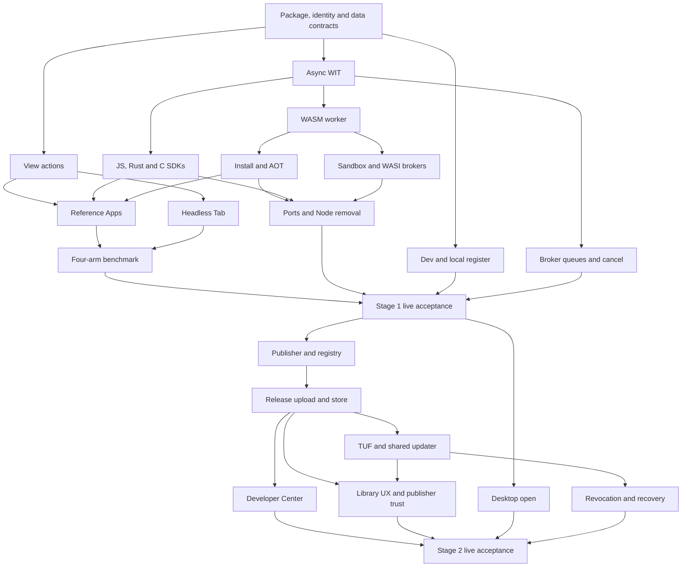

# Apps v2: one plan, two testable stages

For Miguel · 2026-10-22 · design only; Apps implementation stays **PAUSED**.

## 1. Summary

**Stage 1 — Apps v2 core: shape and functionality.** Build the portable WASM
backend, Rust/JS/C SDKs, declared agent actions, headless Tabs and the separate
dev copy. Keep local package installation and safe updates. At its end, you
can develop an App with `/app dev`, register it locally with `/app register`,
install a `.cxapp` on macOS or Linux, and watch an agent use Excalidraw and
Univer through the same functions you use. No Library account, catalogue or
publishing service is needed. Estimate: **7–9 weeks with four lanes**, including
integration and real live validation; C++ follows immediately after C.

**Stage 2 — Install and distribute.** Add the App Library, Developer Center,
opening downloaded packages, and one updater for Library and publisher feeds.
At its end, an external developer can publish without staff help, and you can
discover, install and update the App through the UI. Trust rests on publisher
identity, verified App-ID ownership, reports, withdrawal and revocation.
Automatic review is **not in the agreed stage**; discuss it before Stage 2.
Estimate: **4–6 more weeks with four lanes without review**, or **6–8 weeks
with the review service** if Miguel chooses it.

**Total: 11–15 calendar weeks without automatic review; 13–17 with it**, after
an explicit resume. These are engineering estimates including real live
acceptance, not delivery promises. The separate tracks in §3.2 are excluded.
Excalidraw first and Univer second are fixed. LaTeX comes later; its compiler
spike found a licence blocker ([TEX_APP.md](tex/TEX_APP.md)). Typst is not
planned. Windows gates neither stage and has no track in this plan.
Stage 1 ships and is testable independently before Stage 2 begins shipping.

### Decisions log

Miguel answered on **2026-10-22, 19:40–19:55 UTC**. These decisions supersede
older recommendations below and in the shape; they are not reopened in §7.

| Date | Decision | Miguel's words |
|---|---|---|
| 10-22 | Automatic review deferred until the Stage 2 discussion | “Automatic review put it in quaranteen. I'm not sure if we'll have this. We'll discuss before starting stage 2.” |
| 10-22 | Moved P2 items keep their separate tracks | “yes” |
| 10-22 | Windows is outside both stages; no Windows track here | “kernel is not yet available in windows, so no” |
| 10-22 | Source-free JS remains undecided | “needs further discussion. Put it to be discussed before starting phase 2” |
| 10-22 | Drop agent outputs to Apps and second-agent continuation; discuss App-created agents/workflows | “I don't think any of these are necessary, apart from 3 where the user might give an app access to create agents in the kernel, but it's unclear the shape of this for me.” |
| 10-22 | Use user-configured notification triggers meanwhile | “Typically the user will set up an agent with notifications coming from the app, which will trigger the agent/workflow.” |
| 10-22 | Review speed and offline policy remain proposals | “we'll discuss the shape of this before phase 2 too” |
| 10-22 | Reverse-domain App IDs with verified ownership accepted | “Ok then” |
| 10-22 | Excalidraw, then Univer; LaTeX later | “Univer sounds like a perfect fit ... univer and scalidraw for certain”; “let's leave any latex related app for later” |
| 10-22 | MPL allowed as a dependency | “Ok to the more permissive dependency” |
| 10-22 | Drop wrapped binaries, including W1/W2 | “the compiled binaries from existing programs, they don't bring anything we can't do with computer use or other tools we're building.” |

### 1.1 What exists, and what must change

Based on `wasmspike/r3` at `5c4d888b9347a93575a8412244b29650c9222799`.
The decisions in [the accepted shape, §8](APPS_V2_SHAPE.md#8-revised-migration-plan-and-your-decisions)
are inputs, with decision 12 reversed and decision 13 fixed by Miguel above.
The [async design](DESIGN.md) and [measured spike](DECISION.md) supply the runtime direction, not product acceptance.
The [old implementation plan](../../docs/CHARIOX_APPS_IMPLEMENTATION_PLAN.html)
supplies the distribution requirements reconciled below.

MP scope: **MP-11** for sandbox, signing, App capability admission and
model-visible Vault protection; **MP-08 / MP-10** when proving the same App
behavior on ordinary and managed kernels. This document closes no MP item.
It does not replace Browser/Computer, Path-1 or Docker persistence acceptance.

These are observations of the exact base above. Paths and line numbers refer
to that commit, not to a newer main or another lane's worktree.

| Existing code | Verified starting point |
|---|---|
| Package and engine | `packages/app-package/src/manifest.rs:9` defines `chariox.app.v1`; `:48` defines runtime entry/engine and `:55` admits only `Node`. WASM and a WIT-world field are new work. |
| Signed declarations | `packages/app-package/src/manifest.rs:26` already references tool/event/action files. Existing actions at `packages/app-package/src/declarations.rs:64` carry critical validation and protected effect routes, not the new view-action API. Preserve those protections when adding UI actions. |
| Archive and signing | `packages/app-package/src/archive.rs:8` fixes three control entries, including `signatures/publisher.sig`; `:19` describes canonical, uncompressed USTAR. `packages/app-package/src/lib.rs:207` verifies the Ed25519 signature; `:411` canonicalizes manifest plus inventory as signing bytes. |
| Signature extension limit | `packages/app-package/src/lib.rs:224` requires the remaining archive entries to match the inventory exactly; `:376` excludes `signatures/` from that inventory. Extra review files are **not** supported merely because a directory is called `signatures/`. |
| Generations | `packages/app-runtime/src/installation.rs:180` persists active, allocated and pending generations and an update journal; `:497` commits the prepared generation transactionally; `:756` advances the allocated counter. `:419` permits pre-commit abort, not restoring an old snapshot after accepted writes. |
| Release store | `packages/app-runtime/src/release_store.rs:1` stores immutable releases and retains the original archive. `packages/app-runtime/src/release_store/lease.rs:18` requires current signature trust before a verified lease. AOT is a new derived cache, not a new release authority. |
| Data | `packages/app-runtime/src/managed_state.rs:1` puts structured state on the kernel SQLite connection. `packages/app-runtime/src/managed_state/migration.rs:1` describes snapshot/abort recovery. `packages/app-runtime/src/worker_process/private_data.rs:15` separately defines file replacement and the 512 MiB private-volume quota. SQL rollback alone is not a multi-file rollback guarantee. |
| Publisher enrollment | `apps/kernel/src/runtime/app_publisher_control/requests.rs:17` checks session membership; `apps/kernel/src/runtime/app_publisher_control/pump.rs:239` creates the exact-key/fingerprint enrollment interaction. `packages/app-runtime/src/publisher_trust.rs:1` is local owner-scoped trust, explicitly outside Library publisher management. |
| Dev loop | `apps/cli/src/app-dev-loop.ts:40` requires an existing signing key; `:143` packs and calls install/update; `:222` finds the active installation by App ID. There is no separate dev installation in this path. `:216` still tells the user to reopen views. |
| Shared installer entry | `apps/cli/src/app-install-file.ts:54` uses the same transfer for updates; `:236` chooses `BeginAppUpdate` with the expected generation or `BeginAppInstall` for first installation. Reuse this kernel lifecycle for every acquisition route. |
| Approval seam | `apps/kernel/src/runtime/app_install_control/pump.rs:272` constructs install/update prompts. The consented-deployment route documented at `apps/kernel/src/runtime/app_install_control/requests.rs:224` is narrower than the accepted general no-repeat rule. Implement and test that rule; do not assume the dev README proves it already works. |

The Library, Developer Center and TUF delivery are requirements of old
P2.01–P2.05, not capabilities established by this local code inspection. The
old P2.03 review service is deferred to §7, not a Stage 2 prerequisite.

## 2. Stage 1 — Apps v2 core: shape and functionality

### 2.1 The deliverable

One signed `.cxapp` carries its view, backend component, declarations and
migrations. One Rust worker process per installation runs one shared component
instance, serving concurrent calls. JS/TS uses pinned QuickJS component tooling;
Rust uses WIT bindings; C ships with the callback/state-machine SDK. C++ is the
small coroutine layer immediately after C, not an excuse to defer C at launch.
Python preview and Go follow the accepted toolchain readiness rules.

Use the async `chariox:app/app@1.0.0` world from the start, with the selected
WASI 0.3 interfaces and the explicit, bounded WASI 0.2 compatibility allowlist
needed by current toolchains. Kernel calls remain brokered. No ambient network,
host filesystem, subprocess or native-library access is gained by compiling to
WASM. The worker still needs real Linux and macOS OS containment.

The worker implements streams/backpressure, cancellation and deadlines, a
bounded broker queue with 64 in flight per App, CPU slices, memory limits,
trap attribution and restart. Only manifest-declared idempotent operations may
be retried automatically after an instance loss, at most once. The SDK must
release host resources even when QuickJS abandons a response but its pending
import continues; the spike's cancellation limitation is work to resolve or
bound, not evidence of a finished SDK.

Agent actions are declared in the view and included in the signed release.
The kernel validates their schemas and executes the same view function as a
button or form, with the real actor attached. Agents get typed actions, a
bounded state snapshot, change events and a stop-on-first-error batch. `read`
and `write` do not prompt. `approval` uses the existing kernel interaction;
an existing grant or `/sudo` means zero additional prompts. Action declarations
do not create capabilities or bypass the backend's protected effect routes.
Runtime registrations must match the signed action names, schemas and effects;
an undeclared or mismatched action is rejected before invocation. Bind every
action/catalog entry to the active generation so an old Tab cannot keep authority.

When no person has the view open, the kernel opens one unprojected Chromium
Tab per installation per Room. Opening the App as a person projects that
**same Tab**. Several Rooms have separate views over the same installation's
backend; they do not share Room authority. Bindings admit an agent in another
Room to this App's declared operations, never to an unrelated Room's browser.
Use the accepted ten-minute idle policy alongside the worker; active admitted
work keeps the Tab alive, and no in-flight action is discarded by idle cleanup.
Use the current Browser display transport, including canvas/region video;
no new Selkies/noVNC path and no primary PNG polling.

### 2.2 The local development and installation flow

1. `/app dev ./app` builds a separate dev installation of the same App ID.
   The kernel creates and uses a dev identity without asking. Creating that
   identity is not publisher enrollment and not a capability approval.
2. The first dev install follows the normal capability decision. Saves with
   unchanged approved capabilities do not prompt. A capability expansion asks
   once through the shared interaction; declining preserves the working build.
3. Only the developer's Room gets automatic dev bindings. Other Rooms and
   existing registered bindings keep using the registered installation.
4. A save builds a component, packs it, stages through the normal installer,
   migrates, checks health and commits. The open DEV Tab reloads in place;
   route/scroll restoration belongs to the App with an SDK helper. Broken
   builds leave a usable prior generation and an actionable error.
5. `/app actions` and the DEV “as the agent sees it” panel expose actions,
   snapshot and undeclared-control warnings. Agent `app_dev_push` uses the
   same kernel operation as the CLI; watching source files stays client-side.
6. `/app register` packs the selected source revision with the real publisher
   key and targets the normal installation. First registration uses
   `BeginAppInstall`; replacement uses `BeginAppUpdate`. It preserves normal
   installation data, never silently replaces it with the dev copy's data,
   and does not upload anything to a Library.
7. A locally built or downloaded publisher-signed `.cxapp` installs through
   Chariox commands on another macOS/Linux kernel after normal trust and
   capability decisions. This works offline with the needed local trust.
   Desktop file associations and a browsing catalogue wait for Stage 2.

Local registration still needs a real publisher identity, enrolled once using
the existing trust flow. The no-prompt dev identity is not silently promoted
into a distributable publisher. Dev data is separate; explicit seed/reset
copies are local development conveniences, not credential or App-set transfer.
Seed only permitted App data; do not clone kernel connection grants, runtime
handles, approval tokens or credentials into a dev installation.
`chariox app pack` is the shared release build command; local `.cxapp` testing
uses the same compiler pins and verifier as register and later publication.

### 2.3 Ports, examples and comparison

Inventory the first-party Apps on the implementation base, port all shipped
ones, and retain their tools, events, integrations, permissions and data. Remove
the embedded Node backend, bootstrap and obsolete engine path in the same
completed port sequence. This does not remove Chromium's JavaScript view engine
or Node used by build tools. Existing Node packages need a rebuild; provide a
clear compatibility error and a data-preserving replacement drill.

Ship Excalidraw first and Univer sheets second (§6), with a small Todo contract
example for SDK onboarding and benchmark control. LaTeX is a later App, outside
both stages; [the completed spike](tex/TEX_APP.md) records its licence blocker.
Typst is not planned, and there is no wrapped-binary App kind.

B1 implements the accepted four-arm comparison: declared App actions,
equivalent web app plus handwritten MCP, Computer Use, and App browser-driving
without declared actions. Use Todo and Univer; record the time spent building
the competing MCP surface. Freeze ten concrete tasks and independent checkers
before measurements. Report tokens, steps, completion/failure rate, task time
and developer minutes. The accepted sampling plan is 30 runs per task per arm
for Codex `gpt-6-luna` low and Claude `claude-haiku-5-5`; reserve its budget
before execution. Do not silently reduce the sample and claim the same result.

The accepted claim gate is fewer tokens and steps than MCP and Computer Use
on every task, fewer failures and fewer developer minutes than the MCP arm.
Report ties and uncertainty honestly. A failed comparison with otherwise
working Apps leaves B1 red and blocks the public superiority claim; Miguel
decides whether to ship functionality separately. Spike timings do not prove
that claim or user-visible latency.

### 2.4 Stage 1 acceptance matrix

These are **required scenarios, all NOT RUN by this design round**. Each gets
a real executable drill, a base/failing-head result and a fixed-head result.
Use built Web and real local/remote TUI clients, the exact kernel and hosted
`wss` relay, and official real provider agents for agent scenarios. An internal
RPC or synthetic worker test supplements the drill; it does not replace it.

Required platform cells inherit the old plan's supported targets
(`docs/CHARIOX_APPS_IMPLEMENTATION_PLAN.html:1327`): macOS on Apple silicon and
Ubuntu 26.04 LTS x86_64, with real platform evidence. Extra architectures need
their own platform gate; a portable component does not certify a worker port.
Missing required hardware is an explicit coordinator ask.
Repeat installation/runtime cases on ordinary and managed placement where
released; keep the same behavior and retain MP-08/MP-10 evidence separately.

| ID | What Miguel or a validator does | Pass condition |
|---|---|---|
| S1-01 | Start from a fresh project; build JS, Rust and C Apps, install each local `.cxapp`, open its view and invoke a tool from a real agent. | One artifact per App works across the supported macOS/Linux targets; typed results, no manual runtime placement or Library. C uses the launch SDK. |
| S1-02 | Open a registered Todo, start `/app dev`, save a UI/backend change and inspect both copies from two Rooms. | DEV changes live in place; registered data, view and agents remain on the registered generation. Other Rooms do not discover DEV automatically. Record measured save→serve time per language, not the shape's estimates. |
| S1-03 | Register that change, make another unchanged-capability change, then add a network capability and decline it. | First publisher enrollment is explicit; normal data survives register; routine updates add zero prompts; the expansion has one shared interaction and denial leaves the old release usable. Dev signatures cannot install as release or be enrolled as publishers. |
| S1-04 | Bind the registered Excalidraw App to an agent in another Room; ask it to draw and label a diagram while the user watches that Room's App view. | Declared actions change the visible canvas through the UI functions; snapshots describe actual elements; actor/operation receipts agree. No access to the developer Room or its DEV view. |
| S1-05 | Ask an agent to edit an App with every human viewer closed, then open it from Web and TUI. | The unprojected Tab becomes the displayed Tab with the completed state, not a second UI instance. Closing viewers does not terminate accepted work; idle cleanup releases the Tab. |
| S1-06 | Use a human plus multiple agents on one App; also run the 64-call concurrency drill through real admission. Cancel one call and exceed the bounded queue. | No lost transactional updates, bounded queues and clear timeout/busy results; unrelated clients stay responsive. Cancellation frees broker resources; a trap names the culprit and makes other calls retryable without replaying non-idempotent effects. |
| S1-07 | Build an App from an agent in the dev Room with `app_dev_push`, inspect `/app actions`, compare the “as the agent sees it” panel and exercise a batch containing invalid input. | CLI and agent use one kernel development path. Schemas/effects match the signed manifest; batch stops at the failing action and reports completed steps without a global rollback promise. |
| S1-08 | Update while editing a real diagram/sheet; interrupt delivery, fail a migration/health check, restart the kernel at commit boundaries, and retry. | Drafts have a safe activation point; pre-commit failures retain the old working generation; accepted post-commit writes survive. Stale worker/view bridges cannot mutate. Structured and private-file data are both checked. |
| S1-09 | Trigger a legitimate `approval` action from an agent, approve/decline from a second client, repeat under an existing grant, and fill a Vault target in the view. | One kernel interaction, zero repeats with authority, correct denial/recovery. Vault-filled target and product results stay masked to the model; owner sees their own screen. No value-following masks or redaction of human typing. |
| S1-10 | Install an unknown-import/malformed component, attempt broker-forbidden network/files, exceed memory/CPU, then perform an ordinary valid action. | Stable rejection/stop reasons, no host escape or ambient authority; valid work recovers. Real Linux sandbox and macOS containment/resource evidence are present, not just WASM limits. |
| S1-11 | Upgrade existing first-party Apps and existing user data, run their actual event/wake and provider workflows, uninstall with retain/delete choices, then reinstall. | Functionality and data survive; no Node engine fallback; durable events/receipts do not duplicate or silently regain revoked grants. |
| S1-12 | In Univer, import a real CSV, change formulas/ranges, sort, save, export and reopen; in Excalidraw create, export and reopen a diagram. | Values, formulas and supported export content match independent file checks. Canvas, menus, popups and file flows are usable; no dependency on paid Univer features. |
| S1-13 | Run the public-site/display and continuity campaign below, then an 8-hour active shared-App session and a 24-hour idle/reopen session. | No stuck or blank post-commit view, lost work or duplicate worker/Tab after reconnect. Bounded memory/disk and no leaked run resources. Provider turns are short; do not loop Codex prompts throughout a soak. |
| S1-14 | Run B1's frozen four-arm tasks with recorded models, sample counts and checkers. | Full comparison table and uncertainty; the accepted public-claim gate is met, or B1 remains FAIL with the failed comparison named. |
| S1-15 | After C, repeat S1-01 and cancellation/state checks using the C++ coroutine SDK. | Same world/artifact and containment; exported errors never unwind into the host. Ships immediately after Stage 1 core without delaying launch C. |

S1-01–14 gate the core launch; S1-15 gates the immediate C++ follow-on.

For UI rows, record 1920×1080 and 1440×900 at DPR 1 plus DPR 2, fresh starts,
normal clicks/keys/scrolls, cookies/popups, tab creation/closure, navigation and
typed URLs. Watch the recordings before declaring PASS; a user getting stuck,
confused or seeing a blank frame is a failure. App function calls are the
product path for agents; acceptance must also demonstrate the human UI, not
use CDP/DOM injection to repair it.

The Browser dependency campaign covers an en.wikipedia.org article,
www.wikipedia.org portal, a github.com repository, DuckDuckGo search, BBC
News and developer.mozilla.org. Report mirror coverage, screenshots and
fallback usability per site and DPR. Assert mirror v2 before mirroring
measurements. Google is N/A for automation under the later owner decision.
Use the real hosted relay with about 8 Mbit/s client uplink and measured RTT
at least 60 ms. Input→visible P95 must be ≤ measured wire RTT + 60 ms;
streamed scrolling must sustain ≥30 fps. Apply the same transport checks to
the reference Apps, especially their canvases. Run performance with diagnostics
off on a quiet host/qualifying isolated guest; record RTT and I/O noise.

Retain exact source/binary hashes, videos, screenshots, provider/model IDs,
commands/exit codes, timing distributions, resource samples, first failing seam
and cleanup outside the repository. Missing accounts, hardware or hosted
resources are specific BLOCKED rows, never replaced by mocks. MP-11 review
covers the changed security anchors; tests alone do not close it.

## 3. Stage 2 — Install and distribute

### 3.1 The deliverable and the two routes

The Library offers browse/search/categories, detail pages, verified publisher
and App-ID ownership, capabilities, action/effect descriptions, compatibility,
releases, install/update/uninstall, reporting and availability/revocation state.
A user does not visit the Developer Center to install an App.

The Library stores deliberately published packages and publishing metadata.
It never receives runtime conversations or becomes Room/session authority;
the runtime relay remains encrypted transport and the kernel owns activation,
capabilities and running App state.

The Developer Center lets a new publisher enroll, prove its namespace, manage
team roles/keys, upload a signed release, see deterministic package/preflight
errors, select channels, stage/pause/withdraw releases, and manage support and
telemetry metadata. Connection/event ingress registration is self-service
with tenant separation, schema negotiation, replay bounds and deletion.

**Stage 2 does not require automatic review or a review attestation to publish
or install.** Publisher signatures and the shared installer still check exact
bytes, supported imports, schemas, capabilities and compatibility. These are
package/admission checks, not a claim that an App was security-reviewed.
Verified ownership identifies a publisher; it does not certify harmless code.

Trust rests on that identity and ownership, clear capabilities, user reports,
publisher withdrawal and operator revocation with recovery. Both Library and
side-install UI show the publisher and what was verified. There is no review
badge or implied verdict. Reports have visible receipt/status and operator
handling; withdrawal stops new acquisition, while revocation blocks newly
learned revoked authority. §7 keeps the possible review service and its UI
separate from this agreed delivery path.

Both routes use one trusted updater and the Stage 1 install/update coordinator.
The Library can download/stage a closed App without starting it or an agent.
Direct feeds check on human/agent opening and boundedly while event/wake work
keeps the App in use; a closed direct App does no publisher polling. Keep a
working offline release, respect manual/automatic policy and compatibility
holds, preserve drafts, and activate only at a safe point.

TUF protects release metadata freshness, rollback/freeze, channel binding and
key/threshold transitions; the publisher signature protects executable content.
Neither substitutes for the other. The reserved attestation slot adds no
review requirement; a future review verdict would be a separate trust claim.
Revocation must show an actionable incident/recovery state, preserve user data
and prevent new execution of known-revoked authority once learned. An offline
kernel cannot know a newly issued revocation; show last-known freshness and
apply the offline policy agreed before Stage 2 (§7). Do not promise immediate
global revocation or silently delete data.

### 3.2 Every old P2 workstream: disposition

“Moved” means a separate track with its own acceptance. Miguel accepted these
placements; they gate neither Apps v2 stage. Windows is excluded outright
from this plan because the kernel is not available there. Deferred review
work is collected in §7 and has no dependency edge into agreed Stage 2.

| Old row | Disposition | What carries forward and why |
|---|---|---|
| P2.01 Library | **Kept — Stage 2** | Discovery, detail, publisher/ownership trust, compatibility, lifecycle, reports and availability. No automatic-review badge or gate; WIT/engine compatibility replaces Node target variants. |
| P2.02 Developer Center | **Kept — Stage 2** | Publisher/namespace ownership, teams/keys, uploads, deterministic preflight errors, release operations and developer connection/event ingress. Review findings/resubmission UI is deferred with P2.03. |
| P2.03 Automatic security review | **To discuss before Stage 2 — §7** | No review-service dependency in agreed Stage 2. If selected later, reuse Stage 1 import/schema/signature/capability checks and add isolated artifact/dependency review, trusted attestations and verdict operations. |
| P2.04 Side install/autoinstaller | **Kept — Stage 2** | Stage 1 installs a local file through commands. Stage 2 adds desktop association and released-client open/share flows with publisher/capability presentation; no review prerequisite or second installer. |
| P2.05 Updates/channels/revocation/TUF | **Kept as is — Stage 2** | Both discovery routes, rollout, rotation, offline catch-up and incident handling. Generation activation and unchanged-capability consent belong to Stage 1 and are reused. Defer view-only hot replacement until continuity is proven. |
| P2.06 Native viewers | **Moved out — native client track, decided** | Same Chromium Tab and full input/accessibility/trusted-panel/recovery matrix; client work is independent of distribution. |
| P2.07 App-set inheritance | **Moved out — kernel provisioning/transfer track, decided** | Independent kernel creation, remapped identities and explicit data/grant copies. No credentials or durable receipts in clones. |
| P2.08 Remaining notification Apps | **Moved out — notification migration track, decided** | Stage 1 ports shipped integrations; remaining service-only sources retain generic event/wake infrastructure and parity-before-deletion. |
| P2.09 Windows sandbox | **Excluded from this plan, decided** | The kernel is not available on Windows. It gates neither stage; no Windows implementation track or estimate is included. |
| P2.10 Cross-App work | **Moved out — agents/workflows track, decided** | Keep existing bindings/workflows. New recipient-consent/provenance/recovery work is separate; agent outputs to Apps and second-agent continuation are dropped. |
| P2.11 Compiled proprietary backends | **Largely absorbed by Stage 1; simplified by WASM** | Rust/C components plus local AOT replace V8 bytecode/per-target backend builds. Keep private debug material and explicit artifact inspection limits. Source-free JS and the review-service artifact audit are in §7; AOT is not obfuscation. |
| P2.12 App outputs/continuation/assets | **Dropped in part; creation deferred — §7** | Drop agent outputs to Apps and second-agent continuation. Only App permission to create agents/workflows remains for discussion. User-configured App-event/notification triggers are the existing alternative (§3.5). |
| P2.13 Step-up authentication | **Moved out — shared authentication track, decided** | Real origins, enrollment and recovery are shared security work. Preserve kernel approval semantics, existing grants and `/sudo`; no new prompt per App action. |

### 3.3 Every old V2 validation: disposition and destination

The exact source is the old plan's Phase 2 table at lines 1680–1705. No row is
silently discarded. New scenario IDs below supplement, rather than rename,
these existing obligations. Platform follow-ons retain the old native viewer
matrix as well, including its real-device, accessibility and human-validation
requirements; supported mobile package-open flows are exercised when those
clients ship, not claimed by a desktop drill.

| Validation | Disposition / destination | Retained test or change |
|---|---|---|
| V2-DIST-01 | **Kept — Stage 2** | Identity, roles/removal/recovery, App-ID confusables/ownership, exact bytes, rotation/transfer; add local-to-Library identity and dev-key rejection. |
| V2-DIST-02 | **Kept — Stage 2** | Search/paging, compatibility, withdrawn/unavailable versions, resumable/concurrent acquisition, tampering and desktop open. Mobile open follows the released native-client gate. |
| V2-DIST-03 | **Deferred — §7, automatic review** | Disposable reviewer isolation, reviewer/harness/network attacks and trusted attestation signing apply only if the service is selected; Stage 1 package checks remain mandatory. |
| V2-DIST-04 | **Kept — Stage 2** | TUF replay/rollback/freeze/expiry/mix-and-match, threshold/rotation and explicit offline/authorized-recovery cases. |
| V2-DIST-05 | **Kept — Stage 2** | Stage/pause/withdraw/revoke/appeal/replace, offline catch-up, schemas and permission expansion; no silent revival of revoked authority. |
| V2-DIST-06 | **Kept — Stage 2** | New external publisher and connection/event ingress without staff edits; tenant, schema, replay and deletion checks. No provider SDK introduced. |
| V2-DIST-07 | **Deferred — §7, automatic review** | Every-release digest-bound verdicts, critical/security versus cosmetic handling, injection and reviewer-outage cases have no gate in agreed Stage 2. |
| V2-DIST-08 | **Deferred — §7, review speed/source-free JS** | Cold/warm review budgets, load/outage and source-inspection promises require the pre-Stage-2 discussion; no instant-verdict claim. |
| V2-DIST-09 | **Kept — Stage 2** | Library/direct parity, human/agent/event/wake use, closed Library delivery versus no closed direct polling, interruption, replay/substitution, offline/multiple kernels and grants. |
| V2-DIST-10 | **Absorbed foundation — Stage 1; rerun Stage 2** | Joint generation, drafts/workflow/agent continuity, incompatible UI/backend rejection and stale-bridge fencing. Conservative fenced replacement is sufficient; no unproven view-only optimization. |
| V2-DIST-11 | **Simplified/split — Stage 1; discussion before Stage 2** | Stage 1 proves supported SDK behavior/containment. Rust/C artifact checks retain dependencies/migrations/maps/caches/debug boundaries. Source-free JS and service-led proprietary-artifact audits move to §7 (I9/S2-05); no unverified JS promise. |
| V2-DIST-12 | **Simplified foundation — Stage 1; rerun Stage 2** | Wrong WIT/engine/cache target, malformed artifacts, patched runtime offline restart, interrupted updates and migration recovery. Recompile trusted portable components locally, never retain a vulnerable engine for its old cache. |
| V2-PLAT-01 | **Excluded — no Windows track in this plan** | Neither stage is gated by Windows. The old requirement is recorded here for traceability, not scheduled or claimed as validated. |
| V2-VIEW-01 | **Moved — native client track** | Same managed Tab/auth/viewport across supported native platforms on the separate track; Windows excluded here; reconnect/crash cannot execute a duplicate UI. |
| V2-VIEW-02 | **Moved — native client track** | VoiceOver/TalkBack/Linux accessibility, IME/touch/insets/keyboard/selection/clipboard/downloads/links/pickers. |
| V2-AUTH-01 | **Moved — shared authentication track** | Real relying-party origin/account/challenge/user verification/recovery from Web and both TUIs; a mock is not authentication evidence. |
| V2-VIEW-03 | **Moved — native + authentication tracks** | Same kernel receipts and denial/recovery/cross-client races; no synthetic human approval. |
| V2-COPY-01 | **Moved — kernel provisioning/transfer track** | Clean/package/config/data variants, explicit grants, remapped automations, unavailable connections and busy snapshots; never clone credentials/receipts/validation tokens. |
| V2-COPY-02 | **Moved — kernel provisioning/transfer track** | Independent update/uninstall/corruption/revocation, managed replacement and occurrence identities. |
| V2-MIG-01 | **Moved — notification migration track** | Migrate each remaining source through the generic contract; prove parity/recovery before deleting service-only execution/configuration. |
| V2-OPS-01 | **Kept — Stage 2, with Stage 1 runtime baseline** | Privacy/consent/support/retention/inventory/incident drills and engine patching. Distribution operations add to the core runtime evidence, not replace it. |
| V2-CROSS-01 | **Moved — agents/workflows track** | Recipient grants/revocation/extra fields, unapproved routes and source/destination operation provenance. |
| V2-CROSS-02 | **Moved — agents/workflows track** | Half-complete tasks, timeout after effects, focus/agent changes and restart; preserve ambiguity instead of duplicating mutations. |
| V2-CROSS-03 | **Narrowed/moved — agents/workflows track** | Retain focus/history and App-local visibility across Apps/clients. Second-agent continuation is dropped by Miguel; it is not a retained gate. |
| V2-VIEW-04 | **Moved — native client track** | Trusted private-panel composition/privacy/accessibility and capture/export separation from App code. |
| V2-REG-01 | **Kept — both stage gates** | Upgrade the shipped version and rerun inherited App/permission/data/event/persistence/Web/TUI guarantees on macOS/Linux. Native client validation stays on its separate track; no Windows gate here. |

### 3.4 Stage 2 acceptance matrix

All rows are **NOT RUN**. Use the same exact-build, real-client/provider,
hosted-network, platform, recording and cleanup rules as Stage 1. Distribution
must use the real deployed Library/Developer Center service and real publisher
accounts, not a local fake store. Adversarial fixtures remain
useful red-capable checks in addition to successful real-user journeys.

| ID / old validations | Concrete user journey | Pass condition |
|---|---|---|
| S2-01 / DIST-01,06 | An external developer creates a publisher/team, proves a DNS/website namespace or GitHub account, claims an App ID, uploads a signed App and registers event ingress through the Developer Center. Try a colliding/unowned ID and unauthorized teammate; compare a locally installed unchecked ID. | No staff DB changes, no publisher substitution; ownership and tenant boundaries survive rotation, removal, recovery and replay/deletion attempts. Existing local installation recognizes the same publisher/App ID. |
| S2-02 / DIST-02 | On fresh macOS and Linux clients, browse/search, inspect capabilities/actions/compatibility, install a publisher-signed reference App, run it with an agent, then uninstall. Interrupt/resume acquisition and try an unavailable release. | One active installation with accurate publisher/ownership and capability state, precise failures and normal data-retention choices; no terminal setup or Developer Center visit. |
| S2-03 / DIST-02,09 | Open a downloaded `.cxapp` through the desktop file association; install the same App directly on another kernel and select a publisher feed. | Correct publisher/digest/grants and explicit ownership/capability state; no review verdict is implied by Library or direct acquisition. Both routes use the same activation journal and recovery. |
| S2-06 / DIST-04,09 | Deliver stable/preview releases through Library and direct feed; attack metadata with replay, freeze, expiry, mixed targets and unauthorized key/channel changes. | TUF and publisher verification reject substitution; approved rotation works. Changing transport origin does not change publisher or permissions. |
| S2-07 / DIST-09,10 | Keep a diagram draft, a running App workflow and agent operation; stage a joint update via each route, add permissions, decline, then accept at a safe point. Also update a closed Library App. | No forced draft loss, mixed UI/backend or duplicate effect; unchanged permissions prompt zero times. Closed Library staging starts neither App nor agent; closed direct App never polls. |
| S2-08 / DIST-05,12 | File a user report, inspect its handling, pause rollout, withdraw/revoke a release or key, replace it, reconnect an offline kernel, and apply a wasmtime security patch while offline. | Report receipt/status and operator action; explicit incident/freshness state, preserved data/new writes, valid replacement and cache rebuild; no silent resurrection of revoked authority or indefinite vulnerable runtime fallback. |
| S2-09 / DIST-09,10; REG-01 | Start with a Stage 1 registered local App; later install/update it via the Library and direct feed on independent kernels. Interrupt/restart at download, stage and commit boundaries. | Same App identity, data, generations and grants; no reinstall into a second “Library App,” duplicate automation, or cross-kernel mutation. |
| S2-10 / OPS-01; REG-01 | Exercise incident/support/retention and runtime-patch procedures; run real local/remote TUI plus Web use through an 8-hour hosted update/reconnect session. | Redacted operational evidence, usable clients, bounded resources and complete cleanup; Stage 1 guarantees remain intact. |

“DIST-xx” above abbreviates the unchanged `V2-DIST-xx` identifiers, likewise
OPS/REG. S2-04/05 are reserved for the review discussion in §7; they are not
Stage 2 gates. Native/mobile/copy/cross-App retain their separate tracks as
accepted by Miguel. Windows is outside this plan.

### 3.5 Notifications can trigger work the user configured

An App emits an event/notification; the kernel routes it to a trigger the user
has configured for an agent or workflow. The App does not choose a new agent
or invent a workflow. The existing design makes adding a trigger to a Freeform
agent create a visible one-node workflow with origin metadata. That preserves
one trigger authority, normal queue admission, grants and durable receipts.
See the [agent-trigger design in the old plan](../../docs/CHARIOX_APPS_IMPLEMENTATION_PLAN.html#workflows)
(the “Add a trigger from Freeform” section) and the
[event trigger contract](../../docs/EVENT_TRIGGER_PROTOCOL.md#boundaries).
Giving an App permission to create agents/workflows is a separate product
question in §7; no such permission is introduced by either agreed stage.

## 4. Decisions Stage 1 must fix now

These are the shared seams. Freeze them in R0 before implementing consumers;
Stage 2 extends trust and discovery, not the runtime or installation model.
Engineering recommendations below are proposed contracts, not descriptions of
existing fields. Genuine remaining product choices are collected only in §7.

### 4.1 Package v2, declarations and signature subjects

**Choice:** retain canonical USTAR, RFC 8785 and Ed25519, but version the
manifest/envelope as `chariox.app.v2`. Add `runtime.engine: "wasm"`, the exact
WIT world, backend component entry, a signed UI action manifest with schemas
and `read / write / approval` effects, capability set and protected effect
routes. Keep compiled migration entries and SDK/toolchain build metadata.
Derive the real kernel floor from required features; do not allocate or copy
a historic protocol number. The coordinator allocates protocol changes.

Reserve bounded, typed `signatures/publisher.sig` and
`signatures/reviews/<reviewer-key-id>.json` entries now. Unknown signature
formats are rejected with a compatibility error, not interpreted as trust.
Missing review files are valid for **both stages and every delivery route**;
publisher verification is always required. A self-authored review file grants
nothing. Reserving the slot costs nothing now: no service, UI, review queue
or release gate is built for it. It avoids a later package-format change.

Define three different digests explicitly: (1) signed content digest over the
canonical manifest/inventory and all inventoried payload digests; (2) digest
of the canonical publisher-only archive, including its signature; (3) digest
of the exact delivered archive. If review is later selected, its attestation
can bind (1), (2), component digests, policy/reviewer versions, vulnerability
freshness, scope, time and verdict.
The verifier reconstructs the canonical publisher-only archive after removing
only recognized review entries to check (2). TUF binds (3). The release store
continues verifying the exact stored archive; review enrichment never mutates
an already stored archive in place. These are reserved format semantics,
not implementation of the deferred service.

This avoids a circular “attestation signs the archive containing itself” hash
and prevents an unchanged backend's review from blessing a changed UI. Review
entries are excluded from the publisher inventory by an explicit v2 grammar,
not today's hard-coded three-entry assumptions. Without the future service,
Library and direct routes both accept valid publisher-signed content under
the same trust/capability rules and neither claims a review verdict.

**Alternative:** leave v1 strict and invent a Library wrapper later. Rejected:
it would give acquisition routes different executable identity and verifier
semantics. R0 needs canonical conformance vectors, including add/remove/reorder
attestations and changed UI, before Stage 2 producers exist.

### 4.2 App ID, local registration and publisher ownership

**Choice:** keep the developer's stable App ID across dev, local registration,
direct feeds and the Library. Bind release authority to the publisher identity
and authenticated signing-key history, not a Library listing or download URL.
The local dev principal is kernel-scoped and trusted only for the dev lane of
that App; it is a distinct principal kind, never a real publisher credential.
An App cannot claim another publisher by copying its manifest name.

**Decided:** use reverse-domain App IDs with verified namespace ownership.
Prove a domain through DNS or a website challenge. Developers without a domain
can use a GitHub-account namespace, verified against the account. Local IDs are
never checked for namespace ownership and never reserve a Library name; local
signatures/capabilities are still verified. The identity claim, not a matching
display name, binds the publisher to the namespace. Library onboarding also
requires proof of the release signing key. If the ID is available, registration
preserves the App ID and publisher binding. If already claimed by a different publisher, reject with a
clear conflict; never overwrite the local installation or silently assign its
data to that publisher. Resolve through an ownership dispute or an explicit
new-ID/export/import migration. Transfers/rotations need authenticated old-to-new
trust transitions, never trust-on-name. DEV cannot bypass an existing registered
App's signer or local binding checks. Confusable/collision handling and
explicit authenticated transfer remain part of I1, not new product questions.

**Alternative:** let Library registration mint a different identity for every
local App. Rejected: it breaks installed data, tools, actions and updates at
the very moment distribution starts.

### 4.3 Dev versus update channels

**Choice:** two concepts, two fields. Installation `channel` is `dev | release`
as accepted in the shape. `updateChannel` is a separate optional subscription
(`stable | preview`) on a release installation. Acquisition source/publisher
feed is separate provenance. DEV has no remote subscription or automatic
publication. Changing stable↔preview changes selection policy, not installation
identity, private data or publisher trust.

Key local installation selection by owner, App ID and installation channel,
plus the permitted dev-Room binding. Keep the existing installation ID as the
runtime/data anchor. A second conflicting dev owner/Room must be explicit,
not accidentally selected by “first App ID match.” Saves are identified by
digest/build revision, so DEV does not require a semantic-version bump per
keystroke. Registered/distributed `(publisher, App ID, version)` identifies
immutable content; publishing different bytes at that version fails.

**Alternative:** `channel = dev | stable | preview`. Rejected: switching an
update subscription would look like moving between independent installations
and would conflate dev trust with publication policy.

### 4.4 One activation path and one approval rule

**Choice:** local file, dev push, `/app register`, Library and direct-feed
acquisition converge after verification on the same kernel staging coordinator:
`BeginAppInstall` for first creation, `BeginAppUpdate` plus expected generation
for replacement. Preserve monotonic generation allocation, signer fencing,
worker drain, snapshots, restricted migrations, health checks and atomic
catalog/view/data activation. Acquisition adapters supply bytes/provenance;
they do not write installation tables or replace workers themselves.

Compare normalized approved capabilities and protected authority. Unchanged
capabilities reuse the durable decision with no prompt. Changed action text
or an extra action within existing authority does not itself prompt; increased
capability or critical-effect authority follows the existing decision rules.
Identity enrollment/rotation and per-operation approval remain separate checks.
Revalidate at commit so concurrent changes cannot reuse stale approval.

**Alternative:** a fast dev swap and a separate Library updater. Rejected:
dev would stop testing migrations, approval and recovery that users rely on.

### 4.5 WIT versioning and Library compatibility

**Choice:** exact world in every manifest. Version 1.0 is async; minor versions
only add `@since` interfaces/functions, with compatible older imports still
linked. Signature changes/removals require a major; support two majors during
one documented deprecation window. R1 must publish that window before a second
major is released. Refuse unsupported worlds/imports before running code.
WASI 0.2 compatibility imports are explicitly enumerated and versioned, never
a wildcard that exposes sockets or new host APIs.

Library “compatible” uses the same kernel query/preflight as local install:
world/import set, contract/resource policy, minimum kernel features, available
worker and platform containment. Backend language is build metadata, not a
second runtime compatibility promise. A remote catalogue cannot override a
kernel incompatibility result. Dropping support requires clear advance notice
and a replacement path, not silently keeping a vulnerable engine.

**Alternative:** use `sdkVersion` or OS target strings alone. Rejected: neither
describes the component's actual import contract or safety requirements.

### 4.6 AOT cache and runtime security updates

**Choice:** ship portable components, never trust uploaded `.cwasm`. The
kernel derives AOT locally in a separate protected cache keyed by component
digest, exact wasmtime/worker build, engine configuration, target triple and
CPU-feature policy. Record its source release; verify trusted component bytes
before compiling and cache provenance/integrity before deserializing. Identical
trusted components may reuse a cache across releases; a cache never conveys
publisher/review trust or substitutes for full-release verification.

A wasmtime/worker security update invalidates every old-build cache entry.
Recompile from retained verified components, including offline. Do not load
stale serialized native code or retain a vulnerable worker because precompile
failed. Report a recoverable incompatibility/build error and keep data safe.
Cache eviction does not uninstall an App. AOT is the expected local activation
step; it does not compile developer source, run npm hooks or fetch toolchains.

**Alternative:** distribute per-platform AOT artifacts or key only by App
version. Rejected: this restores target builds, stale native-code trust and
the runtime-upgrade coupling WASM was meant to remove.

### 4.7 Data, migrations and accepted work

**Choice:** durable data belongs to installation identity, not a component
instance, release digest or subscription. Dev and release have separate data.
In-memory state is disposable on swap/trap; use kernel state/private files for
durability. Declare a data schema and ordered migration chain, compile the
migration world, restrict it from network/agents/workflows/other Apps, and fence
all old writers before staging. Checkpoint/snapshot structured state **and**
private-volume state with an explicit recovery journal; prove both on macOS
and Linux. Do not infer file rollback from SQL transaction tests.

Before commit, failed migration/startup restores the prior data and working
release. After commit, new writes/effect history cannot be discarded to make a
rollback look successful: recovery needs a compatible forward/reverse migration
or a clearly blocked repair preserving data. Keep event identities, dedupe
receipts and external-effect records outside rollbackable App data. Hold an
update rather than discard an unsaved draft. Uninstall asks retain/delete;
reinstall never silently restores old grants or automations.

**Alternative:** release-specific data directories with snapshot restoration
on every error. Rejected: switching channels or recovering after new writes
would lose accepted human/agent work.

## 5. Dependencies, PRs and staffing

All sizes are estimates for one lane: **S = 1–2 days, M = 3–5 days,
L = 5–10 days**. Each implementation PR includes focused fail-first tests and
its real-path drill; integration/review and multi-platform availability add
calendar time. The rows preserve the shape's IDs; R0 and I* are additions.
These are a resume plan, not permission to resume implementation or trigger CI.

### 5.1 Stage 1 PR list

| ID | Scope | Size | Dependencies |
|---|---|---|---|
| R0 | Freeze §4 package/identity/channel/data contracts, canonical vectors and protocol allocation request | S | — |
| R1 | Async WIT 1.0, import/export allowlist and compatibility vectors | S | R0 |
| R2 | Bounded kernel broker queues, 64 in flight, cancel/resource ownership and protocol drill | M | R1; integrates R3 |
| R3 | Rust async worker: streams, deadlines/slices, trap attribution, OOM/restart, `check`/precompile | L | R1 |
| R4 | WASM verification/install/native launch and protected AOT cache | L | R0, R3; release gate includes R5/R6 |
| R5 | Linux and macOS worker containment, executable-memory policy, quotas and hostile corpus | M | R3 |
| R6 | Broker-backed WASI HTTP, data/tmp preopens, compatibility imports and migration world | M | R1, R3 |
| L1 | Pinned QuickJS toolchain, JS polyfills/SDK/packer and Rust SDK/templates | L | R1; real drills R4/R6 |
| L2 | C task/state-machine SDK, JSON/helpers, cancellation and template | M | R1; real drills R4/R6 |
| L3 | C++ coroutine headers/template; follow C immediately | S | L2; not launch-C dependency |
| D1 | Separate dev installation/identity, no-repeat approvals, register, generation reload and save timings | M | R0; WASM completion R4/L1 |
| D2 | Kernel dev push and agent tool, CLI watch adapter | M | D1, L1; real agent drill R4 |
| A1 | View SDK actions/state/changes/markup and signed manifest agreement | M | R0 |
| A2 | Actor-bound CDP action bridge, per-view queue, runtime MCP action/state/batch catalog | L | A1; real WASM flow R4/L1 |
| A3 | Unprojected Tab lifecycle, human adoption, idle/reconnect and measured cost | M | A2 |
| A4 | `/app actions`, DEV agent-view panel and coverage warnings | S | A1, D1 |
| P1 | Port shipped first-party Apps, preserve data/events, delete Node backend and obsolete bootstrap | M + S | R2, R4, R5, R6, L1/L2 |
| X1 | Excalidraw reference App and real diagram/export drills | M | A2, L1, R4/R6 |
| X2 | Univer sheets reference App and CSV/formula/export drills | M | A2, L1, R4/R6; can start alongside X1 |
| B1 | Frozen four-arm benchmark harness and full budgeted run/report | S harness + M execution/analysis | A3, X1, X2, Todo; not X1 alone |
| G1 | Exact-head Stage 1 matrix, platform evidence, security-anchor review and cleanup | M–L | Core rows above; L3 follows immediately |

Miguel dropped W1/W2 and the wrapped-binary kind on 10-22; they have no work,
dependency or estimate here. Python preview/Go remain separate follow-ons.

### 5.2 Stage 2 PR list — without automatic review

| ID | Scope | Size | Dependencies / old rows |
|---|---|---|---|
| I1 | Registry identity, DNS/website/GitHub namespace proofs, publisher/team roles and key transitions | L | R0/G1; P2.02 |
| I2 | Resumable immutable upload/store, signed release metadata, dependency inventory and version/channel bindings | M | I1, package v2; P2.01/02 |
| I4 | Developer Center: onboarding, ingress, upload/preflight errors, versions/rollout/support | L | I1/I2; P2.02; review UI deferred to §7 |
| I5 | TUF metadata/trust, Library/direct acquisition and one kernel updater policy | L | I1/I2, G1 generations; P2.05; no I3 dependency |
| I6 | Library browse/search/detail, publisher/ownership/capability trust, compatibility/install/update/uninstall/reports | L | I2/I5; P2.01; review state/badges deferred to §7 |
| I7 | Desktop `.cxapp` association/open flow and publisher/capability installer UX | M | G1, v2 trust UI; P2.04 |
| I8 | Reports and operator handling, rollout, withdrawal/revocation, key rotation, offline recovery and operations | L | I5, I4/I6 report/release surfaces; P2.05 and V2-OPS-01; no I3 dependency |
| G2 | Both routes' exact-head live matrix, shipped-version upgrade/regression, independent security-anchor review and cleanup | M–L | I1/I2/I4–I8; Stage 1 rerun; offline policy settled before implementation |

I3/I9 are intentionally absent from this stage; §7 retains them if review is
chosen. An independent implementation/security review is still required for
Chariox's own changes; it is different from an automatic App-release service.

### 5.3 Graph and critical path

With four lanes after R0/R1: one owns worker/install, one SDKs and ports,
one actions/headless/examples, one dev/approval plus containment and platform
validation. Use explicit handoffs for R5/R6 so OS containment is not left until
the last week; the SDK lane can help with X2 when L1/L2 integrate. The runtime
path R1→R3→R4→P1/G1 is approximately 4–6 weeks before acceptance slack.
Actions/headless, D1/D2, both reference Apps and B1 can become equally critical;
their complete integration makes Stage 1 **7–9 weeks**, rather than treating
the shape's approximate six-week runtime path as the entire delivery.

Stage 2 without review uses up to four lanes: publisher/store/Developer
Center; updater/TUF; Library/desktop UX; reports/incidents and live validation.
I1→I2→I4/I6→G2 and I2→I5→I8→G2 are the likely **4–6-week** critical paths.
There is no hidden reviewer dependency. If automatic review is selected,
I2→I3→I6/G2 and I9 add about **two calendar weeks**, for **6–8 weeks**.
UI shells and drill design can start against frozen contracts; mocked flows
do not count as completion. Before Stage 2, settle §7 and re-estimate any
changed scope. B1 provider sampling needs its budget reserved before execution.

Rough effort is **90–125 lane-days for Stage 1**, **60–80 for Stage 2 without
review**, or **80–110 with review**. Four lanes supply 20 lane-days/week before
integration, platform access and acceptance slack. These estimates explain
calendar ranges, not additive per-PR promises. The total is **11–15 weeks
without review**, or **13–17 with review**, with Stage 1 unchanged. After each
milestone, reconcile actual results and re-estimate.

## 6. Licence rule and example Apps

**Decided:** first-party Apps use permissive code (MIT, BSD, Apache-2.0 or
public-domain equivalents); **MPL is allowed as a dependency**, as Miguel
accepted in the shape. MPL is weak copyleft, not a permissive licence; comply
with its file-level source/notice obligations when used. Preserve notices and
required licence texts for dependencies, fonts, assets, codecs and compilers.
Pin exact revisions and inspect the full inventory before shipping. No GPL/AGPL
bundle qualifies; compiling or downloading it as WASM does not change its terms.

- **Excalidraw is the first reference App.** Use its MIT web component, scene
  persistence/files and declared diagram actions. Inspect selected assets and
  dependencies when pinning the implementation.
- **Univer sheets is the second reference App.** Use the Apache-2.0 core,
  excluding proprietary Pro features. Launch scope is workbook state,
  ranges/formulas, CSV and verified export support. XLSX needs a separately
  chosen permitted dependency and round-trip tests; a core licence does not
  grant rights to Pro import/export or collaboration.
- **LaTeX comes later**, outside both stages and their estimates. The
  [completed compiler spike](tex/TEX_APP.md) built Tectonic as a component and
  measured real documents, but found linked GPL-2.0+ PDF-engine code and
  CPL/LGPL TECkit code. The top-level MIT label does not clear that engine;
  allowing an MPL dependency does not cure the blocker. The report also lists
  integration gaps; it is not a finished App or real-user acceptance.
- **Typst is not planned now.** Its spike comparison remains research, not
  an extra example or a replacement for LaTeX. Todo is a small SDK/benchmark
  control, not a third major product App. The wrapped-binary App kind is dropped.

The candidate inventory comes from the accepted shape and LaTeX spike. This
round does not claim a fresh upstream audit or clearance of a final lockfile;
shipping requires the actual pinned inventory.

## 7. To discuss before stage 2

These four topics remain open. They do not reopen Stage 1 or the accepted
placements, IDs, examples and licence rule. Resolve the affected policy before
Stage 2 implementation; automatic review is optional, not presumed approved.

1. **Automatic review of every release (P2.03).** Miguel: “Automatic review put
   it in quaranteen. I'm not sure if we'll have this. We'll discuss before
   starting stage 2.” The agreed Stage 2 works without it (§3/§5). Its trust
   model is publisher identity, verified ownership, reports, withdrawal and
   revocation. If selected, add the work below: isolated artifact/dependency
   probes plus reused package checks, no routine human queue, a trusted
   attestation signer and visible failure/retry states. A model's prose or an
   App's instructions cannot issue a passing attestation. This is **2 more
   calendar weeks**, making Stage 2 **6–8 instead of 4–6 weeks**, subject to
   the final scope. The §4.1 signature slot is reserved either way and costs
   nothing now; there is no later package-format migration to add review.
2. **Source-free JS distribution.** Miguel: “needs further discussion. Put it
   to be discussed before starting phase 2”. Compiling QuickJS into WASM or
   caching AOT does not establish source exclusion. Recommend promising it
   only for toolchains whose final artifacts pass the audit, initially
   compiled Rust/C; do not extend that promise to JS without evidence. Decide
   whether JS needs a launch guarantee and re-estimate if so. No claim of
   protection against reverse engineering, and no source upload is required
   by the agreed publisher-signed release flow.
3. **Review speed and offline policy.** Miguel: “we'll discuss the shape of
   this before phase 2 too”. If review is chosen, proposed verdict budgets
   remain warm p95 ≤60 s and cold p95 ≤180 s at ten concurrent typical uploads
   of ≤10 MiB; record upload/queue/check/model times separately and publish a
   size/load curve for larger packages. These are proposals, not commitments
   or measurements. **Offline-metadata proposal:** expired metadata blocks
   new acquisition/activation, while a previously verified, not-known-revoked
   installed release remains usable offline with freshness shown. Known
   revocation blocks execution and keeps data recoverable. This policy needs
   agreement even without review; it never relaxes TUF metadata validation.
4. **Apps creating agents/workflows.** Miguel sees a possible permission for
   this, but the shape is unclear. Discuss the user grant, requested creation
   and lifecycle before adding authority. **Agent outputs to Apps and
   second-agent continuation are dropped**, not postponed. The existing
   alternative is App events/notifications → a user-configured agent/workflow
   trigger (§3.5), with normal kernel admission and receipts.

### Deferred review work — only if selected

This is the holding list, not an additional Stage 2 gate. IDs are retained so
nothing from the old plan is silently counted as done.

| Work | Scope if review is selected | Estimate / dependencies |
|---|---|---|
| P2.03 / I3 | Isolated automatic reviewer, reused package checks, artifact/dependency probes, trusted attestation signer, outage/retry states | L; I2 and R1/R4/R5 |
| I9 | Service-led proprietary/source-exclusion audit, cold/warm publish-load budgets and reviewer-outage campaign | M; I3/I4; discussion topics 2/3 |
| Review part of I4 | Developer Center findings, review status, repair/resubmit and verdict operations | Included in review increment; I3 |
| Review part of I6 | Library review state/badges and verdict-based delivery policy, if agreed | Included in review increment; I3/I5 |
| V2-DIST-03 | Reviewer isolation, harness/network attacks and trusted attestation signing | Retain old hostile cases; reuse Stage 1 deterministic checks |
| V2-DIST-07 | Every initial/backend/UI/dependency release gets a digest-bound verdict; security/critical versus advisory handling; injection/outage cannot forge approval | I3 plus reviewed release/Library integration |
| V2-DIST-08 | Review speed/load/outage, no-source artifact inspection and honest limits | I9; agreed budgets and source-free scope |

| Deferred scenario | Concrete journey | Conditional pass criteria |
|---|---|---|
| S2-04 / DIST-03,07 | Publish initial, backend, UI-only and dependency changes, security/critical/cosmetic cases and reviewer-injection attempts. | Every Library digest has a structured verdict from the trusted service; security/critical cases block, advisory cases do not. Timeout/scanner/model failure shows pending/retry, never success. |
| S2-05 / DIST-08,11 | Publish a proprietary compiled App without backend source; inspect package/installed artifacts and measure warm/cold revisions at agreed load. | Dependency/migration/maps/caches audit and explicit source-exclusion scope; portable artifact binding and inspection limits; p50/p95 meet the agreed budgets. No source-free JS PASS without evidence. |

Both deferred scenarios are **NOT RUN**. They become acceptance gates only if
the service/scope is selected; the base Stage 2 matrix has eight rows.
