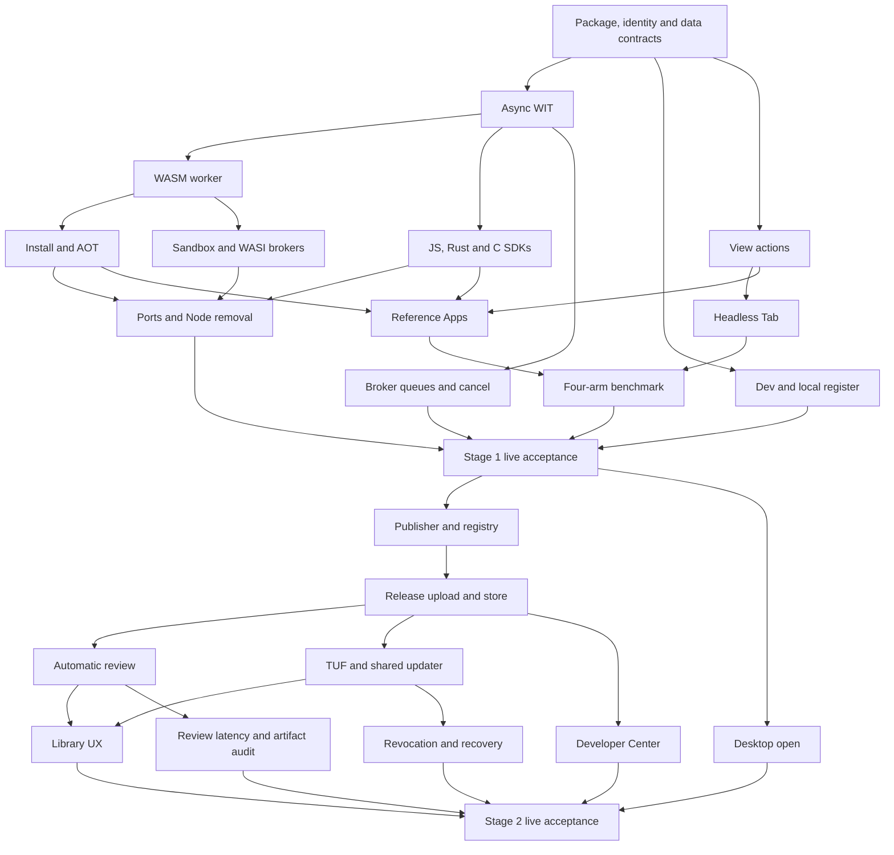

# Apps v2: one plan, two testable stages

For Miguel · 2026-10-22 · design only; Apps implementation stays **PAUSED**.

## 1. Summary

**Stage 1 — Apps v2 core: shape and functionality.** Build the portable WASM
backend, Rust/JS/C SDKs, declared agent actions, headless Tabs and the separate
dev copy. Keep local package installation and safe updates. At its end, you
can develop an App with `/app dev`, register it locally with `/app register`,
install a `.cxapp` on macOS or Linux, and watch an agent use Excalidraw and
Univer through the same functions you use. No Library account, catalogue or
publishing service is needed. Estimate: **7–9 weeks with four lanes**, including
integration and real live validation; C++ follows immediately after C.

**Stage 2 — Install and distribute.** Add the App Library, Developer Center,
automatic review of every release, opening downloaded packages, and one
updater for Library and publisher feeds. At its end, an external developer
can publish without staff help or source upload, and you can discover,
install and update that App through the UI. Channels, revoked releases,
offline operation and recovery use Stage 1's installer and generations.
Estimate: **6–8 more weeks with four lanes**.

**Total: 13–17 calendar weeks after an explicit resume**, an engineering
estimate, not a delivery promise. This includes both stages' acceptance;
it excludes the separate platform/product tracks listed in §3.3. A LaTeX App
is **pending texspike** and is not hidden inside that estimate. Stage 1 ships
and is testable independently before Stage 2 begins shipping.

### 1.1 What exists, and what must change

Based on `wasmspike/r3` at `5c4d888b9347a93575a8412244b29650c9222799`.
All 14 decisions in [the accepted shape, §8](APPS_V2_SHAPE.md#8-revised-migration-plan-and-your-decisions)
are inputs, not questions reopened here. The [async design](DESIGN.md) and
[measured spike](DECISION.md) supply the runtime direction, not product acceptance.
The [old implementation plan](../../docs/CHARIOX_APPS_IMPLEMENTATION_PLAN.html)
supplies the distribution requirements reconciled below.

MP scope: **MP-11** for sandbox, signing, App capability admission and
model-visible Vault protection; **MP-08 / MP-10** when proving the same App
behavior on ordinary and managed kernels. This document closes no MP item.
It does not replace Browser/Computer, Path-1 or Docker persistence acceptance.

These are observations of the exact base above. Paths and line numbers refer
to that commit, not to a newer main or another lane's worktree.

| Existing code | Verified starting point |
|---|---|
| Package and engine | `packages/app-package/src/manifest.rs:9` defines `chariox.app.v1`; `:48` defines runtime entry/engine and `:55` admits only `Node`. WASM and a WIT-world field are new work. |
| Signed declarations | `packages/app-package/src/manifest.rs:26` already references tool/event/action files. Existing actions at `packages/app-package/src/declarations.rs:64` carry critical validation and protected effect routes, not the new view-action API. Preserve those protections when adding UI actions. |
| Archive and signing | `packages/app-package/src/archive.rs:8` fixes three control entries, including `signatures/publisher.sig`; `:19` describes canonical, uncompressed USTAR. `packages/app-package/src/lib.rs:207` verifies the Ed25519 signature; `:411` canonicalizes manifest plus inventory as signing bytes. |
| Signature extension limit | `packages/app-package/src/lib.rs:224` requires the remaining archive entries to match the inventory exactly; `:376` excludes `signatures/` from that inventory. Extra review files are **not** supported merely because a directory is called `signatures/`. |
| Generations | `packages/app-runtime/src/installation.rs:180` persists active, allocated and pending generations and an update journal; `:497` commits the prepared generation transactionally; `:756` advances the allocated counter. `:419` permits pre-commit abort, not restoring an old snapshot after accepted writes. |
| Release store | `packages/app-runtime/src/release_store.rs:1` stores immutable releases and retains the original archive. `packages/app-runtime/src/release_store/lease.rs:18` requires current signature trust before a verified lease. AOT is a new derived cache, not a new release authority. |
| Data | `packages/app-runtime/src/managed_state.rs:1` puts structured state on the kernel SQLite connection. `packages/app-runtime/src/managed_state/migration.rs:1` describes snapshot/abort recovery. `packages/app-runtime/src/worker_process/private_data.rs:15` separately defines file replacement and the 512 MiB private-volume quota. SQL rollback alone is not a multi-file rollback guarantee. |
| Publisher enrollment | `apps/kernel/src/runtime/app_publisher_control/requests.rs:17` checks session membership; `apps/kernel/src/runtime/app_publisher_control/pump.rs:239` creates the exact-key/fingerprint enrollment interaction. `packages/app-runtime/src/publisher_trust.rs:1` is local owner-scoped trust, explicitly outside Library publisher management. |
| Dev loop | `apps/cli/src/app-dev-loop.ts:40` requires an existing signing key; `:143` packs and calls install/update; `:222` finds the active installation by App ID. There is no separate dev installation in this path. `:216` still tells the user to reopen views. |
| Shared installer entry | `apps/cli/src/app-install-file.ts:54` uses the same transfer for updates; `:236` chooses `BeginAppUpdate` with the expected generation or `BeginAppInstall` for first installation. Reuse this kernel lifecycle for every acquisition route. |
| Approval seam | `apps/kernel/src/runtime/app_install_control/pump.rs:272` constructs install/update prompts. The consented-deployment route documented at `apps/kernel/src/runtime/app_install_control/requests.rs:224` is narrower than the accepted general no-repeat rule. Implement and test that rule; do not assume the dev README proves it already works. |

The Library, Developer Center, review service and TUF delivery are requirements
of old P2.01–P2.05, not capabilities established by this local code inspection.

## 2. Stage 1 — Apps v2 core: shape and functionality

### 2.1 The deliverable

One signed `.cxapp` carries its view, backend component, declarations and
migrations. One Rust worker process per installation runs one shared component
instance, serving concurrent calls. JS/TS uses pinned QuickJS component tooling;
Rust uses WIT bindings; C ships with the callback/state-machine SDK. C++ is the
small coroutine layer immediately after C, not an excuse to defer C at launch.
Python preview and Go follow the accepted toolchain readiness rules.

Use the async `chariox:app/app@1.0.0` world from the start, with the selected
WASI 0.3 interfaces and the explicit, bounded WASI 0.2 compatibility allowlist
needed by current toolchains. Kernel calls remain brokered. No ambient network,
host filesystem, subprocess or native-library access is gained by compiling to
WASM. The worker still needs real Linux and macOS OS containment.

The worker implements streams/backpressure, cancellation and deadlines, a
bounded broker queue with 64 in flight per App, CPU slices, memory limits,
trap attribution and restart. Only manifest-declared idempotent operations may
be retried automatically after an instance loss, at most once. The SDK must
release host resources even when QuickJS abandons a response but its pending
import continues; the spike's cancellation limitation is work to resolve or
bound, not evidence of a finished SDK.

Agent actions are declared in the view and included in the signed release.
The kernel validates their schemas and executes the same view function as a
button or form, with the real actor attached. Agents get typed actions, a
bounded state snapshot, change events and a stop-on-first-error batch. `read`
and `write` do not prompt. `approval` uses the existing kernel interaction;
an existing grant or `/sudo` means zero additional prompts. Action declarations
do not create capabilities or bypass the backend's protected effect routes.
Runtime registrations must match the signed action names, schemas and effects;
an undeclared or mismatched action is rejected before invocation. Bind every
action/catalog entry to the active generation so an old Tab cannot keep authority.

When no person has the view open, the kernel opens one unprojected Chromium
Tab per installation per Room. Opening the App as a person projects that
**same Tab**. Several Rooms have separate views over the same installation's
backend; they do not share Room authority. Bindings admit an agent in another
Room to this App's declared operations, never to an unrelated Room's browser.
Use the accepted ten-minute idle policy alongside the worker; active admitted
work keeps the Tab alive, and no in-flight action is discarded by idle cleanup.
Use the current Browser display transport, including canvas/region video;
no new Selkies/noVNC path and no primary PNG polling.

### 2.2 The local development and installation flow

1. `/app dev ./app` builds a separate dev installation of the same App ID.
   The kernel creates and uses a dev identity without asking. Creating that
   identity is not publisher enrollment and not a capability approval.
2. The first dev install follows the normal capability decision. Saves with
   unchanged approved capabilities do not prompt. A capability expansion asks
   once through the shared interaction; declining preserves the working build.
3. Only the developer's Room gets automatic dev bindings. Other Rooms and
   existing registered bindings keep using the registered installation.
4. A save builds a component, packs it, stages through the normal installer,
   migrates, checks health and commits. The open DEV Tab reloads in place;
   route/scroll restoration belongs to the App with an SDK helper. Broken
   builds leave a usable prior generation and an actionable error.
5. `/app actions` and the DEV “as the agent sees it” panel expose actions,
   snapshot and undeclared-control warnings. Agent `app_dev_push` uses the
   same kernel operation as the CLI; watching source files stays client-side.
6. `/app register` packs the selected source revision with the real publisher
   key and targets the normal installation. First registration uses
   `BeginAppInstall`; replacement uses `BeginAppUpdate`. It preserves normal
   installation data, never silently replaces it with the dev copy's data,
   and does not upload anything to a Library.
7. A locally built or downloaded publisher-signed `.cxapp` installs through
   Chariox commands on another macOS/Linux kernel after normal trust and
   capability decisions. This works offline with the needed local trust.
   Desktop file associations and a browsing catalogue wait for Stage 2.

Local registration still needs a real publisher identity, enrolled once using
the existing trust flow. The no-prompt dev identity is not silently promoted
into a distributable publisher. Dev data is separate; explicit seed/reset
copies are local development conveniences, not credential or App-set transfer.
Seed only permitted App data; do not clone kernel connection grants, runtime
handles, approval tokens or credentials into a dev installation.
`chariox app pack` is the shared release build command; local `.cxapp` testing
uses the same compiler pins and verifier as register and later publication.

### 2.3 Ports, examples and comparison

Inventory the first-party Apps on the implementation base, port all shipped
ones, and retain their tools, events, integrations, permissions and data. Remove
the embedded Node backend, bootstrap and obsolete engine path in the same
completed port sequence. This does not remove Chromium's JavaScript view engine
or Node used by build tools. Existing Node packages need a rebuild; provide a
clear compatibility error and a data-preserving replacement drill.

Ship Excalidraw first and Univer sheets second (§6), with a small Todo contract
example for SDK onboarding and benchmark control. The Overleaf-like LaTeX
candidate remains **pending texspike**. Do not call Typst “LaTeX compatibility”
or add a native compiler sidecar to make the WASM example appear complete.

B1 implements the accepted four-arm comparison: declared App actions,
equivalent web app plus handwritten MCP, Computer Use, and App browser-driving
without declared actions. Use Todo and Univer; record the time spent building
the competing MCP surface. Freeze ten concrete tasks and independent checkers
before measurements. Report tokens, steps, completion/failure rate, task time
and developer minutes. The accepted sampling plan is 30 runs per task per arm
for Codex `gpt-6-luna` low and Claude `claude-haiku-5-5`; reserve its budget
before execution. Do not silently reduce the sample and claim the same result.

The accepted claim gate is fewer tokens and steps than MCP and Computer Use
on every task, fewer failures and fewer developer minutes than the MCP arm.
Report ties and uncertainty honestly. A failed comparison with otherwise
working Apps leaves B1 red and blocks the public superiority claim; Miguel
decides whether to ship functionality separately. Spike timings do not prove
that claim or user-visible latency.

### 2.4 Stage 1 acceptance matrix

These are **required scenarios, all NOT RUN by this design round**. Each gets
a real executable drill, a base/failing-head result and a fixed-head result.
Use built Web and real local/remote TUI clients, the exact kernel and hosted
`wss` relay, and official real provider agents for agent scenarios. An internal
RPC or synthetic worker test supplements the drill; it does not replace it.

Required platform cells inherit the old plan's supported targets
(`docs/CHARIOX_APPS_IMPLEMENTATION_PLAN.html:1327`): macOS on Apple silicon and
Ubuntu 26.04 LTS x86_64, with real platform evidence. Extra architectures need
their own platform gate; a portable component does not certify a worker port.
Missing required hardware is an explicit coordinator ask.
Repeat installation/runtime cases on ordinary and managed placement where
released; keep the same behavior and retain MP-08/MP-10 evidence separately.

| ID | What Miguel or a validator does | Pass condition |
|---|---|---|
| S1-01 | Start from a fresh project; build JS, Rust and C Apps, install each local `.cxapp`, open its view and invoke a tool from a real agent. | One artifact per App works across the supported macOS/Linux targets; typed results, no manual runtime placement or Library. C uses the launch SDK. |
| S1-02 | Open a registered Todo, start `/app dev`, save a UI/backend change and inspect both copies from two Rooms. | DEV changes live in place; registered data, view and agents remain on the registered generation. Other Rooms do not discover DEV automatically. Record measured save→serve time per language, not the shape's estimates. |
| S1-03 | Register that change, make another unchanged-capability change, then add a network capability and decline it. | First publisher enrollment is explicit; normal data survives register; routine updates add zero prompts; the expansion has one shared interaction and denial leaves the old release usable. Dev signatures cannot install as release or be enrolled as publishers. |
| S1-04 | Bind the registered Excalidraw App to an agent in another Room; ask it to draw and label a diagram while the user watches that Room's App view. | Declared actions change the visible canvas through the UI functions; snapshots describe actual elements; actor/operation receipts agree. No access to the developer Room or its DEV view. |
| S1-05 | Ask an agent to edit an App with every human viewer closed, then open it from Web and TUI. | The unprojected Tab becomes the displayed Tab with the completed state, not a second UI instance. Closing viewers does not terminate accepted work; idle cleanup releases the Tab. |
| S1-06 | Use a human plus multiple agents on one App; also run the 64-call concurrency drill through real admission. Cancel one call and exceed the bounded queue. | No lost transactional updates, bounded queues and clear timeout/busy results; unrelated clients stay responsive. Cancellation frees broker resources; a trap names the culprit and makes other calls retryable without replaying non-idempotent effects. |
| S1-07 | Build an App from an agent in the dev Room with `app_dev_push`, inspect `/app actions`, compare the “as the agent sees it” panel and exercise a batch containing invalid input. | CLI and agent use one kernel development path. Schemas/effects match the signed manifest; batch stops at the failing action and reports completed steps without a global rollback promise. |
| S1-08 | Update while editing a real diagram/sheet; interrupt delivery, fail a migration/health check, restart the kernel at commit boundaries, and retry. | Drafts have a safe activation point; pre-commit failures retain the old working generation; accepted post-commit writes survive. Stale worker/view bridges cannot mutate. Structured and private-file data are both checked. |
| S1-09 | Trigger a legitimate `approval` action from an agent, approve/decline from a second client, repeat under an existing grant, and fill a Vault target in the view. | One kernel interaction, zero repeats with authority, correct denial/recovery. Vault-filled target and product results stay masked to the model; owner sees their own screen. No value-following masks or redaction of human typing. |
| S1-10 | Install an unknown-import/malformed component, attempt broker-forbidden network/files, exceed memory/CPU, then perform an ordinary valid action. | Stable rejection/stop reasons, no host escape or ambient authority; valid work recovers. Real Linux sandbox and macOS containment/resource evidence are present, not just WASM limits. |
| S1-11 | Upgrade existing first-party Apps and existing user data, run their actual event/wake and provider workflows, uninstall with retain/delete choices, then reinstall. | Functionality and data survive; no Node engine fallback; durable events/receipts do not duplicate or silently regain revoked grants. |
| S1-12 | In Univer, import a real CSV, change formulas/ranges, sort, save, export and reopen; in Excalidraw create, export and reopen a diagram. | Values, formulas and supported export content match independent file checks. Canvas, menus, popups and file flows are usable; no dependency on paid Univer features. |
| S1-13 | Run the public-site/display and continuity campaign below, then an 8-hour active shared-App session and a 24-hour idle/reopen session. | No stuck or blank post-commit view, lost work or duplicate worker/Tab after reconnect. Bounded memory/disk and no leaked run resources. Provider turns are short; do not loop Codex prompts throughout a soak. |
| S1-14 | Run B1's frozen four-arm tasks with recorded models, sample counts and checkers. | Full comparison table and uncertainty; the accepted public-claim gate is met, or B1 remains FAIL with the failed comparison named. |
| S1-15 | After C, repeat S1-01 and cancellation/state checks using the C++ coroutine SDK. | Same world/artifact and containment; exported errors never unwind into the host. Ships immediately after Stage 1 core without delaying launch C. |

S1-01–14 gate the core launch; S1-15 gates the immediate C++ follow-on.

For UI rows, record 1920×1080 and 1440×900 at DPR 1 plus DPR 2, fresh starts,
normal clicks/keys/scrolls, cookies/popups, tab creation/closure, navigation and
typed URLs. Watch the recordings before declaring PASS; a user getting stuck,
confused or seeing a blank frame is a failure. App function calls are the
product path for agents; acceptance must also demonstrate the human UI, not
use CDP/DOM injection to repair it.

The Browser dependency campaign covers an en.wikipedia.org article,
www.wikipedia.org portal, a github.com repository, DuckDuckGo search, BBC
News and developer.mozilla.org. Report mirror coverage, screenshots and
fallback usability per site and DPR. Assert mirror v2 before mirroring
measurements. Google is N/A for automation under the later owner decision.
Use the real hosted relay with about 8 Mbit/s client uplink and measured RTT
at least 60 ms. Input→visible P95 must be ≤ measured wire RTT + 60 ms;
streamed scrolling must sustain ≥30 fps. Apply the same transport checks to
the reference Apps, especially their canvases. Run performance with diagnostics
off on a quiet host/qualifying isolated guest; record RTT and I/O noise.

Retain exact source/binary hashes, videos, screenshots, provider/model IDs,
commands/exit codes, timing distributions, resource samples, first failing seam
and cleanup outside the repository. Missing accounts, hardware or hosted
resources are specific BLOCKED rows, never replaced by mocks. MP-11 review
covers the changed security anchors; tests alone do not close it.

## 3. Stage 2 — Install and distribute

### 3.1 The deliverable and the two routes

The Library offers browse/search/categories, detail pages, publisher identity,
capabilities, action/effect descriptions, compatibility, releases, review state,
install/update/uninstall, reporting and availability/revocation state. A user
does not visit the Developer Center to install an App.

The Library stores deliberately published packages and publishing metadata.
It never receives runtime conversations or becomes Room/session authority;
the runtime relay remains encrypted transport and the kernel owns activation,
capabilities and running App state.

The Developer Center lets a new publisher enroll, reserve an App ID, manage
team roles/keys, upload a signed release, see preflight/review findings, repair
and resubmit, select channels, stage/pause/withdraw releases, and manage support
and telemetry metadata. Connection/event ingress registration is self-service
with tenant separation, schema negotiation, replay bounds and deletion.

Every Library release is reviewed: initial, backend, UI-only and dependency
changes. Reuse deterministic verification from Stage 1 plus artifact/dependency
analysis and isolated dynamic probes, with LLM-assisted security review.
Imports describe available interfaces, not every behavior or a proof that no
vulnerability exists. WASI HTTP imports still need the manifest's exact
network/capability enforcement. QuickJS can evaluate code inside its sandbox;
an import allowlist does not prove “only reviewed code executes.”

No source upload, source-based tiers or routine human queue. Block security
vulnerabilities and critical failures such as data loss or unusable startup;
cosmetic/product/noncritical suggestions remain advisory. A trusted review
coordinator validates required structured checks and signs the reviewed subject;
an App's instructions or model prose cannot issue a passing attestation.
Pending, timeout and scanner/model outage stay visible with retry paths.

Library delivery requires that release's valid review attestation. Publisher
feeds and side-installed packages remain explicitly reviewed or unreviewed;
they never acquire a Library badge just by using the installer. Local policy
may warn on or prohibit unreviewed acquisition without creating a second runtime.

Both routes use one trusted updater and the Stage 1 install/update coordinator.
The Library can download/stage a closed App without starting it or an agent.
Direct feeds check on human/agent opening and boundedly while event/wake work
keeps the App in use; a closed direct App does no publisher polling. Keep a
working offline release, respect manual/automatic policy and compatibility
holds, preserve drafts, and activate only at a safe point.

TUF protects release metadata freshness, rollback/freeze, channel binding and
key/threshold transitions; the publisher signature protects executable content;
review attestations express Library verdicts. None substitutes for the others.
Revocation must show an actionable incident/recovery state, preserve user data
and prevent new execution of known-revoked authority once learned. An offline
kernel cannot know a newly issued revocation; show last-known freshness and
apply the chosen offline policy (§7), rather than promising immediate global
revocation or silently deleting data.

### 3.2 Every old P2 workstream: disposition

“Moved” means a named follow-on with its own acceptance, not completed or
deleted. Proposed placement changes requiring Miguel's decision are in §7.

| Old row | Disposition | What carries forward and why |
|---|---|---|
| P2.01 Library | **Kept as is — Stage 2** | All discovery, detail, review/trust, compatibility, lifecycle, report and availability requirements; show WIT/engine compatibility instead of Node target variants. |
| P2.02 Developer Center | **Kept as is — Stage 2** | Publisher/App-ID ownership, teams/keys, uploads, findings, release operations and developer connection/event ingress remain necessary. |
| P2.03 Automatic security review | **Simplified by WASM — Stage 2** | Reuse install-time import/export, schema, signature and capability checks. Keep isolated artifact review/probes, every-release verdicts, security/critical-only blocking, no source prerequisite and measured feedback. WASM removes neither UI review nor malicious/incomplete dependency risks. |
| P2.04 Side install/autoinstaller | **Kept as is — Stage 2** | Stage 1 already installs a local file through commands. Stage 2 adds desktop association and supported released-client open/share flows, trust/review presentation and policy; no second installer. |
| P2.05 Updates/channels/revocation/TUF | **Kept as is — Stage 2** | Both discovery routes, rollout, rotation, offline catch-up and incident handling. Generation activation and unchanged-capability consent belong to Stage 1 and are reused. Defer view-only hot replacement until continuity is proven. |
| P2.06 Native viewers | **Moved out of Apps v2 — native client track** | Projects the same Chromium Tab; it is a client/platform project, not distribution. Preserve the full desktop/mobile input, accessibility, trusted-panel and recovery matrix. See Q1. |
| P2.07 App-set inheritance | **Moved out of Apps v2 — kernel provisioning/transfer track** | Independent kernel creation, remapped identities and explicit data/grant copies are not publication. Keep machine credentials and durable receipts out of clones. See Q1. |
| P2.08 Remaining notification Apps | **Moved out of Apps v2 — notification migration track** | Existing shipped App integrations are ported in Stage 1; converting remaining service-only sources is separate. Retain generic event/wake infrastructure and parity-before-deletion. See Q1. |
| P2.09 Windows sandbox | **Simplified by WASM; moved to Windows platform track** | One portable component replaces per-target App backends. Windows still needs a native worker, broker/IPC/storage port, restricted identity, Job/ACL/mitigation evidence and real containment tests. It is not “solved by WASM.” See Q2. |
| P2.10 Cross-App work | **Moved out of Apps v2 — agents/workflows track** | Preserve ordinary existing bindings and workflows. New recipient-consent/provenance/recovery features span Apps and kernel conversations, not installation. No cross-App transaction promise. See Q1. |
| P2.11 Compiled proprietary backends | **Largely absorbed by Stage 1; simplified by WASM** | Rust/C compiled components and local AOT replace selecting a V8 bytecode format and publishing per-target variants. Stage 2 retains the proprietary-package audit, private debug material, dependency/migration checks and inspection limits. QuickJS source exclusion is unproven; AOT is not obfuscation. See Q3. |
| P2.12 App outputs/continuation/assets | **To revisit; outside both stages** | Keep the original explicit deferral. Ordinary App actions/state are enough for this plan; information sets stay dropped. Do not invent output/agent-asset authority to fill a planning box. See Q4. |
| P2.13 Step-up authentication | **Moved out of Apps v2 — shared authentication track** | Origin-bound authenticators, local/remote/TUI origins, enrollment and recovery are shared security infrastructure. Preserve existing kernel approval semantics, including existing grants and `/sudo`; this is not a new prompt per App action. See Q1. |

### 3.3 Every old V2 validation: disposition and destination

The exact source is the old plan's Phase 2 table at lines 1680–1705. No row is
silently discarded. New scenario IDs below supplement, rather than rename,
these existing obligations. Platform follow-ons retain the old native viewer
matrix as well, including its real-device, accessibility and human-validation
requirements; supported mobile package-open flows are exercised when those
clients ship, not claimed by a desktop drill.

| Validation | Disposition / destination | Retained test or change |
|---|---|---|
| V2-DIST-01 | **Kept — Stage 2** | Identity, roles/removal/recovery, App-ID confusables/ownership, exact bytes, rotation/transfer; add local-to-Library identity and dev-key rejection. |
| V2-DIST-02 | **Kept — Stage 2** | Search/paging, compatibility, withdrawn/unavailable versions, resumable/concurrent acquisition, tampering and desktop open. Mobile open follows the released native-client gate. |
| V2-DIST-03 | **Simplified — Stage 2** | Reuse Stage 1 checks; retain disposable review isolation, reviewer/harness/network attacks and trusted attestation signing. |
| V2-DIST-04 | **Kept — Stage 2** | TUF replay/rollback/freeze/expiry/mix-and-match, threshold/rotation and explicit offline/authorized-recovery cases. |
| V2-DIST-05 | **Kept — Stage 2** | Stage/pause/withdraw/revoke/appeal/replace, offline catch-up, schemas and permission expansion; no silent revival of revoked authority. |
| V2-DIST-06 | **Kept — Stage 2** | New external publisher and connection/event ingress without staff edits; tenant, schema, replay and deletion checks. No provider SDK introduced. |
| V2-DIST-07 | **Kept — Stage 2** | Every release type receives a digest-bound verdict; vulnerable/critical cases block, cosmetic cases do not; injection/outage never manufacture approval. |
| V2-DIST-08 | **Simplified — Stage 2** | Numeric cold/warm publish budgets, declared load, integration change/outage, compiled artifact without source, honest inspection limits. No literal instant-verdict claim. |
| V2-DIST-09 | **Kept — Stage 2** | Library/direct parity, human/agent/event/wake use, closed Library delivery versus no closed direct polling, interruption, replay/substitution, offline/multiple kernels and grants. |
| V2-DIST-10 | **Absorbed foundation — Stage 1; rerun Stage 2** | Joint generation, drafts/workflow/agent continuity, incompatible UI/backend rejection and stale-bridge fencing. Conservative fenced replacement is sufficient; no unproven view-only optimization. |
| V2-DIST-11 | **Simplified/split — Stages 1 and 2** | Stage 1 proves supported WASM SDK behavior/containment; Stage 2 audits proprietary artifacts for source, maps, caches, symbols/secrets, including dependencies/migrations. Replace Node fixtures with supported SDK conformance; do not promise QuickJS confidentiality without evidence. |
| V2-DIST-12 | **Simplified foundation — Stage 1; rerun Stage 2** | Wrong WIT/engine/cache target, malformed artifacts, patched runtime offline restart, interrupted updates and migration recovery. Recompile trusted portable components locally, never retain a vulnerable engine for its old cache. |
| V2-PLAT-01 | **Simplified/moved — Windows track** | Same portable component; native Windows worker and full hostile/quotas/filesystem/ACL suite on signed Windows release builds. No per-target App compilation. |
| V2-VIEW-01 | **Moved — native client track** | Same managed Tab/auth/viewport across all named native platforms; reconnect/crash cannot execute a duplicate UI. |
| V2-VIEW-02 | **Moved — native client track** | VoiceOver/TalkBack/Narrator/Linux accessibility, IME/touch/insets/keyboard/selection/clipboard/downloads/links/pickers. |
| V2-AUTH-01 | **Moved — shared authentication track** | Real relying-party origin/account/challenge/user verification/recovery from Web and both TUIs; a mock is not authentication evidence. |
| V2-VIEW-03 | **Moved — native + authentication tracks** | Same kernel receipts and denial/recovery/cross-client races; no synthetic human approval. |
| V2-COPY-01 | **Moved — kernel provisioning/transfer track** | Clean/package/config/data variants, explicit grants, remapped automations, unavailable connections and busy snapshots; never clone credentials/receipts/validation tokens. |
| V2-COPY-02 | **Moved — kernel provisioning/transfer track** | Independent update/uninstall/corruption/revocation, managed replacement and occurrence identities. |
| V2-MIG-01 | **Moved — notification migration track** | Migrate each remaining source through the generic contract; prove parity/recovery before deleting service-only execution/configuration. |
| V2-OPS-01 | **Kept — Stage 2, with Stage 1 runtime baseline** | Privacy/consent/support/retention/inventory/incident drills and engine patching. Distribution operations add to the core runtime evidence, not replace it. |
| V2-CROSS-01 | **Moved — agents/workflows track** | Recipient grants/revocation/extra fields, unapproved routes and source/destination operation provenance. |
| V2-CROSS-02 | **Moved — agents/workflows track** | Half-complete tasks, timeout after effects, focus/agent changes and restart; preserve ambiguity instead of duplicating mutations. |
| V2-CROSS-03 | **Moved — agents/workflows track** | Focus and second-agent continuity across Apps/clients; kernel history and App-local visibility. |
| V2-VIEW-04 | **Moved — native client track** | Trusted private-panel composition/privacy/accessibility and capture/export separation from App code. |
| V2-REG-01 | **Kept — both stage gates** | Upgrade the shipped version and rerun inherited App/permission/data/event/persistence/Web/TUI guarantees on macOS/Linux. Extend to Windows/native when released. |

### 3.4 Stage 2 acceptance matrix

All rows are **NOT RUN**. Use the same exact-build, real-client/provider,
hosted-network, platform, recording and cleanup rules as Stage 1. Distribution
must use the real deployed Library/Developer Center service and real publisher
accounts, not a local fake store or reviewer. Adversarial fixtures remain
useful red-capable checks in addition to successful real-user journeys.

| ID / old validations | Concrete user journey | Pass condition |
|---|---|---|
| S2-01 / DIST-01,06 | An external developer creates a publisher/team, claims an App ID, uploads a signed App and registers its event ingress, entirely through the Developer Center. Try a colliding ID and unauthorized teammate. | No staff DB changes, no publisher substitution; ownership and tenant boundaries survive rotation, removal, recovery and replay/deletion attempts. Existing local installation recognizes the same publisher/App ID. |
| S2-02 / DIST-02 | On fresh macOS and Linux clients, browse/search, inspect capabilities/actions/compatibility, install a reviewed reference App, run it with an agent, then uninstall. Interrupt/resume acquisition and try an unavailable release. | One active installation with accurate trust/review state, precise failures and normal data-retention choices; no terminal setup or Developer Center visit. |
| S2-03 / DIST-02,09 | Open a downloaded `.cxapp` through the desktop file association; install the same App directly on another kernel and select a publisher feed. | Correct publisher/digest/grants and reviewed/unreviewed label. Local unreviewed policy is enforced. Both routes use the same activation journal and recovery. |
| S2-04 / DIST-03,07 | Publish initial, backend, UI-only and dependency changes; include a security failure, critical startup/data failure, a cosmetic change and reviewer-injection attempts. | Every Library digest has its own structured verdict; only the trusted service can sign. Critical/security cases block; advisory cases publish. Timeout/scanner/model failure shows pending/retry, never success. |
| S2-05 / DIST-08,11 | Upload a proprietary compiled App with no backend source, inspect package/installed artifacts, and publish warm/cold revisions at frozen load. | Verified source-exclusion scope includes dependencies/migrations/maps/caches. Signed portable artifact binding and honest inspection limits; measured p50/p95 meet Q5's ratified budgets. |
| S2-06 / DIST-04,09 | Deliver stable/preview releases through Library and direct feed; attack metadata with replay, freeze, expiry, mixed targets and unauthorized key/channel changes. | TUF and publisher verification reject substitution; approved rotation works. Changing transport origin does not change publisher or permissions. |
| S2-07 / DIST-09,10 | Keep a diagram draft, a running App workflow and agent operation; stage a joint update via each route, add permissions, decline, then accept at a safe point. Also update a closed Library App. | No forced draft loss, mixed UI/backend or duplicate effect; unchanged permissions prompt zero times. Closed Library staging starts neither App nor agent; closed direct App never polls. |
| S2-08 / DIST-05,12 | Pause rollout, withdraw/revoke a release or key, replace it, reconnect an offline kernel, and apply a wasmtime security patch while offline. | Explicit incident/freshness state, preserved data/new writes, valid replacement and cache rebuild; no silent resurrection of revoked authority or indefinite vulnerable runtime fallback. |
| S2-09 / DIST-09,10; REG-01 | Start with a Stage 1 registered local App; later install/update it via the Library and direct feed on independent kernels. Interrupt/restart at download, stage and commit boundaries. | Same App identity, data, generations and grants; no reinstall into a second “Library App,” duplicate automation, or cross-kernel mutation. |
| S2-10 / OPS-01; REG-01 | Exercise incident/support/retention and runtime-patch procedures; run real local/remote TUI plus Web use through an 8-hour hosted update/reconnect session. | Redacted operational evidence, usable clients, bounded resources and complete cleanup; Stage 1 guarantees remain intact. |

“DIST-xx” above abbreviates the unchanged `V2-DIST-xx` identifiers, likewise
OPS/REG. Native/mobile/Windows/copy/cross-App follow-ons are not counted as
passing this stage by omission; their proposed exclusion requires Q1/Q2.

## 4. Decisions Stage 1 must fix now

These are the shared seams. Freeze them in R0 before implementing consumers;
Stage 2 extends trust and discovery, not the runtime or installation model.
Engineering recommendations below are proposed contracts, not descriptions of
existing fields. Genuine remaining product choices are collected only in §7.

### 4.1 Package v2, declarations and signature subjects

**Choice:** retain canonical USTAR, RFC 8785 and Ed25519, but version the
manifest/envelope as `chariox.app.v2`. Add `runtime.engine: "wasm"`, the exact
WIT world, backend component entry, a signed UI action manifest with schemas
and `read / write / approval` effects, capability set and protected effect
routes. Keep compiled migration entries and SDK/toolchain build metadata.
Derive the real kernel floor from required features; do not allocate or copy
a historic protocol number. The coordinator allocates protocol changes.

Reserve bounded, typed `signatures/publisher.sig` and
`signatures/reviews/<reviewer-key-id>.json` entries now. Unknown signature
formats are rejected with a compatibility error, not interpreted as trust.
Missing review files are valid for Stage 1/direct acquisition; publisher
verification is always required. A self-authored review file grants nothing.

Define three different digests explicitly: (1) signed content digest over the
canonical manifest/inventory and all inventoried payload digests; (2) digest
of the canonical publisher-only archive, including its signature; (3) digest
of the exact delivered archive. A review attests (1), (2), component digests,
policy/reviewer versions, vulnerability freshness, scope, time and verdict.
The verifier reconstructs the canonical publisher-only archive after removing
only recognized review entries to check (2). TUF binds (3). The release store
continues verifying the exact stored archive; review enrichment never mutates
an already stored archive in place.

This avoids a circular “attestation signs the archive containing itself” hash
and prevents an unchanged backend's review from blessing a changed UI. Review
entries are excluded from the publisher inventory by an explicit v2 grammar,
not today's hard-coded three-entry assumptions. Removing an attestation never
leaves a Library route reviewed; direct policy may still accept the valid
publisher-signed content as unreviewed.

**Alternative:** leave v1 strict and invent a Library wrapper later. Rejected:
it would give acquisition routes different executable identity and verifier
semantics. R0 needs canonical conformance vectors, including add/remove/reorder
attestations and changed UI, before Stage 2 producers exist.

### 4.2 App ID, local registration and publisher ownership

**Choice:** keep the developer's stable App ID across dev, local registration,
direct feeds and the Library. Bind release authority to the publisher identity
and authenticated signing-key history, not a Library listing or download URL.
The local dev principal is kernel-scoped and trusted only for the dev lane of
that App; it is a distinct principal kind, never a real publisher credential.
An App cannot claim another publisher by copying its manifest name.

Locally chosen IDs do not reserve the global Library namespace. Library
onboarding requires authenticated publisher ownership and proof of the release
signing key. If the ID is available, registration preserves the App ID and
publisher binding. If already claimed by a different publisher, reject with a
clear conflict; never overwrite the local installation or silently assign its
data to that publisher. Resolve through an ownership dispute or an explicit
new-ID/export/import migration. Transfers/rotations need authenticated old-to-new
trust transitions, never trust-on-name. DEV cannot bypass an existing registered
App's signer or local binding checks. Q6 covers namespace allocation policy.

**Alternative:** let Library registration mint a different identity for every
local App. Rejected: it breaks installed data, tools, actions and updates at
the very moment distribution starts.

### 4.3 Dev versus update channels

**Choice:** two concepts, two fields. Installation `channel` is `dev | release`
as accepted in the shape. `updateChannel` is a separate optional subscription
(`stable | preview`) on a release installation. Acquisition source/publisher
feed is separate provenance. DEV has no remote subscription or automatic
publication. Changing stable↔preview changes selection policy, not installation
identity, private data or publisher trust.

Key local installation selection by owner, App ID and installation channel,
plus the permitted dev-Room binding. Keep the existing installation ID as the
runtime/data anchor. A second conflicting dev owner/Room must be explicit,
not accidentally selected by “first App ID match.” Saves are identified by
digest/build revision, so DEV does not require a semantic-version bump per
keystroke. Registered/distributed `(publisher, App ID, version)` identifies
immutable content; publishing different bytes at that version fails.

**Alternative:** `channel = dev | stable | preview`. Rejected: switching an
update subscription would look like moving between independent installations
and would conflate dev trust with publication policy.

### 4.4 One activation path and one approval rule

**Choice:** local file, dev push, `/app register`, Library and direct-feed
acquisition converge after verification on the same kernel staging coordinator:
`BeginAppInstall` for first creation, `BeginAppUpdate` plus expected generation
for replacement. Preserve monotonic generation allocation, signer fencing,
worker drain, snapshots, restricted migrations, health checks and atomic
catalog/view/data activation. Acquisition adapters supply bytes/provenance;
they do not write installation tables or replace workers themselves.

Compare normalized approved capabilities and protected authority. Unchanged
capabilities reuse the durable decision with no prompt. Changed action text
or an extra action within existing authority does not itself prompt; increased
capability or critical-effect authority follows the existing decision rules.
Identity enrollment/rotation and per-operation approval remain separate checks.
Revalidate at commit so concurrent changes cannot reuse stale approval.

**Alternative:** a fast dev swap and a separate Library updater. Rejected:
dev would stop testing migrations, approval and recovery that users rely on.

### 4.5 WIT versioning and Library compatibility

**Choice:** exact world in every manifest. Version 1.0 is async; minor versions
only add `@since` interfaces/functions, with compatible older imports still
linked. Signature changes/removals require a major; support two majors during
one documented deprecation window. R1 must publish that window before a second
major is released. Refuse unsupported worlds/imports before running code.
WASI 0.2 compatibility imports are explicitly enumerated and versioned, never
a wildcard that exposes sockets or new host APIs.

Library “compatible” uses the same kernel query/preflight as local install:
world/import set, contract/resource policy, minimum kernel features, available
worker and platform containment. Backend language is build metadata, not a
second runtime compatibility promise. A remote catalogue cannot override a
kernel incompatibility result. Dropping support requires clear advance notice
and a replacement path, not silently keeping a vulnerable engine.

**Alternative:** use `sdkVersion` or OS target strings alone. Rejected: neither
describes the component's actual import contract or safety requirements.

### 4.6 AOT cache and runtime security updates

**Choice:** ship portable components, never trust uploaded `.cwasm`. The
kernel derives AOT locally in a separate protected cache keyed by component
digest, exact wasmtime/worker build, engine configuration, target triple and
CPU-feature policy. Record its source release; verify trusted component bytes
before compiling and cache provenance/integrity before deserializing. Identical
trusted components may reuse a cache across releases; a cache never conveys
publisher/review trust or substitutes for full-release verification.

A wasmtime/worker security update invalidates every old-build cache entry.
Recompile from retained verified components, including offline. Do not load
stale serialized native code or retain a vulnerable worker because precompile
failed. Report a recoverable incompatibility/build error and keep data safe.
Cache eviction does not uninstall an App. AOT is the expected local activation
step; it does not compile developer source, run npm hooks or fetch toolchains.

**Alternative:** distribute per-platform AOT artifacts or key only by App
version. Rejected: this restores target builds, stale native-code trust and
the runtime-upgrade coupling WASM was meant to remove.

### 4.7 Data, migrations and accepted work

**Choice:** durable data belongs to installation identity, not a component
instance, release digest or subscription. Dev and release have separate data.
In-memory state is disposable on swap/trap; use kernel state/private files for
durability. Declare a data schema and ordered migration chain, compile the
migration world, restrict it from network/agents/workflows/other Apps, and fence
all old writers before staging. Checkpoint/snapshot structured state **and**
private-volume state with an explicit recovery journal; prove both on macOS
and Linux. Do not infer file rollback from SQL transaction tests.

Before commit, failed migration/startup restores the prior data and working
release. After commit, new writes/effect history cannot be discarded to make a
rollback look successful: recovery needs a compatible forward/reverse migration
or a clearly blocked repair preserving data. Keep event identities, dedupe
receipts and external-effect records outside rollbackable App data. Hold an
update rather than discard an unsaved draft. Uninstall asks retain/delete;
reinstall never silently restores old grants or automations.

**Alternative:** release-specific data directories with snapshot restoration
on every error. Rejected: switching channels or recovering after new writes
would lose accepted human/agent work.

## 5. Dependencies, PRs and staffing

All sizes are estimates for one lane: **S = 1–2 days, M = 3–5 days,
L = 5–10 days**. Each implementation PR includes focused fail-first tests and
its real-path drill; integration/review and multi-platform availability add
calendar time. The rows preserve the shape's IDs; R0 and I* are additions.
These are a resume plan, not permission to resume implementation or trigger CI.

### 5.1 Stage 1 PR list

| ID | Scope | Size | Dependencies |
|---|---|---|---|
| R0 | Freeze §4 package/identity/channel/data contracts, canonical vectors and protocol allocation request | S | — |
| R1 | Async WIT 1.0, import/export allowlist and compatibility vectors | S | R0 |
| R2 | Bounded kernel broker queues, 64 in flight, cancel/resource ownership and protocol drill | M | R1; integrates R3 |
| R3 | Rust async worker: streams, deadlines/slices, trap attribution, OOM/restart, `check`/precompile | L | R1 |
| R4 | WASM verification/install/native launch and protected AOT cache | L | R0, R3; release gate includes R5/R6 |
| R5 | Linux and macOS worker containment, executable-memory policy, quotas and hostile corpus | M | R3 |
| R6 | Broker-backed WASI HTTP, data/tmp preopens, compatibility imports and migration world | M | R1, R3 |
| L1 | Pinned QuickJS toolchain, JS polyfills/SDK/packer and Rust SDK/templates | L | R1; real drills R4/R6 |
| L2 | C task/state-machine SDK, JSON/helpers, cancellation and template | M | R1; real drills R4/R6 |
| L3 | C++ coroutine headers/template; follow C immediately | S | L2; not launch-C dependency |
| D1 | Separate dev installation/identity, no-repeat approvals, register, generation reload and save timings | M | R0; WASM completion R4/L1 |
| D2 | Kernel dev push and agent tool, CLI watch adapter | M | D1, L1; real agent drill R4 |
| A1 | View SDK actions/state/changes/markup and signed manifest agreement | M | R0 |
| A2 | Actor-bound CDP action bridge, per-view queue, runtime MCP action/state/batch catalog | L | A1; real WASM flow R4/L1 |
| A3 | Unprojected Tab lifecycle, human adoption, idle/reconnect and measured cost | M | A2 |
| A4 | `/app actions`, DEV agent-view panel and coverage warnings | S | A1, D1 |
| P1 | Port shipped first-party Apps, preserve data/events, delete Node backend and obsolete bootstrap | M + S | R2, R4, R5, R6, L1/L2 |
| X1 | Excalidraw reference App and real diagram/export drills | M | A2, L1, R4/R6 |
| X2 | Univer sheets reference App and CSV/formula/export drills | M | A2, L1, R4/R6; can start alongside X1 |
| B1 | Frozen four-arm benchmark harness and full budgeted run/report | S harness + M execution/analysis | A3, X1, X2, Todo; not X1 alone |
| G1 | Exact-head Stage 1 matrix, platform evidence, security-anchor review and cleanup | M–L | Core rows above; L3 follows immediately |
| W1 | Linux GUI/CLI wrapped-binary kind | L, separate follow-on | A-track, native-binary containment/design |
| W2 | macOS window capture/accessibility for wrapped programs | L, separate follow-on | W1 contracts, macOS permissions/design |

W1/W2 keep accepted decision 12: Linux GUI/CLI first, macOS second, after the
A-track. They are scheduled after core acceptance and outside the 13–17-week
estimate. Their per-OS binaries and display/AX authority need their own package
profile and review policy; they cannot use a WASM review badge or delay the
portable package contract. Python preview/Go also remain separate follow-ons.

### 5.2 Stage 2 PR list

| ID | Scope | Size | Dependencies / old rows |
|---|---|---|---|
| I1 | Registry identity, App-ID claims/collisions, publisher/team roles and key transitions | L | R0/G1; P2.02 |
| I2 | Resumable immutable upload/store, release metadata, SBOM/attestation subjects and version/channel bindings | M | I1, package v2; P2.01/02 |
| I3 | Isolated automatic reviewer, deterministic check reuse, artifact/dependency probes, trusted attestation signer and failure/retry states | L | I2, R1/R4/R5; P2.03 |
| I4 | Developer Center UI: onboarding, ingress, upload/preflight/findings/resubmit, versions/rollout/support | L | I1/I2; review integration I3; P2.02/03 |
| I5 | TUF metadata/trust, Library/direct acquisition and one kernel updater policy | L | I1/I2, G1 generations; Library delivery I3; P2.05 |
| I6 | App Library browse/search/detail/compatibility/install/update/uninstall/report UX | L | I2/I3/I5; P2.01 |
| I7 | Desktop `.cxapp` association/open flow, unreviewed policy and installer UX | M | G1, v2 trust UI; Library badge I3; P2.04 |
| I8 | Rollout, withdrawal/revocation, authenticated rotation, offline incident/recovery and operational tooling | L | I3/I5; P2.05 and V2-OPS-01 |
| I9 | Proprietary source-exclusion audit, cold/warm publish-load budgets and reviewer-outage campaign | M | I3/I4, Q3/Q5; P2.03/11 |
| G2 | Both routes' exact-head live matrix, shipped-version upgrade/regression, independent review and cleanup | M–L | I1–I9; Stage 1 rerun |

### 5.3 Graph and critical path

With four lanes after R0/R1: one owns worker/install, one SDKs and ports,
one actions/headless/examples, one dev/approval plus containment and platform
validation. Use explicit handoffs for R5/R6 so OS containment is not left until
the last week; the SDK lane can help with X2 when L1/L2 integrate. The runtime
path R1→R3→R4→P1/G1 is approximately 4–6 weeks before acceptance slack.
Actions/headless, D1/D2, both reference Apps and B1 can become equally critical;
their complete integration makes Stage 1 **7–9 weeks**, rather than treating
the shape's approximate six-week runtime path as the entire delivery.

Stage 2 uses four lanes: publisher/store/Developer Center; review; updater/TUF/
incidents; Library/desktop UX and live validation. I1→I2→I3→I6→G2 and
I2→I5→I8→G2 are the likely **6–8-week** critical paths. UI shells and test
design can proceed against the frozen contracts, but do not count mocked
flows as completion. B1 provider sampling and review-service load tests need
separate spend approval before execution, not an invented free soak.

Rough effort is 90–125 lane-days for Stage 1 and 80–110 for Stage 2;
four lanes give 20 lane-days/week before integration and blocked-platform
time. These estimates include the rows above and explain the calendar range;
they are not additive per-PR promises. Two lanes would likely mean roughly
20–26 calendar weeks total, with further uncertainty from platform access.
After every milestone, reconcile real results and re-estimate the next stage.

## 6. Licence rule and example Apps

**Permissive only for first-party Apps we ship:** MIT, BSD, Apache-2.0 or
public-domain equivalents, including bundled dependencies, fonts, assets,
codecs and compiler packages. Preserve notices and required licence texts;
pin exact revisions and inspect the full dependency inventory before shipping.
WASM does not change a dependency's licence. The accepted shape's parenthetical
listing of MPL must not be read as calling it permissive: MPL is weak copyleft
and is outside this round's explicit permissive-only rule. No GPL/AGPL bundle,
or native sidecar hidden behind a permissive wrapper, qualifies.

- **Excalidraw is the first reference App.** The accepted candidate is its MIT
  web component, with scene persistence/files and declared diagram actions.
  Inspect the selected assets/dependencies when pinning the implementation.
- **Univer sheets is second.** Use the Apache-2.0 core identified by the shape,
  excluding proprietary Pro features. Keep launch scope to workbook state,
  ranges/formulas, CSV and verified permissive export support. XLSX import/export
  needs its own chosen dependency and round-trip tests; a core licence is not
  permission to redistribute Pro import/export or collaboration.
- **Overleaf-like LaTeX App: pending texspike.** The spike must report the
  actual compiler/packages/fonts' licence inventory, whether a real backend
  builds as a supported component, resource limits, document compatibility,
  error recovery and preview/export usability. No feasibility or licence PASS
  is inferred here. If it qualifies, choose whether it replaces an example or
  follows them (Q7), with an explicit estimate.
- **Todo is a small SDK/benchmark example**, not a third major product App.
  Typst remains a separate possible compiler showcase; it does not establish
  LaTeX compatibility. Wrapped third-party programs are a later track, not a
  way to evade the licence rule for first-party packages.

Licence labels above carry forward the accepted shape's candidate inventory;
this design round did not refresh upstream releases or audit a final dependency
lockfile. Shipping acceptance requires the exact pinned inventory, not a claim
that an entire upstream ecosystem was audited today.

## 7. Open questions for Miguel

None asks whether to adopt the accepted 14 shape decisions. Recommendations
below can guide planning while the affected scope stays explicit.

1. **Which old Phase 2 features travel separately?** Recommend native viewers,
   App-set inheritance, remaining notification migration, cross-App work and
   authenticator step-up stay on their named platform/kernel/workflow/security
   tracks (§3.2). They retain their old validation IDs and existing guarantees;
   they do not gate the two portable-core/distribution stages. Confirm this
   boundary so a “Stage 2 complete” claim cannot hide dropped requirements.
2. **Does Windows gate either stage?** Recommend no: macOS/Linux core and
   distribution first; Windows worker containment and native clients follow
   with their own real-platform gate. One portable App artifact is fixed now,
   while Windows sandbox/storage/IPC engineering is separately estimated.
3. **What proprietary-backend promise must JS have at launch?** Recommend
   promise source-free distribution only for toolchains whose final artifacts
   pass the audit, initially compiled Rust/C; require a QuickJS artifact audit
   before extending that promise to JS. No source upload is ever required for
   Library review. No promise of protection from reverse engineering. If
   source-free JS is mandatory, make that an explicit pre-release gate and
   re-estimate; compiling an interpreter to WASM is not enough evidence.
4. **When revisit App outputs/continuation/assets (P2.12)?** Recommend after
   Stage 1 hands-on tests, in a separate product decision. Keep information
   sets removed and use ordinary actions/state/workflows meanwhile.
5. **What does “near-immediate” review mean, and what is offline policy?**
   Recommend ratifying provisional verdict budgets of warm p95 ≤60 s and cold
   p95 ≤180 s at ten simultaneous typical reference-App uploads (each ≤10 MiB),
   recording p50/p95 plus upload/queue/check/model times separately. Larger
   supported packages need an explicit size/load curve and published budget
   before validation. An outage shows pending/retry, never a false pass.
   Recommend expired metadata blocks new acquisition/activation while a
   previously verified, not-known-revoked installed release remains usable
   offline with freshness shown; known revocation blocks execution and keeps
   data recoverable. These are proposed product budgets/policy, not measured
   results or relaxed TUF validation.
6. **How are global App IDs allocated?** Recommend reverse-domain-style IDs
   with verified namespace ownership/reservations, confusable checks and an
   explicit dispute/transfer process. A local ID remains usable locally but
   does not reserve a global name. Never silently rename an installed App or
   give its data to a different publisher when the Library arrives.
7. **Which substantial example follows Excalidraw?** Keep accepted Univer as
   second unless **pending texspike** yields a permissive, feasible LaTeX App
   you prefer to substitute. Recommend avoiding a third launch-sized example;
   show texspike's measured compatibility/resource result before deciding.
