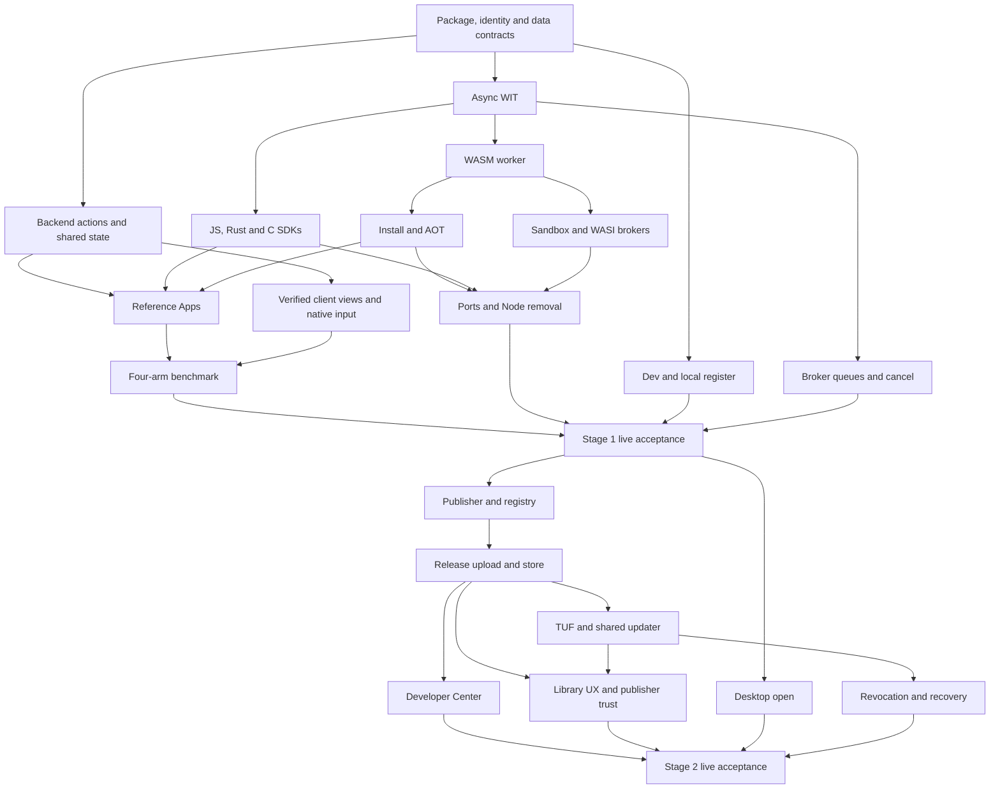

# Apps v2: one plan, two testable stages

For Miguel · updated 2026-11-05 · Apps product cutover stays **PAUSED**;
the AV1 feasibility result and its owner-authorized route-probe exception are
recorded in [the AV1 receipt](../../docs/APP_VIEW_HOST_AV1.md). The first AV2
signed-asset transport slice is recorded in [its scoped receipt](../../docs/APP_VIEW_DELIVERY_AV2.md);
reference execution and the App-open cutover remain deferred.

## 1. Summary

**Stage 1 — Apps v2 core: shape and functionality.** Build the portable WASM
backend, Rust/JS/C SDKs, backend agent actions, client-rendered views and the separate
dev copy. Keep local package installation and safe updates. At its end, you
can develop an App with `/app dev`, register it locally with `/app register`,
install a `.cxapp` on macOS or Linux, and watch an agent use Excalidraw and
Univer through the same backend operations you use. No Library account, catalogue or
publishing service is needed. Revised estimate: **8–10 weeks with four lanes**, including
integration and real live validation; C++ follows immediately after C.

**Stage 2 — Install and distribute.** Add the App Library, Developer Center,
opening downloaded packages, and one updater for Library and publisher feeds.
At its end, an external developer can publish without staff help, and you can
discover, install and update the App through the UI. Trust rests on publisher
identity, verified App-ID ownership, reports, withdrawal and revocation.
Automatic review is **not in the agreed stage**; discuss it before Stage 2.
Estimate: **4–6 more weeks with four lanes without review**, or **6–8 weeks
with the review service** if Miguel chooses it.

**Total: 12–16 calendar weeks without automatic review; 14–18 with it**, after
an explicit resume. These are engineering estimates including real live
acceptance, not delivery promises. The separate tracks in §3.2 are excluded.
Excalidraw first and Univer second are fixed. LaTeX comes later; its compiler
spike found a licence blocker ([TEX_APP.md](tex/TEX_APP.md)). Typst is not
planned. Windows gates neither stage and has no track in this plan.
Stage 1 ships and is testable independently before Stage 2 begins shipping.

### Decisions log

Miguel answered on **2026-10-22, 19:40–19:55 UTC**, with the App renderer
decision added on **2026-11-02**. These decisions supersede older
recommendations below and in the shape; they are not reopened in §7.

| Date | Decision | Miguel's words |
|---|---|---|
| 11-02 | Client-rendered App views replace streamed Chromium App Tabs; no streamed fallback | Binding appview lane brief. Kernel Browser remains for websites. Apps acting as Chariox clients/external agents is **not decided**; the current SDK broker surface is unchanged. |
| 10-22 | Automatic review deferred until the Stage 2 discussion | “Automatic review put it in quaranteen. I'm not sure if we'll have this. We'll discuss before starting stage 2.” |
| 10-22 | Moved P2 items keep their separate tracks | “yes” |
| 10-22 | Windows is outside both stages; no Windows track here | “kernel is not yet available in windows, so no” |
| 10-22 | Source-free JS remains undecided | “needs further discussion. Put it to be discussed before starting phase 2” |
| 10-22 | Drop agent outputs to Apps and second-agent continuation; discuss App-created agents/workflows | “I don't think any of these are necessary, apart from 3 where the user might give an app access to create agents in the kernel, but it's unclear the shape of this for me.” |
| 10-22 | Use user-configured notification triggers meanwhile | “Typically the user will set up an agent with notifications coming from the app, which will trigger the agent/workflow.” |
| 10-22 | Review speed and offline policy remain proposals | “we'll discuss the shape of this before phase 2 too” |
| 10-22 | Reverse-domain App IDs with verified ownership accepted | “Ok then” |
| 10-22 | Excalidraw, then Univer; LaTeX later | “Univer sounds like a perfect fit ... univer and scalidraw for certain”; “let's leave any latex related app for later” |
| 10-22 | MPL allowed as a dependency | “Ok to the more permissive dependency” |
| 10-22 | Drop wrapped binaries, including W1/W2 | “the compiled binaries from existing programs, they don't bring anything we can't do with computer use or other tools we're building.” |

### 1.1 What exists, and what must change

Based on `wasmspike/r3` at `5c4d888b9347a93575a8412244b29650c9222799`.
The decisions in [the accepted shape, §8](APPS_V2_SHAPE.md#8-revised-migration-plan-and-your-decisions)
are inputs, with decision 12 reversed and decision 13 fixed by Miguel above.
The [async design](DESIGN.md) and [measured spike](DECISION.md) supply the runtime direction, not product acceptance.
The [old implementation plan](../../docs/CHARIOX_APPS_IMPLEMENTATION_PLAN.html)
supplies the distribution requirements reconciled below. The 11-02 decision
supersedes both documents’ App-host/headless-Tab and UI-function execution
assumptions; neither is a parallel renderer specification.

MP scope: **MP-11** for sandbox, signing, App capability admission and
model-visible Vault protection; **MP-08 / MP-10** when proving the same App
behavior on ordinary and managed kernels; **MP-09** when proving that idle
client views do not prevent managed shutdown and accepted backend work still
holds the existing activity fence. This document closes no MP item.
It does not replace Browser/Computer, Path-1 or Docker persistence acceptance.

The table below records the earlier spike base above. The App-view replacement
in §2.1.1–§2.1.7 was inspected on `appsland/oss`
`6a93cea5dfdd7b13d714c06326d4a606da4df75c`; §5.1.1 records its code/history
inventory. Earlier line citations are not a claim of a fresh whole-tree audit.

| Existing code | Verified starting point |
|---|---|
| Package and engine | `packages/app-package/src/manifest.rs:9` defines `chariox.app.v1`; `:48` defines runtime entry/engine and `:55` admits only `Node`. WASM and a WIT-world field are new work. |
| Signed declarations | `packages/app-package/src/manifest.rs:26` already references tool/event/action files. Existing actions at `packages/app-package/src/declarations.rs:64` carry critical validation and protected effect routes, not the new view-action API. Preserve those protections when adding UI actions. |
| Archive and signing | `packages/app-package/src/archive.rs:8` fixes three control entries, including `signatures/publisher.sig`; `:19` describes canonical, uncompressed USTAR. `packages/app-package/src/lib.rs:207` verifies the Ed25519 signature; `:411` canonicalizes manifest plus inventory as signing bytes. |
| Signature extension limit | `packages/app-package/src/lib.rs:224` requires the remaining archive entries to match the inventory exactly; `:376` excludes `signatures/` from that inventory. Extra review files are **not** supported merely because a directory is called `signatures/`. |
| Generations | `packages/app-runtime/src/installation.rs:180` persists active, allocated and pending generations and an update journal; `:497` commits the prepared generation transactionally; `:756` advances the allocated counter. `:419` permits pre-commit abort, not restoring an old snapshot after accepted writes. |
| Release store | `packages/app-runtime/src/release_store.rs:1` stores immutable releases and retains the original archive. `packages/app-runtime/src/release_store/lease.rs:18` requires current signature trust before a verified lease. AOT is a new derived cache, not a new release authority. |
| Data | `packages/app-runtime/src/managed_state.rs:1` puts structured state on the kernel SQLite connection. `packages/app-runtime/src/managed_state/migration.rs:1` describes snapshot/abort recovery. `packages/app-runtime/src/worker_process/private_data.rs:15` separately defines file replacement and the 512 MiB private-volume quota. SQL rollback alone is not a multi-file rollback guarantee. |
| Publisher enrollment | `apps/kernel/src/runtime/app_publisher_control/requests.rs:17` checks session membership; `apps/kernel/src/runtime/app_publisher_control/pump.rs:239` creates the exact-key/fingerprint enrollment interaction. `packages/app-runtime/src/publisher_trust.rs:1` is local owner-scoped trust, explicitly outside Library publisher management. |
| Dev loop | `apps/cli/src/app-dev-loop.ts:40` requires an existing signing key; `:143` packs and calls install/update; `:222` finds the active installation by App ID. There is no separate dev installation in this path. `:216` still tells the user to reopen views. |
| Shared installer entry | `apps/cli/src/app-install-file.ts:54` uses the same transfer for updates; `:236` chooses `BeginAppUpdate` with the expected generation or `BeginAppInstall` for first installation. Reuse this kernel lifecycle for every acquisition route. |
| Approval seam | `apps/kernel/src/runtime/app_install_control/pump.rs:272` constructs install/update prompts. The consented-deployment route documented at `apps/kernel/src/runtime/app_install_control/requests.rs:224` is narrower than the accepted general no-repeat rule. Implement and test that rule; do not assume the dev README proves it already works. |

The Library, Developer Center and TUF delivery are requirements of old
P2.01–P2.05, not capabilities established by this local code inspection. The
old P2.03 review service is deferred to §7, not a Stage 2 prerequisite.

## 2. Stage 1 — Apps v2 core: shape and functionality

### 2.1 The deliverable

One signed `.cxapp` carries its view, backend component, declarations and
migrations. One Rust worker process per installation runs one shared component
instance, serving concurrent calls. JS/TS uses pinned QuickJS component tooling;
Rust uses WIT bindings; C ships with the callback/state-machine SDK. C++ is the
small coroutine layer immediately after C, not an excuse to defer C at launch.
Python preview and Go follow the accepted toolchain readiness rules.

Use the async `chariox:app/app@1.0.0` world from the start, with the selected
WASI 0.3 interfaces and the explicit, bounded WASI 0.2 compatibility allowlist
needed by current toolchains. Kernel calls remain brokered. No ambient network,
host filesystem, subprocess or native-library access is gained by compiling to
WASM. The worker still needs real Linux and macOS OS containment.

The worker implements streams/backpressure, cancellation and deadlines, a
bounded broker queue with 64 in flight per App, CPU slices, memory limits,
trap attribution and restart. Only manifest-declared idempotent operations may
be retried automatically after an instance loss, at most once. The SDK must
release host resources even when QuickJS abandons a response but its pending
import continues; the spike's cancellation limitation is work to resolve or
bound, not evidence of a finished SDK.

Agent actions are declared in the signed release and implemented by the backend
component. A button and an agent invoke the same backend operation, with the
real actor attached; neither invokes a function in a browser page. Agents get typed actions, a
bounded state snapshot, change events and a stop-on-first-error batch. `read`
and `write` do not prompt. `approval` uses the existing kernel interaction;
an existing grant or `/sudo` means zero additional prompts. Action declarations
do not create capabilities or bypass the backend's protected effect routes.
Runtime registrations must match the signed action names, schemas and effects;
an undeclared or mismatched action is rejected before invocation. Bind every
action/catalog entry to the active generation so an old view cannot keep authority.

The backend supplies a bounded state snapshot and sequenced changes. Each open
client renders that state using the release's view bundle. Several Rooms may
use the same installation without sharing Room authority. Bindings admit an
agent to declared backend operations, never to another Room or client DOM.
With every view closed the same backend actions still work. There is no
unprojected App Tab, shared DOM/profile/viewport, human Tab adoption, or App
ten-minute idle-Tab policy. The existing backend worker lifecycle remains.
App views do not use Browser DOM mirroring, region video or display input.

### 2.1.1 Where the view executes (MP-08 / MP-10 / MP-11)

The signed release contains static HTML, JS, CSS, fonts and other view assets.
Only the backend is a kernel WASM component; the view executes in the person's
client browser engine. Independent layouts, focus, selection, zoom and scroll
are local. Shared documents and edits are backend state, so two clients can
show different parts of the same diagram without changing each other's viewport.

| Client | Execution and delivery |
|---|---|
| Web | A trusted Chariox App host loads an opaque-origin sandboxed iframe inside the existing App area. The host retrieves verified release assets and state over the Web client's existing encrypted kernel connection, direct where supported or hosted relay WSS. Cloud serves only the trusted client build; it does not fetch, unpack or execute App releases or broker App calls. |
| Local TUI | `/app open` starts the CLI's loopback App host on `127.0.0.1` with an ephemeral port and opens the default browser. The CLI ships the same trusted host/renderer assets as Web, and forwards only the App bridge and trusted chrome's requests over its already authenticated local kernel connection. This loopback adapter is part of the CLI, not a kernel HTTP service. |
| Remote TUI | The CLI runs on the person's computer and already connects to the remote kernel through encrypted relay WSS. Its default-browser page is still served by that CLI on loopback; asset/state/call traffic uses that same existing connection. No remote kernel port, SSH tunnel, public App URL, Cloud asset proxy, or second kernel login. An SSH-only terminal on another computer needs the existing local client launcher; it cannot cause that computer's browser to open by printing a bearer URL. |
| Native iOS/Android later | The client embeds the signed view in its own WebView with the same sandbox/bridge contract, navigation delegate, generation fencing, native accessibility and trusted conversation chrome. This remains the separate native-client track. No streamed App fallback while a native client is unfinished. |

Choose **opaque origin**, initially `sandbox="allow-scripts"`, without
`allow-same-origin`, forms, popups, top navigation, downloads or storage access.
Do not serve App JS at a Chariox origin with same-origin privileges. App code
gets volatile JS memory, local view preferences and its signed asset map; no
cookies, localStorage, IndexedDB, Cache Storage or service workers. Persist
drafts/preferences through declared backend state, scoped by owner and, where
appropriate, Room/client. Browser clearing or another device does not lose
accepted edits. Trusted host storage may cache verified bytes and non-secret
presentation preferences, never App authority or Vault values. This avoids
per-installation DNS, certificates, shared parent cookies and a second origin
service; the cost is porting Apps that assumed browser persistence.

The CLI loopback host accepts only its exact Host and Origin, binds no wildcard
interface, has no CORS wildcard and rejects cross-site requests/WebSocket
upgrades. A one-use, short-lived browser handoff in a URL fragment binds the
page to that launch; exchange it once, clear it before other content loads,
and never print/log it or pass kernel/relay credentials into the page. App
messages cannot choose the kernel, owner, Room or arbitrary RPC method. Closing
the page detaches its view; CLI exit closes the host and its exact owned sockets.

### 2.1.2 Verified bundle and generation (MP-08 / MP-10 / MP-11)

AV1 implementation result (2026-11-05, MP-08 / MP-09 / MP-10 / MP-11): the
candidate renders both reference Apps in the built Cloud web assets at DPR 1/2,
but the Chrome155 whole-browser network gate is **FAIL**. The restricted
launch/profile stops the ordinary-profile frame TCP/DNS failures; a browser-internal
IPv6 route-check UDP socket still violates the unchanged zero-socket gate.
Data/blob-only stylesheet CSP renders both references. No narrower gate has been
accepted. Dedicated launch ownership is required; ordinary Web tabs cannot set it. No browser is accepted for contained App
views from this result. The candidate packer, host/bootstrap/CSP, complete
controls, evidence and AV2–AV7 dependencies are frozen in
[`docs/APP_VIEW_HOST_AV1.md`](../../docs/APP_VIEW_HOST_AV1.md). Keep the streamed
product path until a contained path passes its real exits; this feasibility
result does not authorize cutover or relax the network guarantee.

Opening returns a kernel-authenticated descriptor: installation, owner/Room
scope, decimal-string generation, release digest, view entry, signed manifest
and inventory, publisher signature and the kernel's currently trusted publisher
key identity. The kernel takes a verified release-store lease and reads only
inventory-listed view files. Clients verify the signature using that authenticated
trust decision, canonical signing bytes and inventory digests; a key supplied by
an untrusted archive alone is not a trust root. Development uses the kernel's
scoped dev identity, never publisher enrollment. Reuse the package verifier's
canonical vectors in the client implementation rather than inventing a second
signing subject. Fetch missing assets in bounded chunks over that connection;
hash complete files before making them executable. No kernel paths or external
package URLs reach App code. An arbitrary asset is not an HTML entry point.

The trusted host assembles a **self-contained `srcdoc` document** from verified
bytes: statically bundled JS, stylesheet text installed as a data URL, and
embedded font/image/media data.
The packer forbids CDN/remote imports, dynamic module loading, view-created
workers and executable blob/data URLs. Package-local lookup returns bytes from
the verified map through the SDK; web-WASM is an asset, not a backend capability.
Heavy shared work belongs in the backend. The host generates a CSP before any
content, then injects the trusted bootstrap before App scripts, with exact
hashes for permitted inline scripts. Stylesheets, images and fonts use only
data/blob resources; native layout uses CSSOM without an unsafe-inline style
grant. Both references are tested with that policy. Hash original publisher bytes before this
assembly; the generated wrapper is not publisher-signed source. Escape HTML
raw-text boundaries as data rather than interpolating arbitrary JS into an
HTML template. Test both reference Apps against this packer contract in AV1.

The trusted App host is a dedicated static client document with its own
restrictive parent CSP: it permits the constructed `srcdoc`, but denies frame
network/blob/data navigation. It relays the narrow port to the main client's
existing connection and never puts App code in its own DOM. The CLI ships the
same host document. There is no App HTTP URL, service-worker dependency,
per-installation DNS/certificate or Cloud asset proxy. Do not reuse the old
worker loader: opaque sandbox documents lose service-worker control, so its
relative-asset/recovery mechanism does not apply. Native WebViews follow this
same document/bridge contract with navigation delegates. AV1 is a feasibility
gate for inherited CSP, `srcdoc`, reload/about:blank/document.write/history
and all fresh-realm transitions on the supported browser matrix. A failing
engine is unsupported for Apps until corrected, never switched to streamed Tabs.
Account for CSP inheritance explicitly: the static trusted host permits the
inline script execution and data/blob styles needed by the child, while the child's first
meta policy narrows scripts to the generated hashes. Both applicable policies
allow `wasm-unsafe-eval` for verified browser-WASM bytes while denying JavaScript
`unsafe-eval`; AV1 tests compilation as well as the JS entry. The trusted host contains
no App HTML/JS interpolation outside `iframe.srcdoc`, has `connect-src 'none'`,
and communicates with the main client only over its private host port.

Cache immutable bytes by kernel identity, owner, installation and release
digest, with per-file hashes and a bounded LRU (initial total 256 MiB per
client). Each attachment also binds the active generation. A cache hit still
requires a fresh authorized descriptor: cached code cannot authorize an open
after uninstall, revocation or update. Separate dev/release installations.
Verify cached bytes on read, evict corrupt entries and retry from the kernel;
never execute a partially fetched or mismatched bundle. Purge installation
cache on uninstall and revoke live ports immediately on trust revocation.

At activation the kernel fences admission to the old generation, drains or
settles admitted work through the installation journal, commits data/worker/
catalog/view together and publishes invalidation. Every call, stream read and
effect rechecks the bound generation and grant epoch; delayed old messages
cannot acquire the new worker. The host stages the new verified bundle and
snapshot, then swaps when ready. Keep the prior rendered state visible but
inert during replacement/reconnect; do not keep its mutation port alive.
Each replacement/reload obtains a fresh view ID, which is also its document
identity. Never rebind an old document/view ID to a new generation.
Persist drafts before activation through the existing safe-point flow. App
route/scroll helpers restore local presentation. Failed pre-commit updates
retain the working release; never roll back accepted post-commit writes.

### 2.1.3 One bridge over the existing connection (MP-08 / MP-10 / MP-11)

Bootstrap a fresh `MessageChannel` to the exact iframe `contentWindow` after
its load handshake. An opaque frame reports origin `null`; matching `null`
alone authenticates nothing. Bind the channel to the expected window, launch
nonce, view ID and generation, transfer its port once, and then accept messages
only on that port. Destroy it on navigation, replacement, close or revocation.
No raw IPC socket, relay key, general kernel request API or conversation data
enters the frame. The trusted host translates a small typed SDK vocabulary
into the existing LocalDaemonRequest transport.

The kernel derives the **human actor on that client** from its authenticated
command/connection, owner and admitted Room membership, captures authority at
submission and checks it at effects. The frame cannot supply an actor or agent
ID. An agent's runtime MCP call separately carries that real agent's Room,
binding, task and generation through the existing admission path. Both enter
the same backend function and state transaction; a human click cannot borrow
an agent's `/sudo` or approve an interaction by sending an SDK message.

Requests have unique operation IDs, schema-checked input, deadlines and typed
result/error envelopes. Long operations return the existing durable pending
operation/interaction reference; they do not hold a request handler open while
waiting for a person. Responses and backend changes include generation and
state revision so the host can await the matching committed state. Call result
delivery and state delivery may race without applying a delta twice.

Add view-call receipts to the existing durable operation store before promising
outcome recovery; today's non-replayable view calls do not supply this contract.
The dedupe key is owner + admitted scope + installation + generation + operation
ID, bound to immutable method/input digest. Reusing an ID with different input
is rejected. Retain terminal receipts at least 24 hours, never expire an active
operation, and preserve effect/dedupe records across App data migration/rollback.
Lookup is authorized by scope/installation, independent of a dead view ID.
After retention expiry return `expired`/`unknown`, never infer failure or replay.

Reuse the 64-in-flight per-installation broker bound. Initially allow 16
outstanding calls per view, 256 KiB per bridge envelope, and 1 MiB/128 events
of unacknowledged changes per subscription; larger assets/files/results use
bounded chunks/streams, not raised relay limits. Every subscription starts
with an atomic snapshot plus cursor. Cursors are bound to installation,
scope, generation and epoch. Stream reads grant byte credit; a slow subscriber
stops its own producer or receives an explicit reset-to-snapshot marker.
State deltas may be replaced by a fresh snapshot; durable business events and
non-idempotent results cannot be silently discarded. Cancellation releases
broker/stream resources but cannot undo an accepted external effect.
Metadata/startup responses obey the existing control-message bound. Large
snapshots return an admitted state-stream reference and are assembled before
the atomic paint; never fit a spreadsheet into one unbounded JSON response.

Reconnect uses the client's existing connection manager and one shared status
source. Keep the last rendered state and local draft, retry in the background,
resume after the last acknowledged cursor, or reset atomically if it expired.
Do not blank the view, add a connection banner, show background error strings,
or queue offline mutations for surprise replay. A requested action that cannot
run uses the existing action-failure interaction. On ambiguous delivery query
the durable operation receipt; never replay a non-idempotent action because
the browser reconnected. With no viewers, no subscription or hidden renderer
is created. Idle views/polls/cache reads do not count as managed activity;
accepted backend calls/events retain the existing work fence until settlement
(MP-09). No Cloud shutdown policy changes.

### 2.1.4 Backend actions and the agent panel (MP-08 / MP-10 / MP-11)

The signed action declaration contains name, input/output schemas and
`read / write / approval` effect, and maps to an **ordinary declared backend
tool**. Invoke it through the existing worker `call-tool` export and broker;
validate output as well as input schemas. Do not add another worker/component
kind or a parallel action execution ABI. Two signed read-tool declarations,
`view_snapshot` and `view_changes`, provide semantic state: snapshot returns
`{ state, revision, cursor }` atomically; changes takes `{ after, max_bytes }`
and returns committed deltas/cursor or a full reset. These names are reserved
for the view contract, not a raw SQL-table subscription. The kernel waits for
the existing declared `view_changed` App event outside the worker/broker call
slot, then reads a bounded page; idle subscriptions cannot occupy the 64-call
execution budget. The SDK's backend transaction
helper commits business state and its semantic change/outbox together, emitting
only after commit; kernel publication validates the declared state/change
schemas and applies audience projection. Backend snapshots/change records describe actual persistent scene,
sheet or document state. Excalidraw's scene elements and Univer's cells/formulas
must be editable and serializable without mounting their frontend; extracting
those operations is part of the ports, not a call back into a hidden browser.
Concurrent writes use backend transactions/revisions and explicit conflicts.
Ephemeral hover/focus/selection is not agent state or global document state.

The DEV “as the agent sees it” panel and `/app actions` show the kernel-admitted
backend catalog, redacted snapshot, change cursor, receipts and stop-on-first-error
batch results. They no longer inspect a Tab or test DOM action registrations.
Coverage means a human business operation has a declared backend operation;
local UI bindings can report missing coverage during development, but DOM
markup cannot grant authority. Agents do not need a view open. No new App-to-
agent/client/external-agent API or broker capability is introduced.

### 2.1.5 Trusted chrome, Vault and native input (MP-08 / MP-10 / MP-11)

The conversation/progress panel, focus selection, prompt area and approvals
remain trusted Chariox chrome **outside the App iframe**, including in the
TUI's default-browser shell. They use kernel history/interaction requests
directly. The App may request the existing signed panel placement; the user's
choice wins and only the user may minimize it. Pending approvals remain in
trusted chrome even with no panel. This plan changes no visible prototype
layout, labels or controls; any missing surface needs a separate approved mock.

Origin isolation, sandbox/Permissions Policy and the typed port enforce
the boundary. Never send conversation text, AX trees, selection, history or
transcript-dependent sizes to the frame. App capture/export covers only App
content; it cannot request screen sharing of Chariox. App scripts/CSS cannot
overlay the parent, read its storage or synthesize trusted approval input.
Only terminal chrome calls the existing human answer/passkey path, with the
same single kernel-owned interaction and existing grant/`/sudo` behavior.

Vault fill is an existing kernel operation extended with an **App field target**:
view/document ID, generation and stable field handle, not a CDP selector.
The trusted bootstrap captures native DOM accessors before App scripts; its
private fill channel registers an actual input element and issues a document-
bound handle. App-provided selectors, mask rectangles and DOM rasterization
are not trusted observation metadata. Kernel-owned target metadata identifies
the filled field and its model-safe projection.
Resolve/fill by Vault handle; tool replies contain a receipt, never a value.
Deliver the value only to the authorized owner's trusted client and that exact
live field over the existing encrypted connection/port. Other clients receive
the masked field state. The owner can see their own value and keeps normal
native input speed; close, generation change or disconnection/replacement of
the actual input element invalidates the field handle.

The default model observation is the backend snapshot/change API, not client
DOM or pixels. The kernel excludes the filled target's value from model-facing
snapshots, changes, action results, history, logs and traces before publication;
audience-safe projection is part of the field contract, not a JS password-input
attribute. A backend operation receives a Vault handle through the existing
credential broker when it needs a credential, rather than echoing fill contents
in general state. Do not store filled values in client bundle/draft caches.

Any product path that offers App DOM/AX/pixels to a model must carry the
kernel-registered filled-target metadata. A trusted capture producer must mask
the exact live target under its capture barrier; **the kernel observation
boundary** admits only that protected result and scrubs structured target text.
An arbitrary client screenshot cannot be assumed safe
because an iframe is sandboxed. Such capture is not enabled until its target
masking drill passes. This does not disable native owner accessibility or App
interaction, and does not create a new streamed App observation transport.
The guard protects the product's filled target only: no value-following masks,
redaction of human typing, or restrictions on an agent's chosen copy/paste/
redisplay. Client rendering does not justify broader secret policing.

Accessibility, IME composition, selection, keyboard shortcuts, touch and DPR
are supplied by the client's native browser/WebView, without an AX or input
round trip to the kernel. Screen-reader labels for App controls belong to the
App. Trusted chrome keeps its own accessible tree. Clipboard and file pickers
use the trusted client's existing platform adapter and real user activation;
App code cannot claim a gesture by passing a boolean. Transfer selected file
bytes with existing bounded file transfer and App authorization, never host
paths. Downloads are explicit exports; external links use a typed host request
and safe URL handling in the person's browser. Authentication uses the
existing backend connection/grant flow; no ambient App browser login profile.

### 2.1.6 Network boundary and performance (MP-08 / MP-10 / MP-11)

The view's only service connection is its MessagePort bridge. Its CSP has
`default-src 'none'; connect-src 'none'; base-uri 'none'; form-action 'none';
object-src 'none'; frame-src 'none'; worker-src 'none'`; allow
scripts only by generated inline hashes; inline styles and font/image/media
data or image/media blobs support verified assets and native local drawing.
Remote resource URLs remain denied. Permit only `wasm-unsafe-eval` for browser
WASM, not JavaScript `unsafe-eval`, script blob/remote sources or dynamic imports.
`connect-src` has **no HTTP/WSS destination**, since a MessagePort is
not a network fetch. Trusted host traffic alone uses the existing kernel
connection. External service/API fetches, redirects and credential use go
through the unchanged backend broker and installation destination policy.

The trusted App host must additionally restrict its child navigation sources
to the constructed `srcdoc`: the child's CSP alone does not stop
`location=externalUrl`. Deny blob/data/external frame navigation. Parent
`frame-src` restrictions, sandboxed top
navigation/popups/forms, no referrers, and native navigation delegates cover
links and redirects. Deny unneeded camera, microphone, geolocation, display
capture and device APIs with Permissions Policy. Test fetch/XHR, WebSocket,
EventSource, beacon, remote assets/CSS/fonts, frame/self navigation, forms,
workers, WebRTC and URL redirects against a receiving endpoint. Do not assume
`connect-src` fences every WebRTC/browser network feature. The trusted pre-script
bootstrap must remove WebRTC constructors and aliases using non-configurable
properties before any App JS. Block fresh-realm escapes through frames,
workers, popups and self-navigation; only the trusted host may replace the
document and it always installs that bootstrap. A cooperative SDK hook or a post-load constructor deletion is
insufficient. Freeze the supported browser policy from real enforcement
results in AV1; an unenforceable egress
path blocks that browser's App support, never enables a streamed fallback.
Service workers and unsandboxed nested documents are excluded initially.

These are proposed acceptance targets, not measurements:

| Measurement | Gate |
|---|---|
| Native local input/selection/drag → paint | P95 ≤50 ms, ≥55 fps during a 10-second canvas drag on a 60 Hz reference device; no network round trip for local feedback. |
| Shared committed state visible in another open client | For warm reference operations, P95 ≤ measured wire RTT +60 ms; record backend time separately for slow operations. |
| App open → first usable state and input, warm verified cache | P95 ≤ measured RTT +250 ms; zero empty replacement frames. |
| Cold reference App open, including bundle verification | P95 ≤5 s for a ≤10 MiB view at ≥20 Mbit/s download, 8 Mbit/s uplink and RTT 60–100 ms; record bytes and throughput. Larger bundles report transfer time plus render/verification P95 ≤500 ms, without claiming the 5 s gate. |
| Reconnect with kernel already reachable again | Last state stays visible; warm current-generation view usable P95 ≤ RTT +500 ms. No duplicate action effects. |

Use ≥30 samples per timing cell, nearest-rank P95, failures/timeouts included,
DPR1/DPR2, diagnostics off and a quiet host or qualified isolated guest. Record
per-client CPU/RSS, kernel worker cost and network bytes. Native pixel quality
is at device DPR; App canvas coverage and native input replace mirror coverage
and video FPS as App gates. Browser website gates remain separate.

No current-head streamed-App paint baseline was measured in this design round:
there is no lane-owned running App acceptance stack, and starting a measured
kernel/isolated slice is not a cheap read-only check. Historical
[release budgets](../../docs/CHARIOX_APPS_RELEASE_BUDGETS.md) report candidate-g
action P95 248 ms (n=4), and a saturated request-to-CDP-capture proxy of 6168 ms;
neither measures client paint nor this base. AV7 must measure the old Tab and
the replacement on the same App/device/network and report both, never present
those historical numbers as the new transport's baseline.

### 2.1.7 Local protocol shape (MP-08 / MP-09 / MP-10 / MP-11)

Names below are proposed LocalDaemonRequest/response and event shapes, not
allocated protocol numbers. Reuse the current client transport, file chunk
limits, durable operation receipts and kernel interaction machinery. A view
scope is a tagged `Owner` or `Room { session_id }`; only owner authority opens
the former, Room membership/binding is checked for the latter. Decimal strings
carry generations/revisions/cursors across JS safely. No actor supplied by the
App is trusted.

| Request | Response / kernel event |
|---|---|
| `OpenAppView { installation_id, scope }` | `AppViewOpened { view_id, installation_id, scope, generation, grant_epoch, release_digest, entry, signed_manifest, inventory, publisher_signature, trusted_publisher, initial_state, cursor, limits }`. `initial_state` is a bounded snapshot or state-stream reference. No `tab_id`, browser generation or controller URL. |
| `GetAppViewAsset { view_id, generation, path, offset, max_bytes }` | `AppViewAsset { path, offset, bytes, eof, digest }`, only a verified inventory member; bounded chunks and exact length/hash. |
| `CallAppView { view_id, generation, operation_id, method, input, expected_state_revision, deadline_ms }` | `AppViewCallResult { operation_id, generation, result, state_revision }`, `AppViewCallPending { operation_id, interaction_id? }`, or typed `AppViewCallFailed`. Backend schema/effect admission applies to every route. |
| `SubscribeAppViewState { view_id, generation, after, max_bytes, wait_ms }` | `AppViewStateChanged { generation, cursor, state_revision, changes }` or `AppViewStateReset { generation, cursor, initial_state }`; bounded long-poll/event delivery over the existing client subscription mechanism. |
| `ReadAppViewStream { view_id, generation, stream_id, after, max_bytes, wait_ms }` | `AppViewStreamChunk { stream_id, cursor, bytes, done, error? }`; stream belongs to this admitted view/generation/scope and its creating open, state subscription or action call. Same credit bounds, grant checks and invalidation apply to all three. |
| `CancelAppViewCall { view_id, generation, operation_id }` | `AppViewCallCanceled` or the existing settled-operation result; not rollback. |
| `GetAppViewOperation { installation_id, scope, generation, operation_id }` | `AppViewOperation { state: accepted/running/pending/completed/failed/canceled/unknown/expired, result_or_interaction?, state_revision? }`. Same owner/scope authority and audience-safe result; independent of a closed view, with receipt retention/dedupe as in §2.1.3. |
| `CloseAppView { view_id }` | `AppViewClosed`; stops this subscription/port and releases its asset lease. Admitted work survives unless explicitly canceled. |
| `RegisterAppViewField { view_id, generation, field_handle, field_schema }` / existing Vault fill extended with this target | `AppViewFieldRegistered` / existing value-free fill receipt; owner-only fill delivery and kernel model-safe projection as in §2.1.5. A field registration grants no Vault access. |
| Existing panel-placement and user-domain/Room interaction-answer requests | Keep the same trusted chrome, human authorization and shared interaction receipts; neither request is exposed as an arbitrary frame RPC. |
| Kernel-origin lifecycle notifications | `AppViewGenerationChanged { view_id, next_generation, release_digest }`, `AppViewInvalidated { view_id, reason }`, `AppViewClosed`; state reset/stream completion always have an explicit terminal reason. Replacement opens a fresh view/document ID. |

Fold the current `OpenUserAppView`/frontend/call/list subscription bookkeeping
into this one scoped view contract; remove the host selector and kernel-browser
variants instead of adding a third App hosting mode. Preserve user-domain
window access rules and detached owner approvals where applicable. The existing
agent action catalog/invoke/state/changes/batch MCP names stay; their executor
becomes the backend component. Lists and reconnect snapshots never restore
authority from a cached view ID. At implementation the coordinator allocates
local and affected peer versions; update generated kernel-client types,
protocol snapshots/hashes and a focused conformance drill in the same slice.

### 2.2 The local development and installation flow

1. `/app dev ./app` builds a separate dev installation of the same App ID.
   The kernel creates and uses a dev identity without asking. Creating that
   identity is not publisher enrollment and not a capability approval.
2. The first dev install follows the normal capability decision. Saves with
   unchanged approved capabilities do not prompt. A capability expansion asks
   once through the shared interaction; declining preserves the working build.
3. Only the developer's Room gets automatic dev bindings. Other Rooms and
   existing registered bindings keep using the registered installation.
4. A save builds a component, packs it, stages through the normal installer,
   migrates, checks health and commits. Each open DEV client view replaces its
   bundle and snapshot in place after generation fencing;
   route/scroll restoration belongs to the App with an SDK helper. Broken
   builds leave a usable prior generation and an actionable error.
5. `/app actions` and the DEV “as the agent sees it” panel expose backend actions,
   redacted state/change cursors and missing-operation coverage. Agent `app_dev_push` uses the
   same kernel operation as the CLI; watching source files stays client-side.
6. `/app register` packs the selected source revision with the real publisher
   key and targets the normal installation. First registration uses
   `BeginAppInstall`; replacement uses `BeginAppUpdate`. It preserves normal
   installation data, never silently replaces it with the dev copy's data,
   and does not upload anything to a Library.
7. A locally built or downloaded publisher-signed `.cxapp` installs through
   Chariox commands on another macOS/Linux kernel after normal trust and
   capability decisions. This works offline with the needed local trust.
   Desktop file associations and a browsing catalogue wait for Stage 2.

Local registration still needs a real publisher identity, enrolled once using
the existing trust flow. The no-prompt dev identity is not silently promoted
into a distributable publisher. Dev data is separate; explicit seed/reset
copies are local development conveniences, not credential or App-set transfer.
Seed only permitted App data; do not clone kernel connection grants, runtime
handles, approval tokens or credentials into a dev installation.
`chariox app pack` is the shared release build command; local `.cxapp` testing
uses the same compiler pins and verifier as register and later publication.

### 2.3 Ports, examples and comparison

Inventory the first-party Apps on the implementation base, port all shipped
ones, and retain their tools, events, integrations, permissions and data. Remove
the embedded Node backend, bootstrap and obsolete engine path in the same
completed port sequence. This does not remove client browsers' JavaScript view engines
or Node used by build tools. Existing Node packages need a rebuild; provide a
clear compatibility error and a data-preserving replacement drill.

Ship Excalidraw first and Univer sheets second (§6), with a small Todo contract
example for SDK onboarding and benchmark control. LaTeX is a later App, outside
both stages; [the completed spike](tex/TEX_APP.md) records its licence blocker.
Typst is not planned, and there is no wrapped-binary App kind.

B1 implements the accepted four-arm comparison: declared App actions,
equivalent web app plus handwritten MCP, Computer Use, and App browser-driving
without declared actions. Use Todo and Univer; record the time spent building
the competing MCP surface. Freeze ten concrete tasks and independent checkers
before measurements. Report tokens, steps, completion/failure rate, task time
and developer minutes. The accepted sampling plan is 30 runs per task per arm
for Codex `gpt-6-luna` low and Claude `claude-haiku-5-5`; reserve its budget
before execution. Do not silently reduce the sample and claim the same result.

The App browser-driving comparison now targets the locally rendered client
using existing Computer/browser automation on that client's machine; it cannot
use an App Tab, CDP action bridge or privileged benchmark-only App control API.
Freeze how that arm obtains legitimate client observation/input before running
B1. A missing client-machine tool path is a specific BLOCKED benchmark cell,
not permission to restore kernel App execution.

The accepted claim gate is fewer tokens and steps than MCP and Computer Use
on every task, fewer failures and fewer developer minutes than the MCP arm.
Report ties and uncertainty honestly. A failed comparison with otherwise
working Apps leaves B1 red and blocks the public superiority claim; Miguel
decides whether to ship functionality separately. Spike timings do not prove
that claim or user-visible latency.

### 2.4 Stage 1 acceptance matrix

These are **required scenarios, all NOT RUN by this design round**. Each gets
a real executable drill, a base/failing-head result and a fixed-head result.
Use built Web and real local/remote TUI clients, the exact kernel and hosted
`wss` relay, and official real provider agents for agent scenarios. An internal
RPC or synthetic worker test supplements the drill; it does not replace it.

Required platform cells inherit the old plan's supported targets
(`docs/CHARIOX_APPS_IMPLEMENTATION_PLAN.html:1327`): macOS on Apple silicon and
Ubuntu 26.04 LTS x86_64, with real platform evidence. Extra architectures need
their own platform gate; a portable component does not certify a worker port.
Missing required hardware is an explicit coordinator ask.
Repeat installation/runtime cases on ordinary and managed placement where
released; keep the same behavior and retain MP-08/MP-10 evidence separately.

| ID | What Miguel or a validator does | Pass condition |
|---|---|---|
| S1-01 | Start from a fresh project; build JS, Rust and C Apps, install each local `.cxapp`, open its view and invoke a tool from a real agent. | One artifact per App works across the supported macOS/Linux targets; typed results, no manual runtime placement or Library. C uses the launch SDK. |
| S1-02 | Open a registered Todo, start `/app dev`, save a UI/backend change and inspect both copies from two Rooms. | DEV changes live in place; registered data, view and agents remain on the registered generation. Other Rooms do not discover DEV automatically. Record measured save→serve time per language, not the shape's estimates. |
| S1-03 | Register that change, make another unchanged-capability change, then add a network capability and decline it. | First publisher enrollment is explicit; normal data survives register; routine updates add zero prompts; the expansion has one shared interaction and denial leaves the old release usable. Dev signatures cannot install as release or be enrolled as publishers. |
| S1-04 **CHANGED** | Bind registered Excalidraw to a real agent in another Room. Open it in built Web and both TUI default-browser hosts over hosted WSS; ask the agent to draw/label a diagram, then edit it by hand in another client. | All clients converge on the backend revision and independent exported element checks; warm commit→other-client paint P95 ≤ RTT +60 ms. Actor receipts identify agent versus human correctly. No developer-Room/DEV access, kernel App Tab or App display subscription. |
| S1-05 **CHANGED** | Close every App page, ask a real agent to edit the diagram/sheet, restart the kernel, then open built Web and local/remote TUI views. Close the last page during another accepted action. | Work completes through the backend with zero App renderer/Tab processes or display registrations while closed. Every reopen shows the durable state exactly once; warm/cold opens meet §2.1.6. View close cannot cancel accepted work. MP-09 idle viewers do not reset shutdown activity. |
| S1-06 | Use a human plus multiple agents on one App; also run the 64-call concurrency drill through real admission. Cancel one call and exceed the bounded queue. | No lost transactional updates, bounded queues and clear timeout/busy results; unrelated clients stay responsive. Cancellation frees broker resources; a trap names the culprit and makes other calls retryable without replaying non-idempotent effects. |
| S1-07 **CHANGED** | Build an App from a real agent in the dev Room with `app_dev_push`; inspect `/app actions` and the DEV “as the agent sees it” panel in built Web/TUI; batch valid, invalid and valid actions with every App frame closed. | Catalog/schema/effects and redacted state come from the signed backend contract, independent of DOM registration. Batch stops at the failing action, reports completed steps and does not run the last step. No global rollback promise. |
| S1-08 **CHANGED** | Update while Web and both TUI browser pages edit a real diagram/sheet; interrupt asset chunks, fail migration/health, restart at commit boundaries, reconnect a paused old frame and replay its old call/stream cursor. | Pre-commit failures preserve the prior release/drafts; post-commit writes survive. Every stale-generation/effect attempt is rejected, including already queued messages. New views use matching signed assets/backend; zero blank replacement frames and zero duplicate effects. |
| S1-09 **CHANGED** | With a real agent, initiate `approval`; approve/decline in another client's trusted panel, repeat with existing grant and `/sudo`. In all three hosts fill an App field by Vault handle, then ask the agent for snapshot/changes/results and exercise any offered DOM/AX/pixel capture. Try App-script approval and conversation access. | One shared kernel interaction, zero repeated prompts with authority, correct denial/recovery. App code cannot read conversation or answer approvals. Owner sees the fill; other clients and model-bound target observations are masked by kernel policy, value-free in results/history/logs/traces. No human-typing redaction/value-following masks. Capture without target masking is unavailable to models, while owner input/AX remains usable. |
| S1-10 | Install an unknown-import/malformed component, attempt broker-forbidden network/files, exceed memory/CPU, then perform an ordinary valid action. | Stable rejection/stop reasons, no host escape or ambient authority; valid work recovers. Real Linux sandbox and macOS containment/resource evidence are present, not just WASM limits. |
| S1-11 | Upgrade existing first-party Apps and existing user data, run their actual event/wake and provider workflows, uninstall with retain/delete choices, then reinstall. | Functionality and data survive; no Node engine fallback; durable events/receipts do not duplicate or silently regain revoked grants. |
| S1-12 **CHANGED** | In each native-rendered Web/local-TUI/remote-TUI view, use Univer to import a real CSV, edit formulas/ranges, sort/save/export/reopen; in Excalidraw create/export/reopen a diagram. Repeat with screen reader, IME, clipboard and native file/link flows. | Independent exports agree with backend state. DPR1/DPR2 canvas/text match device pixels; native composition/focus/selection/pickers work, with no remote AX/input projection or paid Univer dependency. Local input/drag meets §2.1.6. |
| S1-13 **CHANGED** | Run AV7 and the separate website campaign below; then an 8-hour active shared-App session and 24-hour idle/reopen, including a 60-second WSS outage, client reload/crash, token renewal and one generation update. Repeat ordinary/managed placement. | Zero stuck/blank replacement frames, lost accepted edits, duplicate effects or extra backend workers. Last-known state remains visible during outage; recovery meets §2.1.6 once reachable. Queues, client cache and streams stay within limits; idle views permit managed stop and reopen recovers. Short real-provider turns only at scenario checkpoints. |
| S1-14 **CHANGED** | Run B1's frozen four-arm tasks with recorded models, sample counts and independent checkers; browser-driving uses the real local client surface. | Full comparison table and uncertainty; no hidden App Tab or benchmark-only privileged bridge. Claim gate met, or failed/blocked comparison named. |
| S1-15 | After C, repeat S1-01 and cancellation/state checks using the C++ coroutine SDK. | Same world/artifact and containment; exported errors never unwind into the host. Ships immediately after Stage 1 core without delaying launch C. |
| S1-16 / AV1 **NEW** | Open Excalidraw/Univer in built Web and both TUI hosts; exercise the full egress/isolation attacks in §2.1.6 with network capture, a receiving endpoint and an adjacent real conversation. Try sibling-frame `null`-origin messages, stale ports, alternate local Host/Origin and cross-site loopback access. | Zero unauthorized payloads reach the receiver; zero conversation/credential reads or approvals; only the exact frame port/owner/scope is admitted. Report real supported-browser versions. Trusted browsing of an explicit external link works. Any WebRTC/navigation escape is RED for that browser. |
| S1-17 / AV2 **NEW** | Corrupt cached JS/CSS/font bytes, substitute a release signature/key/inventory, interrupt cold chunk delivery, open two installations, revoke trust and uninstall while a cached page is open. Drive opens from the released Web/TUI entry points. | No mismatched byte executes; no cross-installation/dev cache/authority reuse. Revocation/uninstall fences calls immediately; corruption refetches only verified bytes; last working view stays visible but inert during recovery. Exact generation and publisher match the authenticated kernel descriptor. |
| S1-18 / AV3 **NEW** | Delay one real client's state/stream consumption, fill its 1 MiB/128-event window, exceed per-view call admission, then reconnect beyond cursor retention while a second client and real agent keep editing. | Slow client alone resets or receives credit-limited chunks; no memory growth beyond configured queues, no dropped durable event/effect, and healthy client's warm paint P95 ≤ RTT +60 ms. Operation receipt resolves uncertain delivery without replay. |

S1-01–14 and S1-16–18 gate the core launch; S1-15 gates the immediate C++
follow-on. Unmarked rows retain their behavior; their opens use §2.1's renderer.
The former S1-05 Tab-adoption/idle assertions and S1-13 App mirror/video checks
are **REMOVED**, replaced in those rows rather than retained as another path.

For every CHANGED/NEW row above the client matrix is built Web, real local TUI
and real remote TUI on the supported macOS/Linux machines, DPR1 at both named
desktop sizes and DPR2, with hosted WSS, 8 Mbit/s uplink and recorded RTT ≥60 ms
for remote cells (local direct is an additional cell). Agent rows use real
official provider runs, defaulting to short `gpt-6-luna` low turns unless the
scenario is provider-specific. Repeat admitted backend work on ordinary and
managed placement; no App-specific managed branch. Before/after runs use the
same real reference release/workflow and independent export checks. A base
failure must identify the first wrong seam (e.g. App Tab allocation, lost
revision, unmasked target), not merely fail on a newly named request. Adversarial
packages/receivers are regression supplements to these real-App user flows.

For UI rows, record 1920×1080 and 1440×900 at DPR 1 plus DPR 2, fresh starts,
normal clicks/keys/scrolls, cookies/popups, tab creation/closure, navigation and
typed URLs. Watch the recordings before declaring PASS; a user getting stuck,
confused or seeing a blank frame is a failure. Backend action calls are the
product path for agents; acceptance must also demonstrate the human UI, not
use CDP/DOM injection to repair it.

The **unchanged website Browser regression** campaign covers an en.wikipedia.org article,
www.wikipedia.org portal, a github.com repository, DuckDuckGo search, BBC
News and developer.mozilla.org. Report mirror coverage, screenshots and
fallback usability per site and DPR. Assert mirror v2 before mirroring
measurements. Google is N/A for automation under the later owner decision.
Use the real hosted relay with about 8 Mbit/s client uplink and measured RTT
at least 60 ms. Input→visible P95 must be ≤ measured wire RTT + 60 ms;
streamed website scrolling must sustain ≥30 fps. Do not apply App mirror/video
checks: the reference Apps use native rendering and §2.1.6 targets. Verify
websites still use the kernel Browser after App code is removed. Run performance with diagnostics
off on a quiet host/qualifying isolated guest; record RTT and I/O noise.

Retain exact source/binary hashes, videos, screenshots, provider/model IDs,
commands/exit codes, timing distributions, resource samples, first failing seam
and cleanup outside the repository. Missing accounts, hardware or hosted
resources are specific BLOCKED rows, never replaced by mocks. MP-11 review
covers the changed security anchors; tests alone do not close it.

## 3. Stage 2 — Install and distribute

### 3.1 The deliverable and the two routes

The Library offers browse/search/categories, detail pages, verified publisher
and App-ID ownership, capabilities, action/effect descriptions, compatibility,
releases, install/update/uninstall, reporting and availability/revocation state.
A user does not visit the Developer Center to install an App.

The Library stores deliberately published packages and publishing metadata.
It never receives runtime conversations or becomes Room/session authority;
the runtime relay remains encrypted transport and the kernel owns activation,
capabilities and running App state.

The Developer Center lets a new publisher enroll, prove its namespace, manage
team roles/keys, upload a signed release, see deterministic package/preflight
errors, select channels, stage/pause/withdraw releases, and manage support and
telemetry metadata. Connection/event ingress registration is self-service
with tenant separation, schema negotiation, replay bounds and deletion.

**Stage 2 does not require automatic review or a review attestation to publish
or install.** Publisher signatures and the shared installer still check exact
bytes, supported imports, schemas, capabilities and compatibility. These are
package/admission checks, not a claim that an App was security-reviewed.
Verified ownership identifies a publisher; it does not certify harmless code.

Trust rests on that identity and ownership, clear capabilities, user reports,
publisher withdrawal and operator revocation with recovery. Both Library and
side-install UI show the publisher and what was verified. There is no review
badge or implied verdict. Reports have visible receipt/status and operator
handling; withdrawal stops new acquisition, while revocation blocks newly
learned revoked authority. §7 keeps the possible review service and its UI
separate from this agreed delivery path.

Both routes use one trusted updater and the Stage 1 install/update coordinator.
The Library can download/stage a closed App without starting it or an agent.
Direct feeds check on human/agent opening and boundedly while event/wake work
keeps the App in use; a closed direct App does no publisher polling. Keep a
working offline release, respect manual/automatic policy and compatibility
holds, preserve drafts, and activate only at a safe point.

TUF protects release metadata freshness, rollback/freeze, channel binding and
key/threshold transitions; the publisher signature protects executable content.
Neither substitutes for the other. The reserved attestation slot adds no
review requirement; a future review verdict would be a separate trust claim.
Revocation must show an actionable incident/recovery state, preserve user data
and prevent new execution of known-revoked authority once learned. An offline
kernel cannot know a newly issued revocation; show last-known freshness and
apply the offline policy agreed before Stage 2 (§7). Do not promise immediate
global revocation or silently delete data.

### 3.2 Every old P2 workstream: disposition

“Moved” means a separate track with its own acceptance. Miguel accepted these
placements; they gate neither Apps v2 stage. Windows is excluded outright
from this plan because the kernel is not available there. Deferred review
work is collected in §7 and has no dependency edge into agreed Stage 2.

| Old row | Disposition | What carries forward and why |
|---|---|---|
| P2.01 Library | **Kept — Stage 2** | Discovery, detail, publisher/ownership trust, compatibility, lifecycle, reports and availability. No automatic-review badge or gate; WIT/engine compatibility replaces Node target variants. |
| P2.02 Developer Center | **Kept — Stage 2** | Publisher/namespace ownership, teams/keys, uploads, deterministic preflight errors, release operations and developer connection/event ingress. Review findings/resubmission UI is deferred with P2.03. |
| P2.03 Automatic security review | **To discuss before Stage 2 — §7** | No review-service dependency in agreed Stage 2. If selected later, reuse Stage 1 import/schema/signature/capability checks and add isolated artifact/dependency review, trusted attestations and verdict operations. |
| P2.04 Side install/autoinstaller | **Kept — Stage 2** | Stage 1 installs a local file through commands. Stage 2 adds desktop association and released-client open/share flows with publisher/capability presentation; no review prerequisite or second installer. |
| P2.05 Updates/channels/revocation/TUF | **Kept as is — Stage 2** | Both discovery routes, rollout, rotation, offline catch-up and incident handling. Generation activation and unchanged-capability consent belong to Stage 1 and are reused. Defer view-only hot replacement until continuity is proven. |
| P2.06 Native viewers | **CHANGED — native client track, still separate** | Client WebView executes the same signed view over backend state, with native input/accessibility, trusted chrome and identical bridge/generation rules. No managed App Tab or display transport. |
| P2.07 App-set inheritance | **Moved out — kernel provisioning/transfer track, decided** | Independent kernel creation, remapped identities and explicit data/grant copies. No credentials or durable receipts in clones. |
| P2.08 Remaining notification Apps | **Moved out — notification migration track, decided** | Stage 1 ports shipped integrations; remaining service-only sources retain generic event/wake infrastructure and parity-before-deletion. |
| P2.09 Windows sandbox | **Excluded from this plan, decided** | The kernel is not available on Windows. It gates neither stage; no Windows implementation track or estimate is included. |
| P2.10 Cross-App work | **Moved out — agents/workflows track, decided** | Keep existing bindings/workflows. New recipient-consent/provenance/recovery work is separate; agent outputs to Apps and second-agent continuation are dropped. |
| P2.11 Compiled proprietary backends | **Largely absorbed by Stage 1; simplified by WASM** | Rust/C components plus local AOT replace V8 bytecode/per-target backend builds. Keep private debug material and explicit artifact inspection limits. Source-free JS and the review-service artifact audit are in §7; AOT is not obfuscation. |
| P2.12 App outputs/continuation/assets | **Dropped in part; creation deferred — §7** | Drop agent outputs to Apps and second-agent continuation. Only App permission to create agents/workflows remains for discussion. User-configured App-event/notification triggers are the existing alternative (§3.5). |
| P2.13 Step-up authentication | **Moved out — shared authentication track, decided** | Real origins, enrollment and recovery are shared security work. Preserve kernel approval semantics, existing grants and `/sudo`; no new prompt per App action. |

### 3.3 Every old V2 validation: disposition and destination

The exact source is the old plan's Phase 2 table at lines 1680–1705. No row is
silently discarded. New scenario IDs below supplement, rather than rename,
these existing obligations. Platform follow-ons retain the old native viewer
matrix as well, including its real-device, accessibility and human-validation
requirements; supported mobile package-open flows are exercised when those
clients ship, not claimed by a desktop drill.

| Validation | Disposition / destination | Retained test or change |
|---|---|---|
| V2-DIST-01 | **Kept — Stage 2** | Identity, roles/removal/recovery, App-ID confusables/ownership, exact bytes, rotation/transfer; add local-to-Library identity and dev-key rejection. |
| V2-DIST-02 | **Kept — Stage 2** | Search/paging, compatibility, withdrawn/unavailable versions, resumable/concurrent acquisition, tampering and desktop open. Mobile open follows the released native-client gate. |
| V2-DIST-03 | **Deferred — §7, automatic review** | Disposable reviewer isolation, reviewer/harness/network attacks and trusted attestation signing apply only if the service is selected; Stage 1 package checks remain mandatory. |
| V2-DIST-04 | **Kept — Stage 2** | TUF replay/rollback/freeze/expiry/mix-and-match, threshold/rotation and explicit offline/authorized-recovery cases. |
| V2-DIST-05 | **Kept — Stage 2** | Stage/pause/withdraw/revoke/appeal/replace, offline catch-up, schemas and permission expansion; no silent revival of revoked authority. |
| V2-DIST-06 | **Kept — Stage 2** | New external publisher and connection/event ingress without staff edits; tenant, schema, replay and deletion checks. No provider SDK introduced. |
| V2-DIST-07 | **Deferred — §7, automatic review** | Every-release digest-bound verdicts, critical/security versus cosmetic handling, injection and reviewer-outage cases have no gate in agreed Stage 2. |
| V2-DIST-08 | **Deferred — §7, review speed/source-free JS** | Cold/warm review budgets, load/outage and source-inspection promises require the pre-Stage-2 discussion; no instant-verdict claim. |
| V2-DIST-09 | **Kept — Stage 2** | Library/direct parity, human/agent/event/wake use, closed Library delivery versus no closed direct polling, interruption, replay/substitution, offline/multiple kernels and grants. |
| V2-DIST-10 | **Absorbed foundation — Stage 1; rerun Stage 2** | Joint generation, drafts/workflow/agent continuity, incompatible UI/backend rejection and stale-bridge fencing. Conservative fenced replacement is sufficient; no unproven view-only optimization. |
| V2-DIST-11 | **Simplified/split — Stage 1; discussion before Stage 2** | Stage 1 proves supported SDK behavior/containment. Rust/C artifact checks retain dependencies/migrations/maps/caches/debug boundaries. Source-free JS and service-led proprietary-artifact audits move to §7 (I9/S2-05); no unverified JS promise. |
| V2-DIST-12 | **Simplified foundation — Stage 1; rerun Stage 2** | Wrong WIT/engine/cache target, malformed artifacts, patched runtime offline restart, interrupted updates and migration recovery. Recompile trusted portable components locally, never retain a vulnerable engine for its old cache. |
| V2-PLAT-01 | **Excluded — no Windows track in this plan** | Neither stage is gated by Windows. The old requirement is recorded here for traceability, not scheduled or claimed as validated. |
| V2-VIEW-01 | **CHANGED — native client track** | Same signed release/backend state and actor authority on supported native platforms; independent native viewport, no App browser profile/Tab. Windows excluded here; reconnect/crash cannot duplicate effects or backend workers. |
| V2-VIEW-02 | **Moved — native client track** | VoiceOver/TalkBack/Linux accessibility, IME/touch/insets/keyboard/selection/clipboard/downloads/links/pickers. |
| V2-AUTH-01 | **Moved — shared authentication track** | Real relying-party origin/account/challenge/user verification/recovery from Web and both TUIs; a mock is not authentication evidence. |
| V2-VIEW-03 | **Moved — native + authentication tracks** | Same kernel receipts and denial/recovery/cross-client races; no synthetic human approval. |
| V2-COPY-01 | **Moved — kernel provisioning/transfer track** | Clean/package/config/data variants, explicit grants, remapped automations, unavailable connections and busy snapshots; never clone credentials/receipts/validation tokens. |
| V2-COPY-02 | **Moved — kernel provisioning/transfer track** | Independent update/uninstall/corruption/revocation, managed replacement and occurrence identities. |
| V2-MIG-01 | **Moved — notification migration track** | Migrate each remaining source through the generic contract; prove parity/recovery before deleting service-only execution/configuration. |
| V2-OPS-01 | **Kept — Stage 2, with Stage 1 runtime baseline** | Privacy/consent/support/retention/inventory/incident drills and engine patching. Distribution operations add to the core runtime evidence, not replace it. |
| V2-CROSS-01 | **Moved — agents/workflows track** | Recipient grants/revocation/extra fields, unapproved routes and source/destination operation provenance. |
| V2-CROSS-02 | **Moved — agents/workflows track** | Half-complete tasks, timeout after effects, focus/agent changes and restart; preserve ambiguity instead of duplicating mutations. |
| V2-CROSS-03 | **Narrowed/moved — agents/workflows track** | Retain focus/history and App-local visibility across Apps/clients. Second-agent continuation is dropped by Miguel; it is not a retained gate. |
| V2-VIEW-04 | **Moved — native client track** | Trusted private-panel composition/privacy/accessibility and capture/export separation from App code. |
| V2-REG-01 | **Kept — both stage gates** | Upgrade the shipped version and rerun inherited App/permission/data/event/persistence/Web/TUI guarantees on macOS/Linux. Native client validation stays on its separate track; no Windows gate here. |

### 3.4 Stage 2 acceptance matrix

All rows are **NOT RUN**. Use the same exact-build, real-client/provider,
hosted-network, platform, recording and cleanup rules as Stage 1. Distribution
must use the real deployed Library/Developer Center service and real publisher
accounts, not a local fake store. Adversarial fixtures remain
useful red-capable checks in addition to successful real-user journeys.

| ID / old validations | Concrete user journey | Pass condition |
|---|---|---|
| S2-01 / DIST-01,06 | An external developer creates a publisher/team, proves a DNS/website namespace or GitHub account, claims an App ID, uploads a signed App and registers event ingress through the Developer Center. Try a colliding/unowned ID and unauthorized teammate; compare a locally installed unchecked ID. | No staff DB changes, no publisher substitution; ownership and tenant boundaries survive rotation, removal, recovery and replay/deletion attempts. Existing local installation recognizes the same publisher/App ID. |
| S2-02 / DIST-02 | On fresh macOS and Linux clients, browse/search, inspect capabilities/actions/compatibility, install a publisher-signed reference App, run it with an agent, then uninstall. Interrupt/resume acquisition and try an unavailable release. | One active installation with accurate publisher/ownership and capability state, precise failures and normal data-retention choices; no terminal setup or Developer Center visit. |
| S2-03 / DIST-02,09 | Open a downloaded `.cxapp` through the desktop file association; install the same App directly on another kernel and select a publisher feed. | Correct publisher/digest/grants and explicit ownership/capability state; no review verdict is implied by Library or direct acquisition. Both routes use the same activation journal and recovery. |
| S2-06 / DIST-04,09 | Deliver stable/preview releases through Library and direct feed; attack metadata with replay, freeze, expiry, mixed targets and unauthorized key/channel changes. | TUF and publisher verification reject substitution; approved rotation works. Changing transport origin does not change publisher or permissions. |
| S2-07 / DIST-09,10 | Keep a diagram draft, a running App workflow and agent operation; stage a joint update via each route, add permissions, decline, then accept at a safe point. Also update a closed Library App. | No forced draft loss, mixed UI/backend or duplicate effect; unchanged permissions prompt zero times. Closed Library staging starts neither App nor agent; closed direct App never polls. |
| S2-08 / DIST-05,12 | File a user report, inspect its handling, pause rollout, withdraw/revoke a release or key, replace it, reconnect an offline kernel, and apply a wasmtime security patch while offline. | Report receipt/status and operator action; explicit incident/freshness state, preserved data/new writes, valid replacement and cache rebuild; no silent resurrection of revoked authority or indefinite vulnerable runtime fallback. |
| S2-09 / DIST-09,10; REG-01 | Start with a Stage 1 registered local App; later install/update it via the Library and direct feed on independent kernels. Interrupt/restart at download, stage and commit boundaries. | Same App identity, data, generations and grants; no reinstall into a second “Library App,” duplicate automation, or cross-kernel mutation. |
| S2-10 / OPS-01; REG-01 | Exercise incident/support/retention and runtime-patch procedures; run real local/remote TUI plus Web use through an 8-hour hosted update/reconnect session. | Redacted operational evidence, usable clients, bounded resources and complete cleanup; Stage 1 guarantees remain intact. |

“DIST-xx” above abbreviates the unchanged `V2-DIST-xx` identifiers, likewise
OPS/REG. S2-04/05 are reserved for the review discussion in §7; they are not
Stage 2 gates. Native/mobile/copy/cross-App retain their separate tracks as
accepted by Miguel. Windows is outside this plan.

### 3.5 Notifications can trigger work the user configured

An App emits an event/notification; the kernel routes it to a trigger the user
has configured for an agent or workflow. The App does not choose a new agent
or invent a workflow. The existing design makes adding a trigger to a Freeform
agent create a visible one-node workflow with origin metadata. That preserves
one trigger authority, normal queue admission, grants and durable receipts.
See the [agent-trigger design in the old plan](../../docs/CHARIOX_APPS_IMPLEMENTATION_PLAN.html#workflows)
(the “Add a trigger from Freeform” section) and the
[event trigger contract](../../docs/EVENT_TRIGGER_PROTOCOL.md#boundaries).
Giving an App permission to create agents/workflows is a separate product
question in §7; no such permission is introduced by either agreed stage.

## 4. Decisions Stage 1 must fix now

These are the shared seams. Freeze them in R0 before implementing consumers;
Stage 2 extends trust and discovery, not the runtime or installation model.
Engineering recommendations below are proposed contracts, not descriptions of
existing fields. Genuine remaining product choices are collected only in §7.

### 4.1 Package v2, declarations and signature subjects

**Choice:** retain canonical USTAR, RFC 8785 and Ed25519, but version the
manifest/envelope as `chariox.app.v2`. Add `runtime.engine: "wasm"`, the exact
WIT world, backend component entry, a signed backend action manifest with schemas
and `read / write / approval` effects, capability set and protected effect
routes. Keep compiled migration entries and SDK/toolchain build metadata.
Derive the real kernel floor from required features; do not allocate or copy
a historic protocol number. The coordinator allocates protocol changes.

Reserve bounded, typed `signatures/publisher.sig` and
`signatures/reviews/<reviewer-key-id>.json` entries now. Unknown signature
formats are rejected with a compatibility error, not interpreted as trust.
Missing review files are valid for **both stages and every delivery route**;
publisher verification is always required. A self-authored review file grants
nothing. Reserving the slot costs nothing now: no service, UI, review queue
or release gate is built for it. It avoids a later package-format change.

Define three different digests explicitly: (1) signed content digest over the
canonical manifest/inventory and all inventoried payload digests; (2) digest
of the canonical publisher-only archive, including its signature; (3) digest
of the exact delivered archive. If review is later selected, its attestation
can bind (1), (2), component digests, policy/reviewer versions, vulnerability
freshness, scope, time and verdict.
The verifier reconstructs the canonical publisher-only archive after removing
only recognized review entries to check (2). TUF binds (3). The release store
continues verifying the exact stored archive; review enrichment never mutates
an already stored archive in place. These are reserved format semantics,
not implementation of the deferred service.

This avoids a circular “attestation signs the archive containing itself” hash
and prevents an unchanged backend's review from blessing a changed UI. Review
entries are excluded from the publisher inventory by an explicit v2 grammar,
not today's hard-coded three-entry assumptions. Without the future service,
Library and direct routes both accept valid publisher-signed content under
the same trust/capability rules and neither claims a review verdict.

**Alternative:** leave v1 strict and invent a Library wrapper later. Rejected:
it would give acquisition routes different executable identity and verifier
semantics. R0 needs canonical conformance vectors, including add/remove/reorder
attestations and changed UI, before Stage 2 producers exist.

### 4.2 App ID, local registration and publisher ownership

**Choice:** keep the developer's stable App ID across dev, local registration,
direct feeds and the Library. Bind release authority to the publisher identity
and authenticated signing-key history, not a Library listing or download URL.
The local dev principal is kernel-scoped and trusted only for the dev lane of
that App; it is a distinct principal kind, never a real publisher credential.
An App cannot claim another publisher by copying its manifest name.

**Decided:** use reverse-domain App IDs with verified namespace ownership.
Prove a domain through DNS or a website challenge. Developers without a domain
can use a GitHub-account namespace, verified against the account. Local IDs are
never checked for namespace ownership and never reserve a Library name; local
signatures/capabilities are still verified. The identity claim, not a matching
display name, binds the publisher to the namespace. Library onboarding also
requires proof of the release signing key. If the ID is available, registration
preserves the App ID and publisher binding. If already claimed by a different publisher, reject with a
clear conflict; never overwrite the local installation or silently assign its
data to that publisher. Resolve through an ownership dispute or an explicit
new-ID/export/import migration. Transfers/rotations need authenticated old-to-new
trust transitions, never trust-on-name. DEV cannot bypass an existing registered
App's signer or local binding checks. Confusable/collision handling and
explicit authenticated transfer remain part of I1, not new product questions.

**Alternative:** let Library registration mint a different identity for every
local App. Rejected: it breaks installed data, tools, actions and updates at
the very moment distribution starts.

### 4.3 Dev versus update channels

**Choice:** two concepts, two fields. Installation `channel` is `dev | release`
as accepted in the shape. `updateChannel` is a separate optional subscription
(`stable | preview`) on a release installation. Acquisition source/publisher
feed is separate provenance. DEV has no remote subscription or automatic
publication. Changing stable↔preview changes selection policy, not installation
identity, private data or publisher trust.

Key local installation selection by owner, App ID and installation channel,
plus the permitted dev-Room binding. Keep the existing installation ID as the
runtime/data anchor. A second conflicting dev owner/Room must be explicit,
not accidentally selected by “first App ID match.” Saves are identified by
digest/build revision, so DEV does not require a semantic-version bump per
keystroke. Registered/distributed `(publisher, App ID, version)` identifies
immutable content; publishing different bytes at that version fails.

**Alternative:** `channel = dev | stable | preview`. Rejected: switching an
update subscription would look like moving between independent installations
and would conflate dev trust with publication policy.

### 4.4 One activation path and one approval rule

**Choice:** local file, dev push, `/app register`, Library and direct-feed
acquisition converge after verification on the same kernel staging coordinator:
`BeginAppInstall` for first creation, `BeginAppUpdate` plus expected generation
for replacement. Preserve monotonic generation allocation, signer fencing,
worker drain, snapshots, restricted migrations, health checks and atomic
catalog/view/data activation. Acquisition adapters supply bytes/provenance;
they do not write installation tables or replace workers themselves.

Compare normalized approved capabilities and protected authority. Unchanged
capabilities reuse the durable decision with no prompt. Changed action text
or an extra action within existing authority does not itself prompt; increased
capability or critical-effect authority follows the existing decision rules.
Identity enrollment/rotation and per-operation approval remain separate checks.
Revalidate at commit so concurrent changes cannot reuse stale approval.

**Alternative:** a fast dev swap and a separate Library updater. Rejected:
dev would stop testing migrations, approval and recovery that users rely on.

### 4.5 WIT versioning and Library compatibility

**Choice:** exact world in every manifest. Version 1.0 is async; minor versions
only add `@since` interfaces/functions, with compatible older imports still
linked. Signature changes/removals require a major; support two majors during
one documented deprecation window. R1 must publish that window before a second
major is released. Refuse unsupported worlds/imports before running code.
WASI 0.2 compatibility imports are explicitly enumerated and versioned, never
a wildcard that exposes sockets or new host APIs.

Library “compatible” uses the same kernel query/preflight as local install:
world/import set, contract/resource policy, minimum kernel features, available
worker and platform containment. Backend language is build metadata, not a
second runtime compatibility promise. A remote catalogue cannot override a
kernel incompatibility result. Dropping support requires clear advance notice
and a replacement path, not silently keeping a vulnerable engine.

**Alternative:** use `sdkVersion` or OS target strings alone. Rejected: neither
describes the component's actual import contract or safety requirements.

### 4.6 AOT cache and runtime security updates

**Choice:** ship portable components, never trust uploaded `.cwasm`. The
kernel derives AOT locally in a separate protected cache keyed by component
digest, exact wasmtime/worker build, engine configuration, target triple and
CPU-feature policy. Record its source release; verify trusted component bytes
before compiling and cache provenance/integrity before deserializing. Identical
trusted components may reuse a cache across releases; a cache never conveys
publisher/review trust or substitutes for full-release verification.

A wasmtime/worker security update invalidates every old-build cache entry.
Recompile from retained verified components, including offline. Do not load
stale serialized native code or retain a vulnerable worker because precompile
failed. Report a recoverable incompatibility/build error and keep data safe.
Cache eviction does not uninstall an App. AOT is the expected local activation
step; it does not compile developer source, run npm hooks or fetch toolchains.

**Alternative:** distribute per-platform AOT artifacts or key only by App
version. Rejected: this restores target builds, stale native-code trust and
the runtime-upgrade coupling WASM was meant to remove.

### 4.7 Data, migrations and accepted work

**Choice:** durable data belongs to installation identity, not a component
instance, release digest or subscription. Dev and release have separate data.
In-memory state is disposable on swap/trap; use kernel state/private files for
durability. Declare a data schema and ordered migration chain, compile the
migration world, restrict it from network/agents/workflows/other Apps, and fence
all old writers before staging. Checkpoint/snapshot structured state **and**
private-volume state with an explicit recovery journal; prove both on macOS
and Linux. Do not infer file rollback from SQL transaction tests.

Before commit, failed migration/startup restores the prior data and working
release. After commit, new writes/effect history cannot be discarded to make a
rollback look successful: recovery needs a compatible forward/reverse migration
or a clearly blocked repair preserving data. Keep event identities, dedupe
receipts and external-effect records outside rollbackable App data. Hold an
update rather than discard an unsaved draft. Uninstall asks retain/delete;
reinstall never silently restores old grants or automations.

**Alternative:** release-specific data directories with snapshot restoration
on every error. Rejected: switching channels or recovering after new writes
would lose accepted human/agent work.

## 5. Dependencies, PRs and staffing

All sizes are estimates for one lane: **S = 1–2 days, M = 3–5 days,
L = 5–10 days**. Each implementation PR includes focused fail-first tests and
its real-path drill; integration/review and multi-platform availability add
calendar time. The rows preserve the shape's IDs; R0 and I* are additions.
These are a resume plan, not permission to resume implementation or trigger CI.

### 5.1 Stage 1 PR list

| ID | Scope | Size | Dependencies |
|---|---|---|---|
| R0 | Freeze §4 package/identity/channel/data contracts, canonical vectors and protocol allocation request | S | — |
| R1 | Async WIT 1.0, import/export allowlist and compatibility vectors | S | R0 |
| R2 | Bounded kernel broker queues, 64 in flight, cancel/resource ownership and protocol drill | M | R1; integrates R3 |
| R3 | Rust async worker: streams, deadlines/slices, trap attribution, OOM/restart, `check`/precompile | L | R1 |
| R4 | WASM verification/install/native launch and protected AOT cache | L | R0, R3; release gate includes R5/R6 |
| R5 | Linux and macOS worker containment, executable-memory policy, quotas and hostile corpus | M | R3 |
| R6 | Broker-backed WASI HTTP, data/tmp preopens, compatibility imports and migration world | M | R1, R3 |
| L1 | Pinned QuickJS toolchain, JS polyfills/SDK/packer and Rust SDK/templates | L | R1; real drills R4/R6 |
| L2 | C task/state-machine SDK, JSON/helpers, cancellation and template | M | R1; real drills R4/R6 |
| L3 | C++ coroutine headers/template; follow C immediately | S | L2; not launch-C dependency |
| D1 | Separate dev installation/identity, no-repeat approvals, register, generation reload and save timings | M | R0; WASM completion R4/L1 |
| D2 | Kernel dev push and agent tool, CLI watch adapter | M | D1, L1; real agent drill R4 |
| A1 | **REPLACED by AV3/AV4** — signed backend action/state contract and client SDK bindings | See §5.1.1 | R0 |
| A2 | **REPLACED by AV2/AV3** — scoped native bridge, backend dispatch and unchanged runtime MCP catalog | See §5.1.1 | R4/L1 |
| A3 | **REMOVED** — unprojected Tab, adoption and idle policy; AV5/AV7 prove no-view work and client continuity | No Tab work | Backend worker lifecycle remains |
| A4 | **CHANGED, in AV3/AV4/AV5** — `/app actions` and DEV panel inspect backend state, not DOM | Included, not additive | D1 |
| P1 | Port shipped first-party Apps, preserve data/events, delete Node backend and obsolete bootstrap | M + S | R2, R4, R5, R6, L1/L2 |
| X1 | Excalidraw reference App, backend scene operations and real diagram/export drills | M + port allowance below | AV3/AV4, L1, R4/R6 |
| X2 | Univer sheets reference App, backend cell/formula operations and CSV/export drills | M + port allowance below | AV3/AV4, L1, R4/R6; can start alongside X1 |
| B1 | Frozen four-arm benchmark harness and full budgeted run/report | S harness + M execution/analysis | AV5, X1, X2, Todo; not X1 alone |
| G1 | Exact-head Stage 1 matrix, platform evidence, security-anchor review and cleanup | M–L | Core rows above; L3 follows immediately |

Miguel dropped W1/W2 and the wrapped-binary kind on 10-22; they have no work,
dependency or estimate here. Python preview/Go remain separate follow-ons.

### 5.1.1 App-view implementation slices and replacement inventory

**MP-08 / MP-09 / MP-10 / MP-11.** This is the ordered replacement plan,
not authorization to resume. Estimates are lane-days including focused
regression tests and the slice's exit drill; AV7 adds the full platform/soak
campaign. Pair OSS/Cloud changes on the paused integration branch and release
one completed cutover. Do not ship a host selector, an old protocol fallback,
or a client capability switch that restores streamed App Tabs. Delete each
old adapter when its replacement lands; AV7 audits remaining mixed branches.

| Order / slice | Owner and concrete change | Exit test (real path; red on old behavior) | Lane-days |
|---|---|---|---|
| AV1 | Cloud Web + shared client host assets: prove self-contained signed `srcdoc` assembly, inherited CSP, opaque sandbox, native fonts/canvas and network boundary. Freeze browser support, packer output and bootstrap field identities. No product UI redesign. | S1-16 with real reference bundles at DPR1/DPR2. Hostile navigation/blob/worker/WebRTC and fresh-realm attempts reach no receiver; no App HTTP entry exists to open unsandboxed. Old streamed build fails the local-execution assertion. | 2–3 |
| AV2 | Kernel + kernel-client: one scoped `OpenAppView`, verified inventory/chunk reads, immutable document/generation lifetime, close/invalidation and protocol vectors. Retain publisher trust, Room/DEV visibility and user-domain ownership. Delete Room/user Chromium host allocation and the old host selector/wire shapes. | S1-17 through built Web/TUI clients on the paired candidate; cached bytes cannot bypass trust or generation. Old build allocates App Tab or executes mismatched cache; new build does neither. | 3–5 |
| AV3 | Kernel + WASM SDK: move action implementations and semantic snapshot/change exports into the same backend component/worker. Reuse catalog, CallerContext, protected effects, grants and batch admission. Change `/app actions`/inspection to backend state; delete CDP action execution/polling. | S1-04/05/07/18 with real agent and no open page; durable diagram/sheet/export state agrees across clients and restart, stale epochs denied, slow client bounded. | 3–5 |
| AV4 | Cloud Web: wire verified loader and typed state/call port to the existing connection, generation replacement, last-state reconnect, DEV backend panel and trusted conversation/approvals. Remove streamed App opening/display attachment. | S1-02/04/08/12 through real built Web, hosted WSS, DPR1/DPR2; native IME/accessibility/files and unchanged prototype placement; no blank frame after refresh/update/outage. | 4–6 |
| AV5 | CLI/TUI: package the shared trusted host, own bounded loopback lifetime and default-browser launch; forward over the captured local/relay client. Keep trusted panel/history/approval controls and command parity. Delete App text-outline/browser-input projection. | S1-04/05/08/12 from real local and remote TUI binaries, default browser at DPR1/DPR2; kernel switching and late replies cannot cross hosts. Cross-site loopback access denied; CLI exit leaves no host/listener. | 3–4 |
| AV6 | Kernel + shared client host: App Vault target/fill provenance, owner-only value delivery, audience-safe backend projection and all enabled model observation gates. Reuse existing interactions and credential broker. | S1-09 with real agent across all three hosts; only owner sees fill, exact target masked in every enabled model path, human typing/copying unaffected. App cannot read panel or answer an approval. | 3–5 |
| AV7 | Kernel/Cloud/CLI integration: audit/delete residual App Tabs, browser refusals, save/restore/streaming/drills; rerun website regressions separately and collect performance/parity/soaks. | S1-13 plus all CHANGED/NEW rows, before/after; same Excalidraw/Univer on same devices/network, native input/open targets, zero hidden Tab/display work. Ordinary/managed behavior matches; idle App clients do not prevent required stop. | 4–6 |

Total **22–34 lane-days**, plus **4–6** for moving Excalidraw/Univer semantics
out of their page if not covered by current X1/X2 ports: **26–40**. This
replaces the prior A1–A4 allowance of 12–22 days, a planning increase of about
14–18 days across the envelope; it is not added twice to X1/X2. Stage 1 becomes
approximately 105–145 lane-days / 8–10 calendar weeks with four lanes. Re-estimate
after AV1/AV3; browser enforcement and spreadsheet semantic extraction are the
main uncertainties, not relay transport development.

**What is actually reusable at the inspected heads:**

- Kernel `durable_state/app_view_assets.rs` verifies the active release and
  inventories `ui/` files; release-store leases, publisher trust and generation
  journal remain the authority. Replace its current 8 MiB all-at-once transfer,
  not the package signature format solely for native rendering.
- `local/api/types/apps.rs` already has `ClientNative`, frontend bundles and
  owner view/call/subscription shapes. `state/user_app_view_runtime.rs` already
  supports no-browser opens and owner-call dispatch. Reuse validation/ownership
  and close tracking, but add Room/DEV checks: today this path is sessionless.
  Its subscription is view inventory/approvals, **not** backend state. Today's
  call lacks an expected generation; do not copy mutable document rebinding.
- Extract backend invocation from `state/app_view_runtime.rs`, preserve
  `runtime/app_view_authority.rs` grant epochs and `app_views/action_approvals.rs`.
  Keep signed schemas/effects from `packages/app-package/src/v2/ui_actions.rs`,
  batch/approval checks from `state/tool_dispatch/app/view_agent.rs`, and useful
  bounded catalog diagnostics from `packages/app-runtime/src/view_catalog.rs`.
  The current WIT tool/event/lifecycle handlers are not a ready-made semantic
  view-state subscription; add that export/dispatch in the same component.
- CLI external-browser launcher and captured client transport are reusable;
  its default-browser App host is new work. Cloud owner/kernel late-reply guards,
  last-known subscription state and `TerminalKernelInteractions`/passkey chrome
  are reusable; do not preserve its background error notices.

**Earlier client-iframe archaeology (read with `git log --all -- <path>`):**
OSS `25e7968da8` introduced native user views; `c3230f5571` added the host
selector. Cloud `b00aef36e` introduced `apps/web/src/user-app-views/frame.ts`
and `origin.ts`; useful recovery/fencing is at `24a275537`, with the later
listener protection at `7819d2235`. `c78b569ac` deleted those files in favor of
kernel-browser Tabs, and `31fd520da` retired remaining iframe-era host/drills.
Use the exact window/nonce/view fencing, bounded calls, before-send revocation
and explicit restore/release ownership. Do **not** restore the old branch
wholesale. Its separate-site `origin.ts` model is replaced by an opaque
`srcdoc` sandbox. The old one-use loader challenge is useful as a handshake
pattern, but delete its worker asset loader: opaque documents cannot retain
worker control, and App storage/service-worker privileges do not carry over.
Its 2 MiB asset validator
does not match today's 8 MiB kernel cap; neither replaces chunking/digests.
Its DOM raster capture is not native compositor capture or trusted Vault masking.

**Delete, rather than retain a second renderer:**

- Kernel `runtime/browser_controller_app_view.rs`,
  `browser_controller_process/app_view_bridge.rs`, `state/app_view_host.rs`,
  `app_view_poll.rs`, `app_view_recovery.rs`, `user_app_view_browser.rs` and
  `user_app_view_restore.rs`, with App controller command/module wiring.
- Chromium orchestration in `state/app_view_runtime.rs`: Tab allocation,
  reproject/layout, polling, logical Tab publication, reload and cold restore.
  In `runtime/app_views.rs`/`user_app_views.rs`, remove physical/logical browser
  targets, projection and idle/browser-generation state; retain only consumed
  client lifetime/call/approval/panel responsibilities. Inspection no longer
  resolves a focused logical Tab or invokes CDP.
- `slice-linux-docker/docker/browser-controller-apps.mjs`,
  `browser-controller-app-idle.mjs`, `browser-app-input-callers.mjs`,
  `browser-app-view-actions.mjs`, `browser-app-drafts.mjs` and
  `browser-app-restore.mjs`, after porting needed draft semantics.
- In `kernel-browser-host.mjs`, remove `AppTabs` construction, saved App origins,
  pending App restore, `browser.app.*` dispatch/fast-lane cases, `appForInput`,
  App-specific navigation refusals, App Vault hooks and blanket Computer refusal
  merely because an App is open. Keep website browser restore, input, Vault
  protection, managed policies and display transport.
- Remove `UserAppViewHost`, `UserAppViewBrowser`, App-only browser/access/target
  response fields, old peer/controller App packets and generated shapes/tests.
  Preserve user-domain ownership/access semantics rather than pretending every
  owner App open is a Room browser grant.
- CLI `user-app-view-controller.ts` browser open, snapshot polling and forwarded
  browser input; App-only `user-app-view-outline.ts`/renderer and old drills.
  Cloud `user-app-views/prototype.tsx` streamed-Tab opening and controller
  `kernel_browser` selection. Remove App-only display registrations/capture and
  old shared-Tab assertions, **not** shared website display code.

**Current cells/branches to retire or rework:** A1/A2/A3/A4 are mapped above.
`apps/a2-bridge`, `apps/a2-live-r3`, `apps/a3-tab`, `apps/a3-tab-red`,
`apps/a3-validation`, `apps/a3-combined-validation` and Cloud
`apps/a3-room-view`, `apps/a3-web-validation`, `apps/view-kernel-tabs-web`
lose their App Tab execution/adoption/display acceptance claims. `apps/a1-actions`
and `apps/a4-actions-view` retain schemas/diagnostic intent but need backend
execution/inspection. `appsweb/oss`, Cloud `appsweb/web` and
`agent/kbrowser-source-appviews*` have App-specific projection/refusal work
superseded; retain unrelated website/browser fixes. `apps/r4-a2-integration`,
X1/X2 and their validation branches must rerun against backend actions/native
views. D1/D2 retain development/installation semantics but replace reload and
inspection assertions. Runtime R1–R6, SDK L1–L3, signatures/trust, durable events
and broker/security work remain useful. These are dispositions, not permission
to delete another lane's branches or to transfer their PASS results.

**v1/v2 and old plan reconciliation:** §2.3 already replaces Node with WASM.
The inspected running admission still includes v1-only assumptions; implement
v2 activation, port shipped App data/tools/events, and remove Node/bootstrap
and legacy view contracts in that same port sequence. No lasting native-v1 or
streamed-v1 mode. Reject old packages clearly while preserving data for the
v2 replacement. Discard old App browser checkpoint entries at cutover; do not
restore them through a legacy reader. This update supersedes the old HTML plan's App view sections,
P1.05/viewer and `/app open` parts, P1.14 App-profile dependence and
V-UX-01/10 shared-Tab checks. P1.13 documents retain their editing/import/export
scope with a native isolated HTML preview; P1.17 retains trusted private chrome
with iframe isolation replacing remote-browser isolation. Browser website
sandbox/persistence remains its own gate, not an App rendering dependency.

Browser primitives are grounded in the [HTML sandbox contract](https://html.spec.whatwg.org/multipage/iframe-embed-object.html#attr-iframe-sandbox)
and [CSP frame/resource checks](https://w3c.github.io/webappsec-csp/#directive-frame-src).
These specify isolation mechanisms; AV1 proves supported-engine behavior,
including the pre-script network restrictions that CSP alone does not provide.

### 5.2 Stage 2 PR list — without automatic review

| ID | Scope | Size | Dependencies / old rows |
|---|---|---|---|
| I1 | Registry identity, DNS/website/GitHub namespace proofs, publisher/team roles and key transitions | L | R0/G1; P2.02 |
| I2 | Resumable immutable upload/store, signed release metadata, dependency inventory and version/channel bindings | M | I1, package v2; P2.01/02 |
| I4 | Developer Center: onboarding, ingress, upload/preflight errors, versions/rollout/support | L | I1/I2; P2.02; review UI deferred to §7 |
| I5 | TUF metadata/trust, Library/direct acquisition and one kernel updater policy | L | I1/I2, G1 generations; P2.05; no I3 dependency |
| I6 | Library browse/search/detail, publisher/ownership/capability trust, compatibility/install/update/uninstall/reports | L | I2/I5; P2.01; review state/badges deferred to §7 |
| I7 | Desktop `.cxapp` association/open flow and publisher/capability installer UX | M | G1, v2 trust UI; P2.04 |
| I8 | Reports and operator handling, rollout, withdrawal/revocation, key rotation, offline recovery and operations | L | I5, I4/I6 report/release surfaces; P2.05 and V2-OPS-01; no I3 dependency |
| G2 | Both routes' exact-head live matrix, shipped-version upgrade/regression, independent security-anchor review and cleanup | M–L | I1/I2/I4–I8; Stage 1 rerun; offline policy settled before implementation |

I3/I9 are intentionally absent from this stage; §7 retains them if review is
chosen. An independent implementation/security review is still required for
Chariox's own changes; it is different from an automatic App-release service.

### 5.3 Graph and critical path

With four lanes after R0/R1: one owns worker/install, one SDKs and ports,
one backend-actions/client-views/examples, one dev/approval plus containment and platform
validation. Use explicit handoffs for R5/R6 so OS containment is not left until
the last week; the SDK lane can help with X2 when L1/L2 integrate. The runtime
path R1→R3→R4→P1/G1 is approximately 4–6 weeks before acceptance slack.
Backend state/client views, D1/D2, both reference Apps and B1 can become equally critical;
their complete integration makes Stage 1 **8–10 weeks**, rather than treating
the shape's approximate six-week runtime path as the entire delivery.

Stage 2 without review uses up to four lanes: publisher/store/Developer
Center; updater/TUF; Library/desktop UX; reports/incidents and live validation.
I1→I2→I4/I6→G2 and I2→I5→I8→G2 are the likely **4–6-week** critical paths.
There is no hidden reviewer dependency. If automatic review is selected,
I2→I3→I6/G2 and I9 add about **two calendar weeks**, for **6–8 weeks**.
UI shells and drill design can start against frozen contracts; mocked flows
do not count as completion. Before Stage 2, settle §7 and re-estimate any
changed scope. B1 provider sampling needs its budget reserved before execution.

Rough effort is **105–145 lane-days for Stage 1**, **60–80 for Stage 2 without
review**, or **80–110 with review**. Four lanes supply 20 lane-days/week before
integration, platform access and acceptance slack. These estimates explain
calendar ranges, not additive per-PR promises. The total is **12–16 weeks
without review**, or **14–18 with review**, including the App-view revision. After each
milestone, reconcile actual results and re-estimate.

## 6. Licence rule and example Apps

**Decided:** first-party Apps use permissive code (MIT, BSD, Apache-2.0 or
public-domain equivalents); **MPL is allowed as a dependency**, as Miguel
accepted in the shape. MPL is weak copyleft, not a permissive licence; comply
with its file-level source/notice obligations when used. Preserve notices and
required licence texts for dependencies, fonts, assets, codecs and compilers.
Pin exact revisions and inspect the full inventory before shipping. No GPL/AGPL
bundle qualifies; compiling or downloading it as WASM does not change its terms.

- **Excalidraw is the first reference App.** Use its MIT web component, scene
  persistence/files and declared diagram actions. Inspect selected assets and
  dependencies when pinning the implementation.
- **Univer sheets is the second reference App.** Use the Apache-2.0 core,
  excluding proprietary Pro features. Launch scope is workbook state,
  ranges/formulas, CSV and verified export support. XLSX needs a separately
  chosen permitted dependency and round-trip tests; a core licence does not
  grant rights to Pro import/export or collaboration.
- **LaTeX comes later**, outside both stages and their estimates. The
  [completed compiler spike](tex/TEX_APP.md) built Tectonic as a component and
  measured real documents, but found linked GPL-2.0+ PDF-engine code and
  CPL/LGPL TECkit code. The top-level MIT label does not clear that engine;
  allowing an MPL dependency does not cure the blocker. The report also lists
  integration gaps; it is not a finished App or real-user acceptance.
- **Typst is not planned now.** Its spike comparison remains research, not
  an extra example or a replacement for LaTeX. Todo is a small SDK/benchmark
  control, not a third major product App. The wrapped-binary App kind is dropped.

The candidate inventory comes from the accepted shape and LaTeX spike. This
round does not claim a fresh upstream audit or clearance of a final lockfile;
shipping requires the actual pinned inventory.

## 7. Owner questions — one before Stage 1, four before Stage 2

The first four are the existing Stage 2 questions; the fifth is the only new
App-view product question (MP-08 / MP-10 / MP-11). Recommendations are stated
first. Technical choices in §2.1 are the proposed implementation, not extra
product asks. None reopens accepted placement, identity, examples or licensing.
This design does not authorize implementation. Automatic review is optional.

1. **Keep automatic review deferred until the Stage 2 discussion (recommended).**
   Should the optional P2.03 service be included then? Miguel: “Automatic review put
   it in quaranteen. I'm not sure if we'll have this. We'll discuss before
   starting stage 2.” The agreed Stage 2 works without it (§3/§5). Its trust
   model is publisher identity, verified ownership, reports, withdrawal and
   revocation. If selected, add the work below: isolated artifact/dependency
   probes plus reused package checks, no routine human queue, a trusted
   attestation signer and visible failure/retry states. A model's prose or an
   App's instructions cannot issue a passing attestation. This is **2 more
   calendar weeks**, making Stage 2 **6–8 instead of 4–6 weeks**, subject to
   the final scope. The §4.1 signature slot is reserved either way and costs
   nothing now; there is no later package-format migration to add review.
2. **Promise source exclusion only for audited toolchains, initially Rust/C (recommended).**
   Is a source-free JS launch guarantee needed? Miguel: “needs further discussion. Put it
   to be discussed before starting phase 2”. Compiling QuickJS into WASM or
   caching AOT does not establish source exclusion. Recommend promising it
   only for toolchains whose final artifacts pass the audit, initially
   compiled Rust/C; do not extend that promise to JS without evidence. Decide
   whether JS needs a launch guarantee and re-estimate if so. No claim of
   protection against reverse engineering, and no source upload is required
   by the agreed publisher-signed release flow.
3. **Keep verified, not-known-revoked installs usable offline; block new activation on expired metadata (recommended).**
   Accept this policy and discuss verdict speed only if review is selected? Miguel: “we'll discuss the shape of
   this before phase 2 too”. If review is chosen, proposed verdict budgets
   remain warm p95 ≤60 s and cold p95 ≤180 s at ten concurrent typical uploads
   of ≤10 MiB; record upload/queue/check/model times separately and publish a
   size/load curve for larger packages. These are proposals, not commitments
   or measurements. **Offline-metadata proposal:** expired metadata blocks
   new acquisition/activation, while a previously verified, not-known-revoked
   installed release remains usable offline with freshness shown. Known
   revocation blocks execution and keeps data recoverable. This policy needs
   agreement even without review; it never relaxes TUF metadata validation.
4. **Keep today's SDK broker and user-configured event triggers; defer creation authority (recommended).**
   What user grant/lifecycle would permit Apps creating agents/workflows? Miguel sees a possible permission for
   this, but the shape is unclear. Discuss the user grant, requested creation
   and lifecycle before adding authority. **Agent outputs to Apps and
   second-agent continuation are dropped**, not postponed. The existing
   alternative is App events/notifications → a user-configured agent/workflow
   trigger (§3.5), with normal kernel admission and receipts.
5. **Gate Stage 1 on native App screen-reader operation (recommended).**
   May the native App accessibility checks in S1-12 replace the old Phase 1.1
   remote-AX-projection deferral? Local DOM accessibility removes that transport
   dependency. This promotes only App controls in built Web/TUI default browsers;
   native mobile remains its separate track. Until answered, budget and test
   the stricter Stage 1 gate. No change to the owner's visible prototype.

### Deferred review work — only if selected

This is the holding list, not an additional Stage 2 gate. IDs are retained so
nothing from the old plan is silently counted as done.

| Work | Scope if review is selected | Estimate / dependencies |
|---|---|---|
| P2.03 / I3 | Isolated automatic reviewer, reused package checks, artifact/dependency probes, trusted attestation signer, outage/retry states | L; I2 and R1/R4/R5 |
| I9 | Service-led proprietary/source-exclusion audit, cold/warm publish-load budgets and reviewer-outage campaign | M; I3/I4; discussion topics 2/3 |
| Review part of I4 | Developer Center findings, review status, repair/resubmit and verdict operations | Included in review increment; I3 |
| Review part of I6 | Library review state/badges and verdict-based delivery policy, if agreed | Included in review increment; I3/I5 |
| V2-DIST-03 | Reviewer isolation, harness/network attacks and trusted attestation signing | Retain old hostile cases; reuse Stage 1 deterministic checks |
| V2-DIST-07 | Every initial/backend/UI/dependency release gets a digest-bound verdict; security/critical versus advisory handling; injection/outage cannot forge approval | I3 plus reviewed release/Library integration |
| V2-DIST-08 | Review speed/load/outage, no-source artifact inspection and honest limits | I9; agreed budgets and source-free scope |

| Deferred scenario | Concrete journey | Conditional pass criteria |
|---|---|---|
| S2-04 / DIST-03,07 | Publish initial, backend, UI-only and dependency changes, security/critical/cosmetic cases and reviewer-injection attempts. | Every Library digest has a structured verdict from the trusted service; security/critical cases block, advisory cases do not. Timeout/scanner/model failure shows pending/retry, never success. |
| S2-05 / DIST-08,11 | Publish a proprietary compiled App without backend source; inspect package/installed artifacts and measure warm/cold revisions at agreed load. | Dependency/migration/maps/caches audit and explicit source-exclusion scope; portable artifact binding and inspection limits; p50/p95 meet the agreed budgets. No source-free JS PASS without evidence. |

Both deferred scenarios are **NOT RUN**. They become acceptance gates only if
the service/scope is selected; the base Stage 2 matrix has eight rows.
